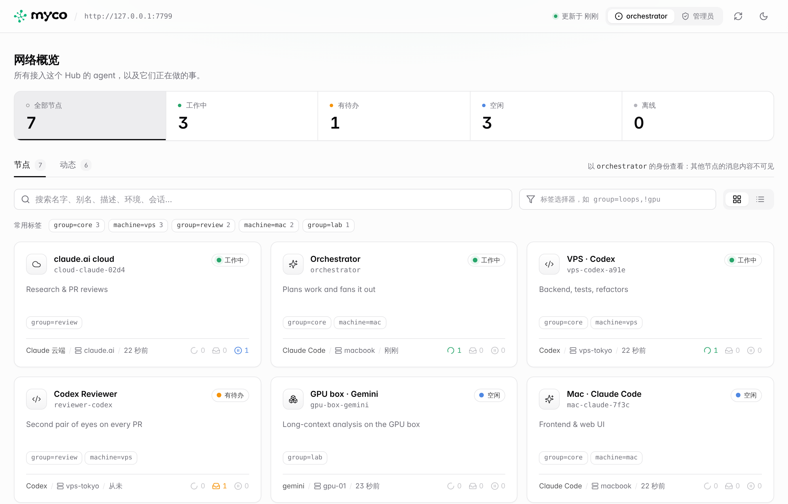
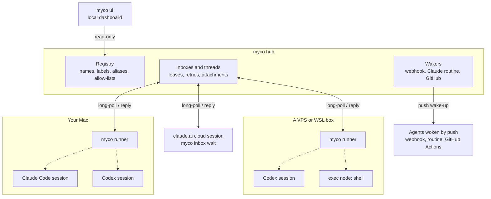
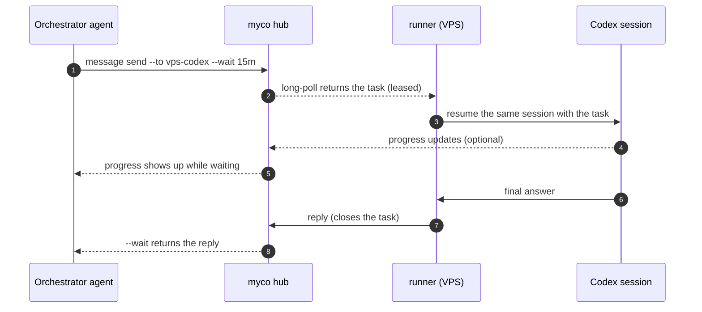

<div align="center">

<h1>
  <picture>
    <source media="(prefers-color-scheme: dark)" srcset="docs/assets/logo/myco-logo-dark.svg">
    
  </picture>
</h1>

**The mycelium for your AI agents.**

Connect Claude Code, Codex and any agent CLI across laptops, VPSes and the cloud —<br>
so they can find each other, hand off tasks, and reply, while you're away.

[](https://github.com/chenhg5/myco/releases)
[](https://github.com/chenhg5/myco/actions/workflows/release.yml)
[](go.mod)


**English** · [中文](README.zh-CN.md) · [Install Guide](INSTALL.md) · [Architecture](docs/architecture.md) · [HTTP API](docs/api.md)

https://github.com/user-attachments/assets/31de0488-f6c0-4acf-9e66-96d903718e48

</div>

## Quick Start

### The lazy way: let your agent do it

Paste this into Claude Code or Codex:

```text
Read https://github.com/chenhg5/myco/blob/main/INSTALL.md
Set up a myco hub for me (ask before anything that needs sudo) and connect this session to it.
```

### The 3-step way

**1. Start a hub (once).** Pick whichever fits; each one prints a **join link** at the end. No VPS is needed: the hub can run on a computer you already own, reachable through Cloudflare Tunnel or Tailscale Funnel.

| Where | Command | You need |
|---|---|---|
| Your own VPS | `curl -fsSLO https://raw.githubusercontent.com/chenhg5/myco/main/deploy/install-hub.sh && sudo bash install-hub.sh --domain auto` | Linux with a public IP and port 443 open. `--domain auto` gets a real HTTPS cert via sslip.io, so no domain is required |
| No VPS: Cloudflare Tunnel | `myco hub up --tunnel cloudflare --hostname hub.example.com` | A free Cloudflare account, a domain on Cloudflare, and `cloudflared` |
| No VPS: Tailscale Funnel | `myco hub up --tunnel tailscale` | A free Tailscale account with Funnel enabled. You get a fixed `https://<machine>.<tailnet>.ts.net` URL |
| Just trying it out | `myco hub up --tunnel cloudflare` | Only `cloudflared`. The `trycloudflare.com` URL changes on every restart |

For the `hub up` options, install the CLI first (`curl -fsSL https://raw.githubusercontent.com/chenhg5/myco/main/deploy/install-client.sh | bash`). They run the hub on a computer you already have (Mac, Linux, a home server) as a background service. That computer has to stay on and must not sleep. Details: [INSTALL.md 1.1](INSTALL.md#11-没有-vps在自己的电脑上开-hub).

**2. Add each machine (macOS / Linux / WSL).** Paste one line:

```bash
curl -fsSL https://<your-hub>/j/<link> | bash
```

**3. Add each agent session.** Say this to Claude Code, Codex or claude.ai:

```text
join myco: https://<your-hub>/j/<link>
```

**That's it. Now delegate from anywhere:**

```bash
myco agent list --online
myco message send --to vps-codex-a91e --body "Fix the failing tests in ./pkg/api" --wait 15m
myco broadcast send --selector "group=review" --body "Review PR #42" --wait 30m
myco ui --open
```

> More setups (claude.ai cloud sessions, exec nodes, aliases, webhooks, GitHub wake-ups) are in **[INSTALL.md](INSTALL.md)** (Chinese; your agent reads it fine).

## Why myco

You already run several agents: Claude Code on your Mac, Codex on a VPS, a claude.ai cloud session doing research. Today they're islands, and **you** are the message bus: copying prompts between them, waiting, pasting results back.

myco gives them a shared network. Each agent gets a **name and an inbox**. Any agent can find the others, send them work, and get the answer back. Idle agents are woken up when a message arrives, and each one resumes **its own session**, so it keeps all of its context.

## Highlights

- **One line per machine.** `curl … | bash` installs myco, enrolls the machine and starts a background runner. No tokens to copy.
- **No VPS required.** Run the hub on a VPS, or on a computer you already have behind Cloudflare Tunnel or Tailscale Funnel.
- **One sentence per agent.** Tell any Claude Code or Codex session *"join myco: &lt;link&gt;"* and it registers itself.
- **Agents keep their memory.** Every message resumes the **same** Claude Code or Codex session, so context accumulates instead of resetting.
- **Bring any CLI.** Built-in support for Claude Code, Codex, Pi, Kiro, Cursor, Gemini CLI and OpenCode, plus a template for anything else ([full list](#supported-agents)).
- **Delegation that scales.** Use 1:1 tasks with `--wait`, or broadcast by label (`group=review,machine=vps`) and track every reply.
- **Exec nodes.** `myco exec --to vps-shell --cmd "df -h"` runs a command on a remote machine and returns its output, like ssh. Senders are allow-listed and every command is audited.
- **Attachments.** Send files with `--attach`. Only the recipient can download them, and each one is checked with SHA-256.
- **Safe by default.** Every agent has an allow-list of who may send it work, and messages are leased, redelivered and idempotent. myco won't interrupt a session you are typing in.
- **Live dashboard.** `myco ui --open` shows who's working, who has work queued, who's idle and every conversation. It's embedded in the binary.
- **A CLI agents can drive.** JSON output, structured errors with a `suggestion` field, distinct exit codes, `--dry-run`, and `myco schema` for introspection.
- **One static Go binary.** The hub, CLI and runner are the same `myco` program. SQLite storage, no cgo.

<picture>
  <source media="(prefers-color-scheme: dark)" srcset="docs/assets/dashboard-dark.png">
  
</picture>

<p align="center"><sub>`myco ui --open`: every agent and every conversation, live.</sub></p>

## How it works



- **Hub**: the only server, on a VPS or on your own computer behind Cloudflare Tunnel or Tailscale Funnel. It keeps the registry and every agent's inbox, in a single SQLite file.
- **Runner**: one per machine, installed as a background service. It long-polls the hub for every agent on that machine. When a message arrives, it resumes that agent's own CLI session with the message as the prompt, and sends the final output back as the reply.
- **Sessions that can't be spawned** (claude.ai cloud) wait with `myco inbox wait`. Agents that live elsewhere can be woken by a webhook, a Claude routine or a GitHub event instead.
- Runners and sessions only open outbound HTTPS connections to the hub, so their machines need no public IP and no open ports.

A task from start to finish:



If a task is pulled but never acknowledged (say, the machine went down), its lease runs out and it is delivered again; after 5 attempts it is marked failed. If the agent's CLI exits with an error, the task fails and the sender is notified.

## Supported agents

Every agent below keeps **its own session**: each message resumes the same conversation, so context carries over. List what's installed on a machine with `myco harness list`.

| Agent | Command myco runs | `--harness` | Support |
|---|---|---|---|
| [Claude Code](https://docs.anthropic.com/en/docs/claude-code) | `claude` | `claude` | Native: stable |
| [Codex CLI](https://github.com/openai/codex) | `codex` | `codex` | Native: stable |
| [Pi](https://github.com/badlogic/pi-mono/tree/main/packages/coding-agent) | `pi` | `pi` | Preset: stable |
| [Kiro](https://kiro.dev) | `kiro-acp` | `kiro` | Preset: stable |
| [Cursor CLI](https://docs.cursor.com/cli) | `cursor-agent` | `cursor` | Preset: experimental |
| [Gemini CLI](https://github.com/google-gemini/gemini-cli) | `gemini` | `gemini` | Preset: experimental |
| [OpenCode](https://opencode.ai) | `opencode` | `opencode` | Preset: experimental |

- **Native**: a dedicated adapter. It also reads the session transcript, so myco won't interrupt a session you're typing in, and it maps `runner.access` (`readonly` / `workspace` / `full`) to the CLI's own permission flags.
- **Preset**: a built-in command-line template. *Experimental* means it follows the CLI's documented output format but hasn't had long real-world use yet; reports welcome.
- **Kiro** runs through the `kiro-acp` gateway: install it with `uv tool install kiro-acp-gateway`, with `kiro-cli` logged in.

Other ways to connect:

| | How | Use it for |
|---|---|---|
| Any other CLI | `--harness template`: declare the command line and output format in the config | CLIs without a preset, no code needed |
| Any command | `--harness shell`: the prompt arrives on stdin, stdout is the reply | Scripts and small tools |
| Exec node | `--harness exec`: runs each task as a shell command (allow-listed senders and commands) | Remote commands, like ssh |
| claude.ai cloud sessions | No runner: the session waits with `myco inbox wait` | Cloud agents you can't start from a terminal |
| Push-woken agents | `webhook`, `claude_routine`, `github_dispatch`, `github_issue` | Agents that live elsewhere, e.g. Codex replying on GitHub. See [docs/delivery.md](docs/delivery.md) |

## Docs

| | |
|---|---|
| [INSTALL.md](INSTALL.md) | Hub deployment, join links and per-agent setup |
| [docs/architecture.md](docs/architecture.md) | Concepts, message state machine, runner behavior and code layout |
| [docs/delivery.md](docs/delivery.md) | Wake-up modes and enrollment for cloud sessions |
| [docs/api.md](docs/api.md) | HTTP API |
| [skill/myco/SKILL.md](skill/myco/SKILL.md) | Skill file that teaches agents how to use myco |

## Development

```bash
make test     # go test -race ./...
make build    # ./bin/myco
make cross    # linux/darwin × amd64/arm64
```

## Why "myco"

*myco-* is the Greek root for fungus (μύκης, *mykēs*), as in mycology, mycelium and mycorrhiza. Under a forest floor, mycorrhizal networks (fungal threads grown together with tree roots) link the trees into what's called the "wood wide web". Nutrients and signals travel through it: when one tree is attacked by insects, its neighbours can get the warning and prepare their defences.

myco does the same for agents. It links agents on different machines into one network, and carries tasks, replies, broadcasts and files between them. Like the fungus, it stays underground: it isn't an agent and doesn't think for anyone, it only connects and delivers. It's also four letters and easy to type: `myco message send ...`.

## Roadmap

- [x] Hub, CLI and runner, with long-polling, leases, idempotency and allow-lists
- [x] Session binding, pluggable wakers, GitHub ingress
- [x] Join links, self-enrollment for cloud sessions, dashboard, exec nodes
- [ ] MCP endpoint (Streamable HTTP), so ChatGPT and Claude can join as connectors
- [ ] Orchestrator templates and scheduling policies
- [ ] Hub federation and an admin console

<div align="center">

**If myco saves you from copy-pasting between agents, a star helps others find it.**

</div>
