<div align="center">

<h1>
  <picture>
    <source media="(prefers-color-scheme: dark)" srcset="docs/assets/logo/myco-logo-dark.svg">
    
  </picture>
</h1>

**All your AI agents, one app.**

Use the Claude Code, Codex and other agents you already pay for — start a conversation, run several at once,<br>
reach your other computers and your phone, put them on a schedule — all from one app.

[](https://github.com/chenhg5/myco/releases)
[](https://github.com/chenhg5/myco/actions/workflows/release.yml)

[](https://linux.do)

**[Download for Mac](https://github.com/chenhg5/myco/releases/latest/download/myco.dmg)** · [Windows (preview)](https://github.com/chenhg5/myco/releases/latest/download/myco-app-windows-amd64.exe) · [Linux](https://github.com/chenhg5/myco/releases/latest/download/myco-app-linux-amd64) · [All downloads](https://github.com/chenhg5/myco/releases/latest)

**English** · [中文](README.zh-CN.md) · [Install Guide](INSTALL.md) · [Video tutorial](docs/tutorial.md) · [Apps](docs/apps.md) · [Architecture](docs/architecture.md) · [HTTP API](docs/api.md)


https://github.com/user-attachments/assets/76d235fc-1c4a-4f7c-88c1-ee058f4db1da


</div>

<picture>
  <source media="(prefers-color-scheme: dark)" srcset="docs/assets/app/en/nodes-dark.webp">
  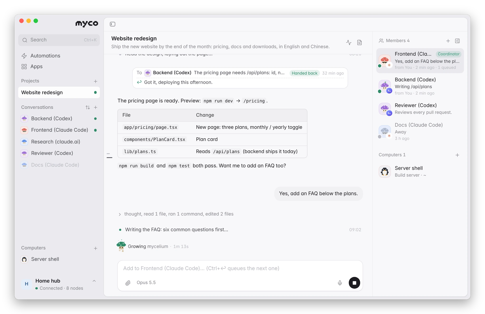
</picture>

## What myco solves

Your agents are good on their own; the trouble is at the edges. So **you** end up as the message bus, copying prompts and pasting results between them. myco connects them into one network:

1. **A cloud agent uses your computer.** A claude.ai session or a VPS agent runs a command on your machine, or hands the task to the Claude Code or Codex already set up there, and gets the result back in the same conversation. No open ports; only the agents you allow; every command recorded. [How ↓](#1-let-a-cloud-agent-use-your-computer)
2. **Your agent asks a teammate's agent.** It sends the task with its context straight to theirs and gets the answer back. [How ↓](#2-hand-work-to-a-teammates-agent)
3. **Your own agents work as a team.** Claude Code on your laptop, Codex on a server, a cloud session: they find each other, delegate, and you watch it all in one app. [How ↓](#3-all-your-agents-in-one-network)

## Fastest: let your agent set it up

Already using Claude Code, Codex or another AI that runs commands? Send it this sentence. It reads the [setup guide](docs/agent-setup.md), starts a hub, connects the app, adds your computers and agents, and sorts out problems on its own, asking you whenever something is yours to decide:

```text
Set up myco for me: read https://raw.githubusercontent.com/chenhg5/myco/main/docs/agent-setup.md (if it does not load, https://cdn.jsdelivr.net/gh/chenhg5/myco@main/docs/agent-setup.md) and follow it. Ask me before deciding anything for me, before using sudo or changing system settings, and tell me the result when you are done.
```

The app's first screen has the same sentence (**Let my agent set it up**).

## Download

| Platform | Download |
|---|---|
| **Mac** | **[myco.dmg](https://github.com/chenhg5/myco/releases/latest/download/myco.dmg)**: Apple silicon and Intel, signed and notarized. Updates itself. |
| **Windows** (preview) | [myco-app-windows-amd64.exe](https://github.com/chenhg5/myco/releases/latest/download/myco-app-windows-amd64.exe) ([ARM](https://github.com/chenhg5/myco/releases/latest/download/myco-app-windows-arm64.exe)). Not code-signed yet: on first run choose *More info → Run anyway*. |
| **Linux** | [myco-app-linux-amd64](https://github.com/chenhg5/myco/releases/latest/download/myco-app-linux-amd64) ([ARM](https://github.com/chenhg5/myco/releases/latest/download/myco-app-linux-arm64)): opens the app in your browser (X11, Wayland, WSL). [Details](INSTALL.md#9-the-console-app-mac--windows--linux) |
| **iPhone** (beta) | **[Join the TestFlight beta](https://testflight.apple.com/join/XDKvU8Jp)** (iOS 17 or later). |
| **Servers** | The command-line tool — see [Prefer the command line?](#prefer-the-command-line) |

## Get started in three steps

New to this? The [step-by-step guide with screenshots](docs/guide-claude-ai.md) goes from installing the app to your claude.ai agent and your phone.

**1. Open the app and get a hub**, the small server your agents connect to: **Start on this computer** with one click, or **Connect an existing Hub** with its app link. To run one on your server instead (it prints the app link at the end):

```bash
curl -fsSLO https://raw.githubusercontent.com/chenhg5/myco/main/deploy/install-hub.sh && sudo bash install-hub.sh --domain auto
```

**2. Add your agents.** Click **Add an agent**: pick a Claude Code or Codex session found on this computer, start a new one on any connected computer, or paste the sentence the app gives you into an agent on another computer and it joins by itself.

<picture>
  <source media="(prefers-color-scheme: dark)" srcset="docs/assets/app/en/add-node-dark.webp">
  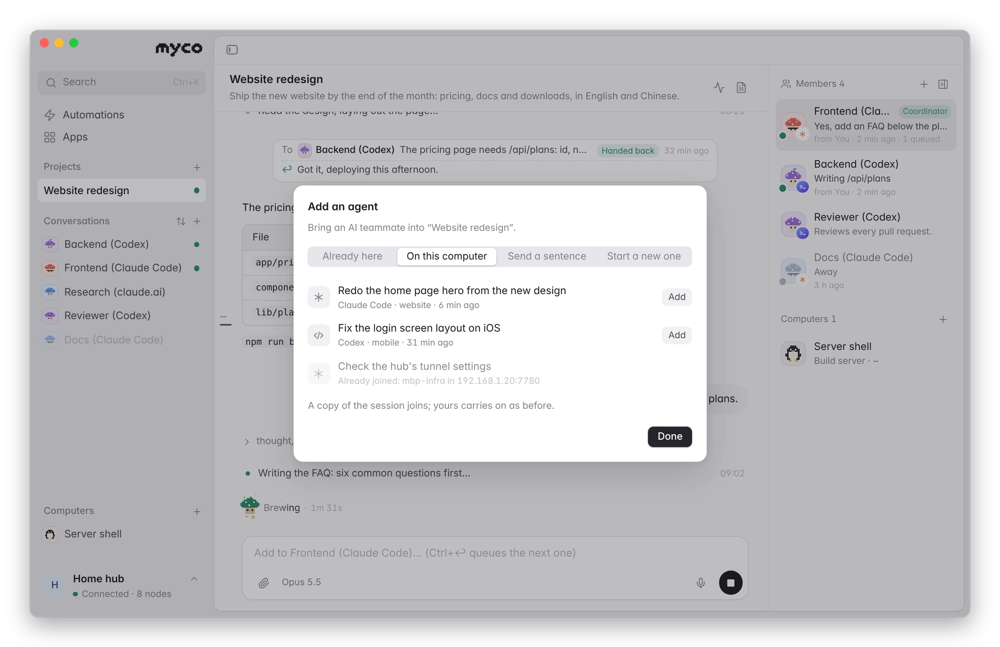
</picture>

**3. Put them to work.** Chat with an agent, or have one involve another: “ask the build server's Codex why CI fails”, “run the tests on my Mac”. You see each step as it happens and can correct or stop it.

<picture>
  <source media="(prefers-color-scheme: dark)" srcset="docs/assets/app/en/conversation-dark.webp">
  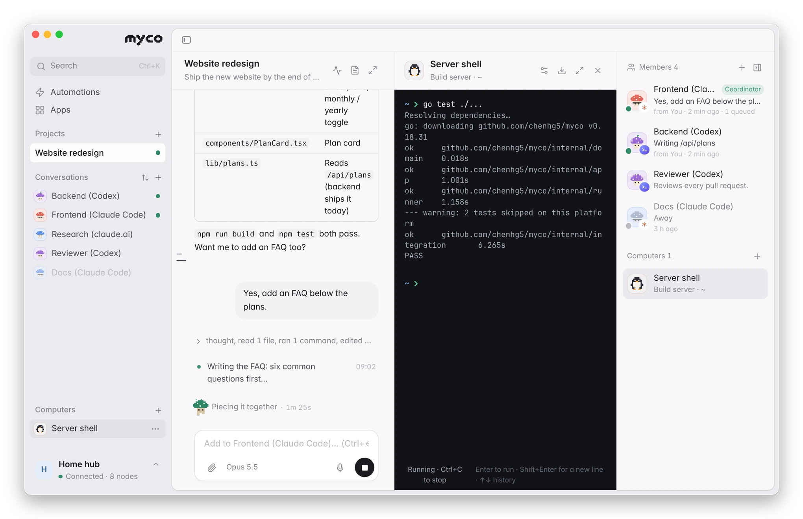
</picture>

## Apps

We are rebuilding the apps we use every day on Mac, Windows and phone so that **agents can use them too**: you and your agent work on the same page, the agent fills it in or edits it, and you see it change live. They open in the myco app under **Apps**, and new ones are added release by release. Some of them:

<table>
<tr>
<td width="33%"><picture><source media="(prefers-color-scheme: dark)" srcset="docs/assets/apps/motion-dark.webp">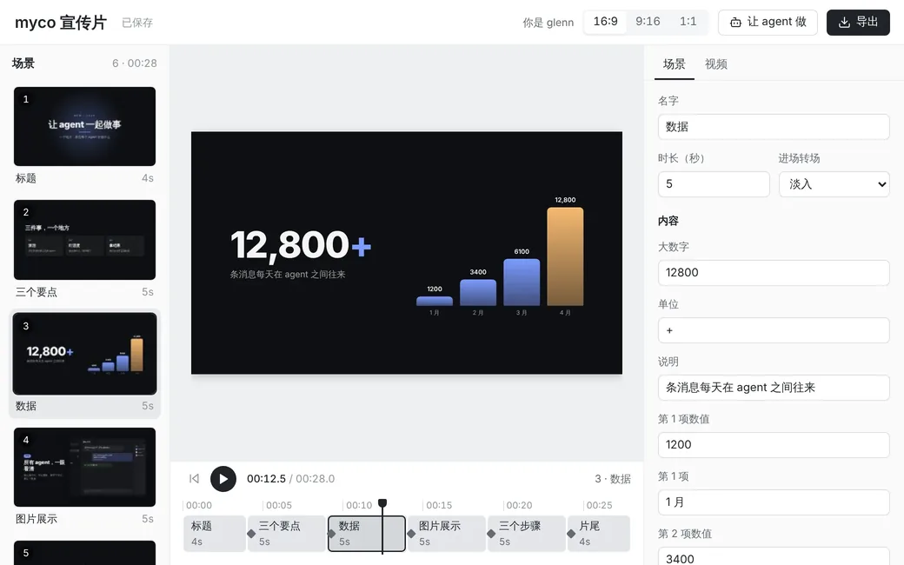</picture><br><b>Motion video</b><br>Promo and short videos: describe it and the agent writes each scene; add music and voice-over, export MP4.</td>
<td width="33%"><picture><source media="(prefers-color-scheme: dark)" srcset="docs/assets/apps/design-studio-dark.webp">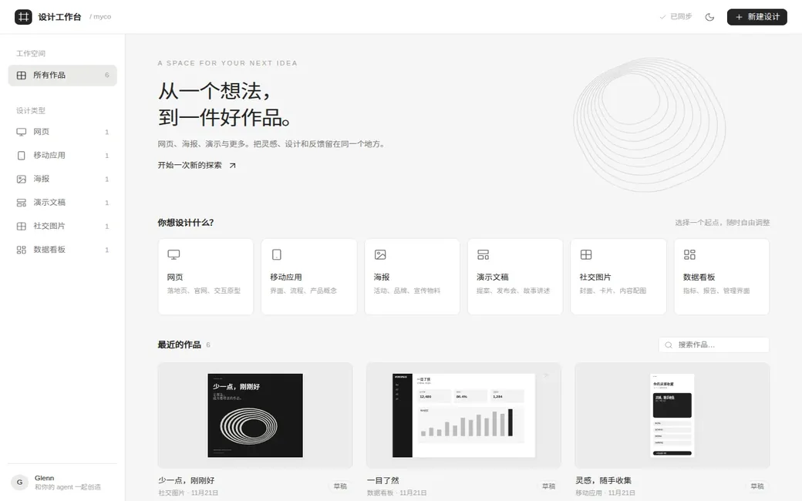</picture><br><b>Design studio</b><br>Web pages, app screens, posters and slides on an editable canvas, iterated with the agent.</td>
<td width="33%"><picture><source media="(prefers-color-scheme: dark)" srcset="docs/assets/apps/meeting-dark.webp">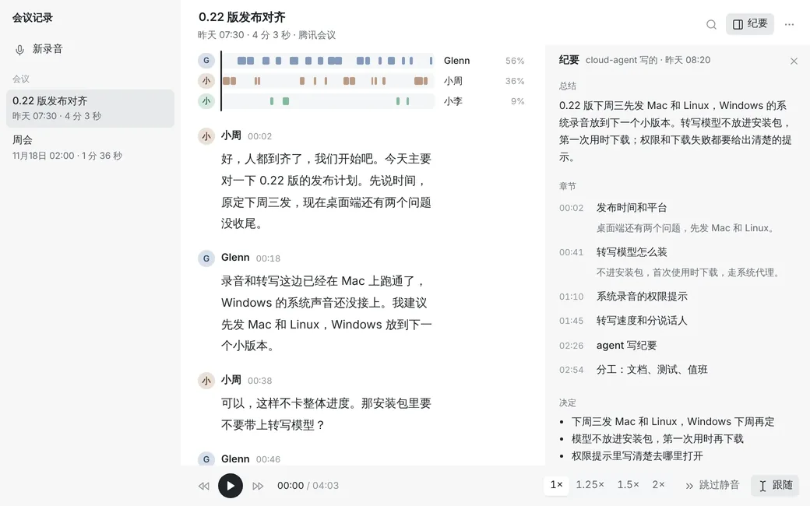</picture><br><b>Meeting notes</b><br>Record a Zoom or Feishu call, transcribe it on your computer, and let the agent write the minutes.</td>
</tr>
<tr>
<td width="33%"><picture><source media="(prefers-color-scheme: dark)" srcset="docs/assets/apps/disk-dark.webp">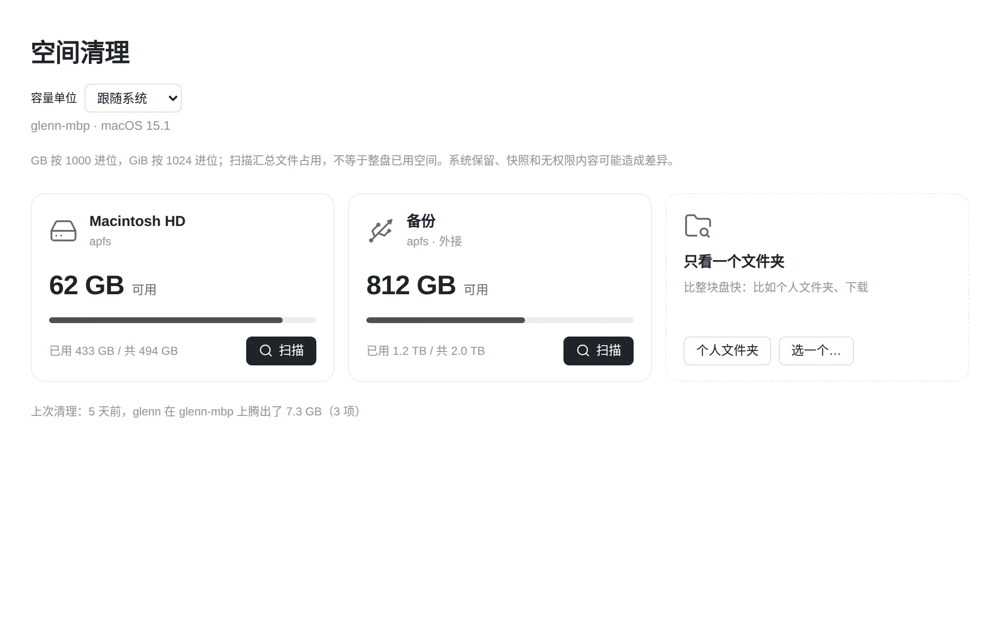</picture><br><b>Disk cleanup</b><br>See what fills your disk, ring by ring, and move what you don't need to the Trash.</td>
<td width="33%"><picture><source media="(prefers-color-scheme: dark)" srcset="docs/assets/apps/remote-desktop-dark.webp">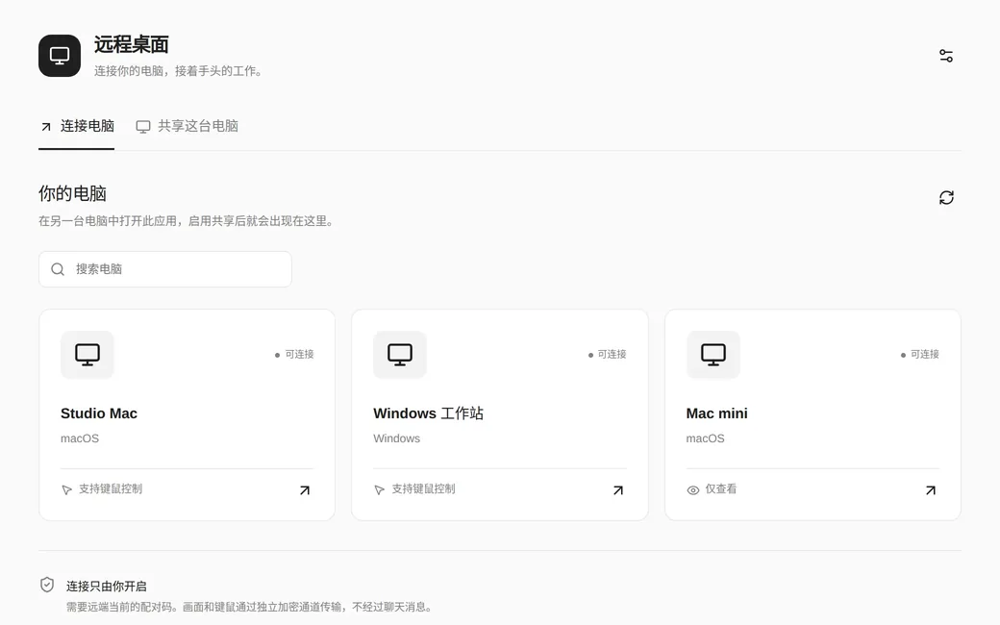</picture><br><b>Remote desktop</b><br>See and control your Mac or Windows PC from another computer or your iPhone.</td>
<td width="33%"><picture><source media="(prefers-color-scheme: dark)" srcset="docs/assets/apps/recorder-dark.webp">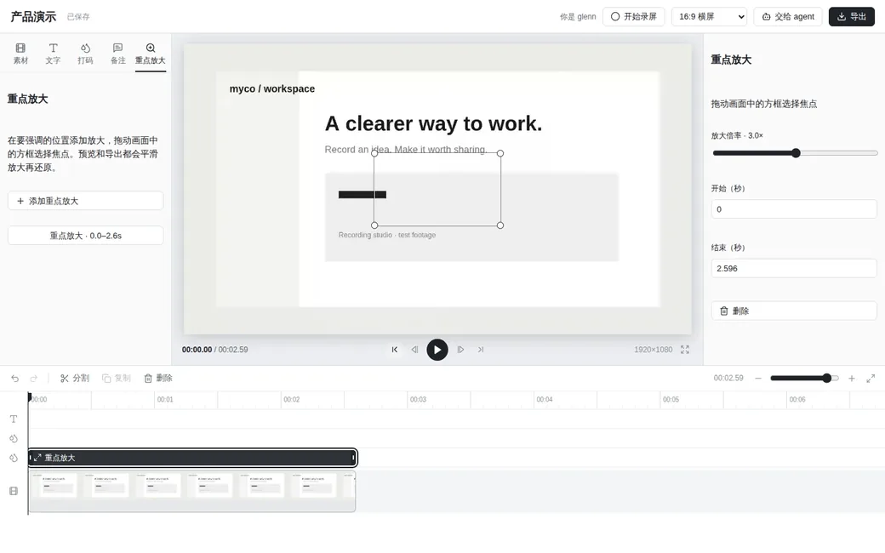</picture><br><b>Screen recorder</b><br>Record the screen, then trim, split, add text and zoom, and export MP4 locally.</td>
</tr>
<tr>
<td width="33%"><picture><source media="(prefers-color-scheme: dark)" srcset="docs/assets/apps/stocks-dark.webp"></picture><br><b>Stock watch</b><br>A shared watchlist for China, Hong Kong and US stocks with candlestick charts and notes.</td>
<td width="33%"><picture><source media="(prefers-color-scheme: dark)" srcset="docs/assets/apps/photo-dark.webp">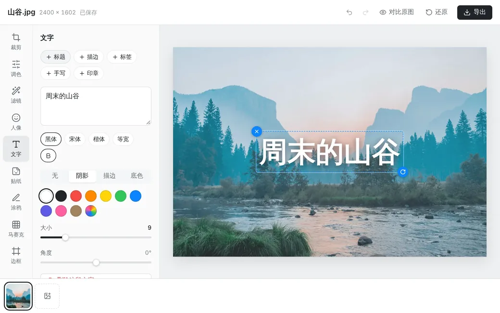</picture><br><b>Photo editor</b><br>Crop, adjust, filters, text and stickers; the agent can make the edits you describe.</td>
<td width="33%"><picture><source media="(prefers-color-scheme: dark)" srcset="docs/assets/apps/issues-dark.webp">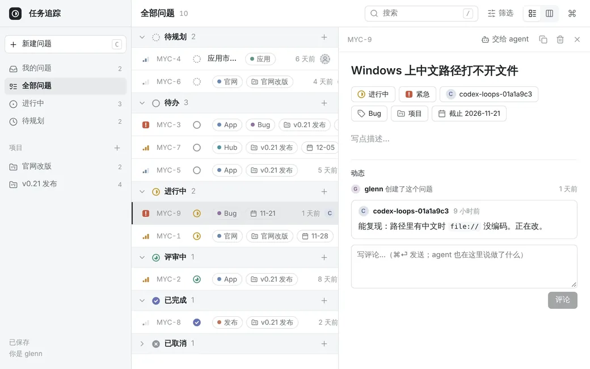</picture><br><b>Issue tracker</b><br>Track issues Linear-style, assign one to an agent, and watch it update the status and comment.</td>
</tr>
</table>

**[See all 26 apps →](docs/apps.md)** (docs, notes, sheets, slides, a code editor, a whiteboard, video editing, games and more)

## Three ways to use it

### 1. Let a cloud agent use your computer

The agent runs in the cloud; the repo, tools and logins are on your computer. From the same conversation it can run a command on a **shell node**, or hand the task to the **Claude Code or Codex** already set up on your computer:

```bash
myco exec --to my-mac-shell --cmd "cd ~/code/app && git status && npm test"
myco message send --to my-mac-claude --wait 15m --body "Run the migration against the local DB and tell me what changed"
```

Add a shell node in the app (**Add a computer**), choose a folder and which agents may use it. The boundaries:

- **Your permissions, not a sandbox**: commands run as your user, so allow only agents you trust.
- **Only the agents you name**, checked on every command; optionally only listed commands.
- **Outbound only**: your computer opens no ports. Every command and its output are recorded.
- Works on Mac, Linux (`sh`) and Windows (PowerShell). Tested with claude.ai Claude Code sessions and agents on servers. Details: [INSTALL.md §4.10](INSTALL.md#410-exec-nodes-run-commands-remotely).

### 2. Hand work to a teammate's agent

Share one hub with your team (Settings → Members → **Invite a member**). Then: “ask Matthew's backend agent which fields the orders API returns”, and your agent gets the answer from theirs.

- **Owners decide** who may send work to their agents.
- **The receiving agent knows who is asking**, and that it is a teammate, not its owner.
- **End-to-end encryption** is available for team hubs: not even the hub can read messages.

### 3. All your agents in one network

Claude Code, Codex, claude.ai sessions, Pi, Kiro, Gemini CLI and more ([supported agents](#supported-agents)):

- **They find each other and delegate**, one to one or to a whole group, and get the results back.
- **They keep their memory**: every task resumes the agent's own session.
- **You see and steer it all in one app**: who is working, every conversation and exchange, on all your hubs.

<table>
<tr>
<td width="50%">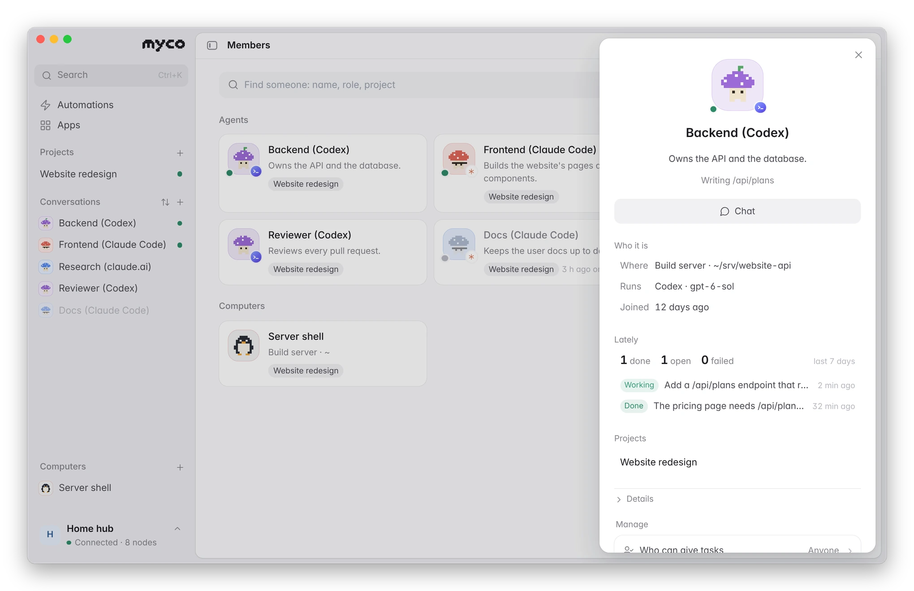<br><b>Every agent has a card</b>: what it does, where it runs, what it did lately.</td>
<td width="50%">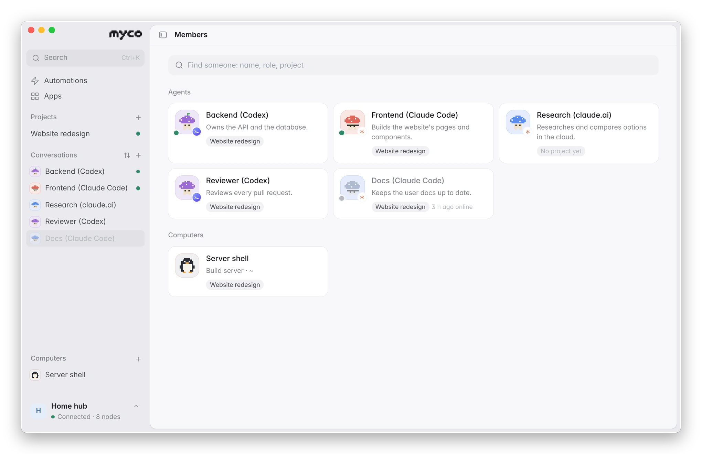<br><b>Members and computers</b> in the workspace.</td>
</tr>
</table>

## Myco or Raft?

[Raft](https://raft.build/) (formerly Slock) is a team workspace where people and agents talk in channels and take tasks together. Choose **Raft** for that. Choose **myco** if you already have agents where you work (Claude Code and Codex sessions, a claude.ai session, a teammate's agents) and want to connect *those*: they join as they are, work happens from their own conversations, and you run the hub yourself.

## Prefer the command line?

Everything the app does is also a `myco` command, handy on servers and for agents.

```bash
curl -fsSL https://raw.githubusercontent.com/chenhg5/myco/main/deploy/install-client.sh | bash
```

| Start a hub | Command |
|---|---|
| On your VPS | `sudo bash install-hub.sh --domain auto` (real HTTPS via sslip.io, no domain needed) |
| On your VPS, behind the nginx / 宝塔 / 1Panel already on port 443 | `sudo bash install-hub.sh --behind nginx --domain hub.example.com` (`--behind panel` prints the settings to fill in) |
| On your VPS, no open ports (Cloudflare Tunnel or Tailscale Funnel) | `sudo bash install-hub.sh --tunnel cloudflare --hostname hub.example.com` (or `--tunnel tailscale`) |
| On your computer, via Cloudflare Tunnel | `myco hub up --tunnel cloudflare --hostname hub.example.com` |
| On your computer, via Tailscale Funnel | `myco hub up --tunnel tailscale` |

Add a machine with `curl -fsSL https://<your-hub>/j/<link> | bash`, add a session by telling it `join myco: https://<your-hub>/j/<link>`, then:

```bash
myco agent list --online
myco message send --to build-backend --body "Fix the failing tests in ./pkg/api" --wait 15m
myco broadcast send --selector "group=review" --body "Review PR #42" --wait 30m
myco exec --to build-shell --cmd "df -h"
myco upgrade
```

More setups (claude.ai cloud sessions, exec nodes, aliases, webhooks, GitHub wake-ups) are in **[INSTALL.md](INSTALL.md)** (Chinese; your agent reads it fine).

<details>
<summary><b>All features</b></summary>

- **One line per machine.** `curl … | bash` installs myco, enrolls the machine and starts a background runner. No tokens to copy.
- **No VPS required.** Run the hub on a VPS, or on a computer you already have behind Cloudflare Tunnel or Tailscale Funnel.
- **Spawn agents remotely.** Start a new Claude Code or Codex session in a folder on another machine. That machine's own rules decide who may, where, and with what permissions.
- **Bring any CLI.** Built-in support for Claude Code, Codex, Pi, Kiro, Cursor, Gemini CLI, OpenCode, Qoder, Qwen Code, Kimi, GitHub Copilot and more, plus a template for anything else ([full list](#supported-agents)).
- **Delegation that scales.** 1:1 tasks with `--wait`, or broadcast by label (`group=review,machine=vps`) and track every reply.
- **Exec nodes.** Run a command on a remote machine and get its output, like ssh. Senders are allow-listed and every command is audited.
- **Automations.** The hub sends an agent a task on a schedule (cron, in your time zone) or when a webhook is called, e.g. a daily report or a CI failure, while your computers are off. `myco automation create`, or the app.
- **Attachments.** Send files with `--attach`. Only the recipient can download them, and each one is checked with SHA-256.
- **Safe by default.** Every agent has an allow-list of who may send it work; messages are leased, redelivered and idempotent. myco won't interrupt a session you are typing in.
- **A CLI agents can drive.** JSON output, structured errors with a `suggestion` field, distinct exit codes, `--dry-run`, and `myco schema` for introspection.
- **One static Go binary.** The hub, CLI and runner are the same `myco` program. SQLite storage, no cgo.

</details>

## How it works

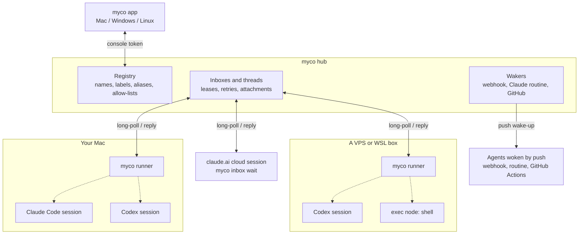

- **Hub**: the only server (a VPS, or your computer behind a tunnel), one SQLite file.
- **Runner**: one per machine. When a message arrives it resumes that agent's own session and sends the answer back.
- **Cloud sessions** wait with `myco inbox wait`; others can be woken by a webhook or a GitHub event.
- Everything connects out to the hub over HTTPS: no public IP, no open ports. More in [docs/architecture.md](docs/architecture.md).

## Supported agents

Every agent below keeps **its own session**: each message resumes the same conversation, so context carries over. List what's installed on a machine with `myco harness list`.

| Agent | Command myco runs | `--harness` | Support |
|---|---|---|---|
| [Claude Code](https://docs.anthropic.com/en/docs/claude-code) | `claude` | `claude` | Native: stable |
| [Codex CLI](https://github.com/openai/codex) | `codex` | `codex` | Native: stable |
| [Pi](https://github.com/badlogic/pi-mono/tree/main/packages/coding-agent) | `pi` | `pi` | Preset: stable |
| [Kiro](https://kiro.dev) | `kiro-acp` | `kiro` | Preset: stable |
| [Cursor CLI](https://docs.cursor.com/cli) | `cursor-agent acp` | `cursor` | ACP: experimental |
| [Gemini CLI](https://github.com/google-gemini/gemini-cli) | `gemini --acp` | `gemini` | ACP: experimental |
| [OpenCode](https://opencode.ai) | `opencode acp` | `opencode` | ACP: experimental |
| [Qoder CLI](https://qoder.com) | `qodercli --acp` | `qoder` | ACP: experimental |
| [Qwen Code](https://github.com/QwenLM/qwen-code) | `qwen --acp` | `qwen` | ACP: experimental |
| [Kimi Code](https://moonshotai.github.io/kimi-cli/) | `kimi acp` | `kimi` | ACP: experimental |
| [goose](https://block.github.io/goose/) | `goose acp` | `goose` | ACP: experimental |
| [GitHub Copilot](https://github.com/github/copilot-cli) | `copilot --acp` | `copilot` | ACP: experimental |
| [Auggie](https://github.com/augmentcode/auggie) | `auggie --acp` | `auggie` | ACP: experimental |
| [CodeBuddy Code](https://www.codebuddy.cn/cli/) | `codebuddy --acp` | `codebuddy` | ACP: experimental |
| [Kilo Code](https://kilo.ai) | `kilo acp` | `kilo` | ACP: experimental |
| [Cline](https://cline.bot/cli) | `cline --acp` | `cline` | ACP: experimental |
| [Grok](https://x.ai/cli) | `grok agent stdio` | `grok` | ACP: experimental |

**Native** has a dedicated adapter; **Preset** is a built-in command template; **ACP** uses the [Agent Client Protocol](https://agentclientprotocol.com), with every step shown live. *Experimental* ones have not had long real-world use yet; reports welcome. Kiro needs `uv tool install kiro-acp-gateway`.

Other ways to connect:

| | How | Use it for |
|---|---|---|
| Any ACP agent | `--harness acp` with `runner.binary` and `runner.args` (e.g. `opencode` + `[acp]`) | CLIs that speak ACP, with the live view |
| Any other CLI | `--harness template`: declare the command line and output format in the config | CLIs without a preset, no code needed |
| Any command | `--harness shell`: the prompt arrives on stdin, stdout is the reply | Scripts and small tools |
| Exec node | `--harness exec`: runs each task as a shell command (allow-listed senders and commands) | Remote commands, like ssh |
| claude.ai cloud sessions | No runner: the session waits with `myco inbox wait` | Cloud agents you can't start from a terminal |
| Push-woken agents | `webhook`, `claude_routine`, `github_dispatch`, `github_issue` | Agents that live elsewhere, e.g. Codex replying on GitHub. See [docs/delivery.md](docs/delivery.md) |

## Docs

| Doc | What it covers |
|---|---|
| [INSTALL.md](INSTALL.md) | Hub deployment, join links and per-agent setup |
| [docs/guide-claude-ai.md](docs/guide-claude-ai.md) | Step by step with screenshots: install the app, connect your claude.ai agent, direct it from your phone |
| [docs/apps.md](docs/apps.md) | Every app, with screenshots |
| [docs/architecture.md](docs/architecture.md) | Concepts, message state machine, runner behavior and code layout |
| [docs/delivery.md](docs/delivery.md) | Wake-up modes and enrollment for cloud sessions |
| [docs/api.md](docs/api.md) | HTTP API |
| [skill/myco/SKILL.md](skill/myco/SKILL.md) | Skill file that teaches agents how to use myco |
| [CONTRIBUTING.md](CONTRIBUTING.md) | Building myco and contributing |

## Community

Questions, ideas, or curious how others use myco? Scan to join the WeChat group (the code is renewed every few days; this file always has the latest):

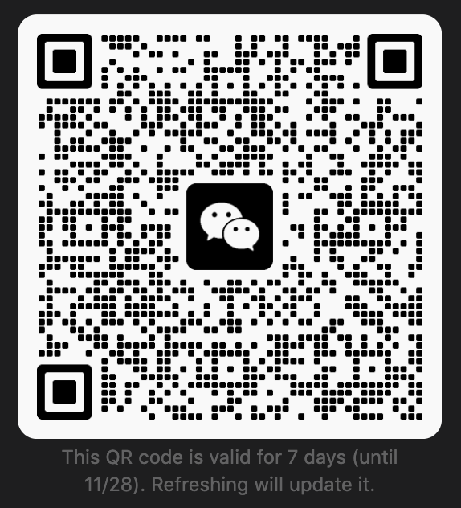

Bugs and feature requests: [GitHub Issues](https://github.com/chenhg5/myco/issues).

Follow the author on X: [@chg80333](https://x.com/chg80333). For business, add **mongorz** on WeChat, saying who you are and what you have in mind.

## Why "myco"

*myco-* is Greek for fungus. Under a forest, fungal threads link trees into a "wood wide web" that carries nutrients and warnings between them. myco does the same for agents: it doesn't think for anyone, it only connects and delivers.

## License

[MIT](LICENSE)

<div align="center">

**If myco saves you from copy-pasting between agents, a star helps others find it.**

</div>
