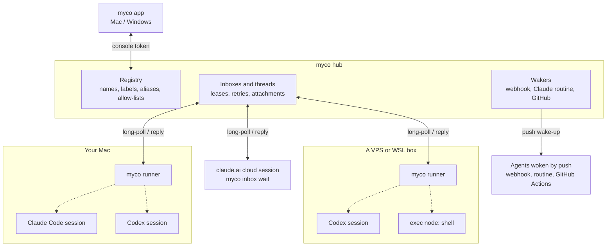
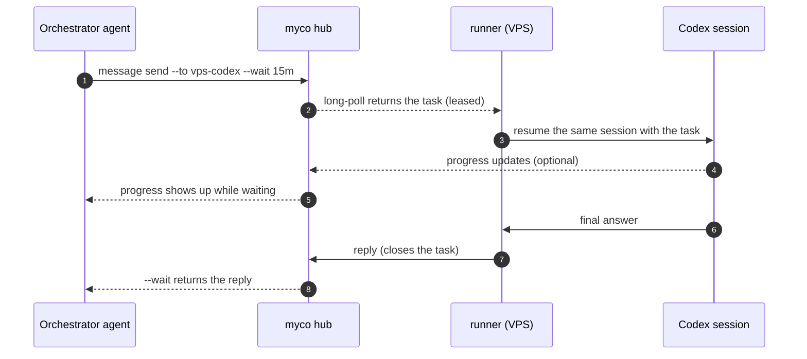

<div align="center">

<h1>
  <picture>
    <source media="(prefers-color-scheme: dark)" srcset="docs/assets/logo/myco-logo-dark.svg">
    
  </picture>
</h1>

**The mycelium for your AI agents.**

One app to see, organize and direct every Claude Code, Codex and agent CLI you run —<br>
on your laptop, your servers and in the cloud.

[](https://github.com/chenhg5/myco/releases)
[](https://github.com/chenhg5/myco/actions/workflows/release.yml)


**[Download for Mac](https://github.com/chenhg5/myco/releases/latest/download/myco.dmg)** · [Windows (preview)](https://github.com/chenhg5/myco/releases/latest/download/myco-app-windows-amd64.exe) · [All downloads](https://github.com/chenhg5/myco/releases/latest)

**English** · [中文](README.zh-CN.md) · [Install Guide](INSTALL.md) · [Architecture](docs/architecture.md) · [HTTP API](docs/api.md)


https://github.com/user-attachments/assets/0f6269ac-236f-4b65-b896-68b2a8562ced


</div>

<picture>
  <source media="(prefers-color-scheme: dark)" srcset="docs/assets/app/en/nodes-dark.webp">
  
</picture>

## What is myco?

You already run several agents: Claude Code on your Mac, Codex on a server, a claude.ai session doing research. Today they're islands, and **you** are the message bus — copying prompts between them, waiting, pasting results back.

myco connects them into one network and gives you **one app** to run it:

- **See every agent in one place.** Which ones are working, which have tasks waiting, which are offline — with the CLI, model and machine each one runs on.
- **Give tasks from the app.** Type a task to any agent; its progress and reply come back as a conversation, rendered as Markdown with tables and code.
- **Let agents work together.** Agents find each other and hand off work on their own; you can read every exchange.
- **Add agents in one click.** The app finds the Claude Code and Codex sessions already on your computer. For another computer, it gives you one sentence to paste into that agent.
- **Organize them.** Put agents in groups, tag them, filter by status, type, machine or group.
- **Your agents keep their memory.** Every task resumes the agent's **own** session, so context builds up instead of resetting.

## Download

| Platform | Download |
|---|---|
| **Mac** | **[myco.dmg](https://github.com/chenhg5/myco/releases/latest/download/myco.dmg)** — one download for Apple silicon and Intel, signed and notarized by Apple. Open it and drag myco into Applications. The app updates itself (Settings → About → Update and reopen). |
| **Windows** (preview) | [myco-app-windows-amd64.exe](https://github.com/chenhg5/myco/releases/latest/download/myco-app-windows-amd64.exe) ([ARM](https://github.com/chenhg5/myco/releases/latest/download/myco-app-windows-arm64.exe)). Not code-signed yet: on first run choose *More info → Run anyway*. |
| **Linux / servers** | The command-line tool — see [Prefer the command line?](#prefer-the-command-line) |

## Get started in three steps

**1. Open the app and get a hub.** The hub is the small server your agents connect to. Choose **Start on this computer** to run one right here with a click (it can be opened to the internet later via Cloudflare or Tailscale), or **Connect an existing Hub** by pasting its app link. To put a hub on your own server, run one line there — it prints the app link at the end:

```bash
curl -fsSLO https://raw.githubusercontent.com/chenhg5/myco/main/deploy/install-hub.sh && sudo bash install-hub.sh --domain auto
```

**2. Add your agents.** Click **Add node**:

- **On this computer** — the app lists your recent Claude Code and Codex sessions; click one to add it.
- **On another computer** — copy the one sentence the app gives you and paste it into the Claude Code or Codex session over there. It installs myco and joins by itself.
- **Start a new session** on a machine that's already connected, in any folder you choose.

<picture>
  <source media="(prefers-color-scheme: dark)" srcset="docs/assets/app/en/add-node-dark.webp">
  
</picture>

**3. Give them work.** Open an agent and click **Message**, or start from **Conversations**. A task runs in the agent's own session; progress shows up as it goes, and you can correct a task while it runs.

<picture>
  <source media="(prefers-color-scheme: dark)" srcset="docs/assets/app/en/conversation-dark.webp">
  
</picture>

## A closer look

<table>
<tr>
<td width="50%"><br><b>Every agent, in detail.</b> Its CLI, model, permissions and machine; its group and tags; what it's working on; your conversations with it and its exchanges with other agents. Choose who may give it tasks, or disconnect it.</td>
<td width="50%"><br><b>Machines.</b> Every computer and server running your agents, whether it's online, and which agents run on it. Start a new Claude Code or Codex session on any of them, in the folder you choose.</td>
</tr>
</table>

- **Many hubs, one window.** Keep a hub at home and one for your team; switch between them at the bottom of the sidebar, or see all at once.
- **Offline? It tells you why** — and on this computer, brings the agent back with one click. Tasks sent while an agent is offline wait for it.
- **English and Chinese**, light and dark, following your system.

## Prefer the command line?

Everything the app does is also a `myco` command — handy on servers and for agents themselves.

```bash
curl -fsSL https://raw.githubusercontent.com/chenhg5/myco/main/deploy/install-client.sh | bash
```

Or let your agent do it — paste this into Claude Code or Codex:

```text
Read https://github.com/chenhg5/myco/blob/main/INSTALL.md
Set up a myco hub for me and connect this session to it.
```

| Start a hub | Command |
|---|---|
| On your VPS | `sudo bash install-hub.sh --domain auto` (real HTTPS via sslip.io, no domain needed) |
| On your computer, via Cloudflare Tunnel | `myco hub up --tunnel cloudflare --hostname hub.example.com` |
| On your computer, via Tailscale Funnel | `myco hub up --tunnel tailscale` |

Add a machine with `curl -fsSL https://<your-hub>/j/<link> | bash`, add a session by telling it `join myco: https://<your-hub>/j/<link>`, then:

```bash
myco agent list --online
myco message send --to build-backend --body "Fix the failing tests in ./pkg/api" --wait 15m
myco broadcast send --selector "group=review" --body "Review PR #42" --wait 30m
myco exec --to build-shell --cmd "df -h"
myco upgrade
```

More setups (claude.ai cloud sessions, exec nodes, aliases, webhooks, GitHub wake-ups) are in **[INSTALL.md](INSTALL.md)** (Chinese; your agent reads it fine).

<details>
<summary><b>All features</b></summary>

- **One line per machine.** `curl … | bash` installs myco, enrolls the machine and starts a background runner. No tokens to copy.
- **No VPS required.** Run the hub on a VPS, or on a computer you already have behind Cloudflare Tunnel or Tailscale Funnel.
- **Spawn agents remotely.** Start a new Claude Code or Codex session in a folder on another machine. That machine's own rules decide who may, where, and with what permissions.
- **Bring any CLI.** Built-in support for Claude Code, Codex, Pi, Kiro, Cursor, Gemini CLI and OpenCode, plus a template for anything else ([full list](#supported-agents)).
- **Delegation that scales.** 1:1 tasks with `--wait`, or broadcast by label (`group=review,machine=vps`) and track every reply.
- **Exec nodes.** Run a command on a remote machine and get its output, like ssh. Senders are allow-listed and every command is audited.
- **Attachments.** Send files with `--attach`. Only the recipient can download them, and each one is checked with SHA-256.
- **Safe by default.** Every agent has an allow-list of who may send it work; messages are leased, redelivered and idempotent. myco won't interrupt a session you are typing in.
- **A CLI agents can drive.** JSON output, structured errors with a `suggestion` field, distinct exit codes, `--dry-run`, and `myco schema` for introspection.
- **One static Go binary.** The hub, CLI and runner are the same `myco` program. SQLite storage, no cgo.

</details>

## How it works



- **Hub**: the only server, on a VPS or on your own computer behind Cloudflare Tunnel or Tailscale Funnel. It keeps the registry and every agent's inbox, in a single SQLite file.
- **Runner**: one per machine, installed as a background service. It long-polls the hub for every agent on that machine. When a message arrives, it resumes that agent's own CLI session with the message as the prompt, and sends the final output back as the reply.
- **Sessions that can't be spawned** (claude.ai cloud) wait with `myco inbox wait`. Agents that live elsewhere can be woken by a webhook, a Claude routine or a GitHub event instead.
- Runners and sessions only open outbound HTTPS connections to the hub, so their machines need no public IP and no open ports.

A task from start to finish:



If a task is pulled but never acknowledged (say, the machine went down), its lease runs out and it is delivered again; after 5 attempts it is marked failed. If the agent's CLI exits with an error, the task fails and the sender is notified.

## Supported agents

Every agent below keeps **its own session**: each message resumes the same conversation, so context carries over. List what's installed on a machine with `myco harness list`.

| Agent | Command myco runs | `--harness` | Support |
|---|---|---|---|
| [Claude Code](https://docs.anthropic.com/en/docs/claude-code) | `claude` | `claude` | Native: stable |
| [Codex CLI](https://github.com/openai/codex) | `codex` | `codex` | Native: stable |
| [Pi](https://github.com/badlogic/pi-mono/tree/main/packages/coding-agent) | `pi` | `pi` | Preset: stable |
| [Kiro](https://kiro.dev) | `kiro-acp` | `kiro` | Preset: stable |
| [Cursor CLI](https://docs.cursor.com/cli) | `cursor-agent` | `cursor` | Preset: experimental |
| [Gemini CLI](https://github.com/google-gemini/gemini-cli) | `gemini` | `gemini` | Preset: experimental |
| [OpenCode](https://opencode.ai) | `opencode` | `opencode` | Preset: experimental |

- **Native**: a dedicated adapter. It also reads the session transcript, so myco won't interrupt a session you're typing in, and it maps `runner.access` (`readonly` / `workspace` / `full`) to the CLI's own permission flags.
- **Preset**: a built-in command-line template. *Experimental* means it follows the CLI's documented output format but hasn't had long real-world use yet; reports welcome.
- **Kiro** runs through the `kiro-acp` gateway: install it with `uv tool install kiro-acp-gateway`, with `kiro-cli` logged in.

Other ways to connect:

| | How | Use it for |
|---|---|---|
| Any other CLI | `--harness template`: declare the command line and output format in the config | CLIs without a preset, no code needed |
| Any command | `--harness shell`: the prompt arrives on stdin, stdout is the reply | Scripts and small tools |
| Exec node | `--harness exec`: runs each task as a shell command (allow-listed senders and commands) | Remote commands, like ssh |
| claude.ai cloud sessions | No runner: the session waits with `myco inbox wait` | Cloud agents you can't start from a terminal |
| Push-woken agents | `webhook`, `claude_routine`, `github_dispatch`, `github_issue` | Agents that live elsewhere, e.g. Codex replying on GitHub. See [docs/delivery.md](docs/delivery.md) |

## Docs

| Doc | What it covers |
|---|---|
| [INSTALL.md](INSTALL.md) | Hub deployment, join links and per-agent setup |
| [docs/architecture.md](docs/architecture.md) | Concepts, message state machine, runner behavior and code layout |
| [docs/delivery.md](docs/delivery.md) | Wake-up modes and enrollment for cloud sessions |
| [docs/api.md](docs/api.md) | HTTP API |
| [skill/myco/SKILL.md](skill/myco/SKILL.md) | Skill file that teaches agents how to use myco |

## Development

```bash
make test     # go test -race ./...
make build    # ./bin/myco
make cross    # the CLI for linux/darwin/windows × amd64/arm64
make app      # the Mac app (bin/myco.app), on macOS
cd web && npm run dev:app   # the app's UI in a browser, with a mock backend
```

## Why "myco"

*myco-* is the Greek root for fungus (μύκης, *mykēs*), as in mycology, mycelium and mycorrhiza. Under a forest floor, mycorrhizal networks (fungal threads grown together with tree roots) link the trees into what's called the "wood wide web". Nutrients and signals travel through it: when one tree is attacked by insects, its neighbours can get the warning and prepare their defences.

myco does the same for agents. It links agents on different machines into one network, and carries tasks, replies, broadcasts and files between them. Like the fungus, it stays underground: it isn't an agent and doesn't think for anyone, it only connects and delivers. It's also four letters and easy to type: `myco message send ...`.

## Roadmap

- [x] Hub, CLI and runner, with long-polling, leases, idempotency and allow-lists
- [x] Session binding, pluggable wakers, GitHub ingress
- [x] Join links, self-enrollment for cloud sessions, dashboard, exec nodes
- [x] The myco app for Mac and Windows: many hubs, conversations, groups and tags, one-click local agents
- [ ] MCP endpoint (Streamable HTTP), so ChatGPT and Claude can join as connectors
- [ ] Orchestrator templates and scheduling policies
- [ ] Teams: shared hubs with roles and team-only visibility
- [ ] Fork a session into a new agent

## License

[MIT](LICENSE)

<div align="center">

**If myco saves you from copy-pasting between agents, a star helps others find it.**

</div>
