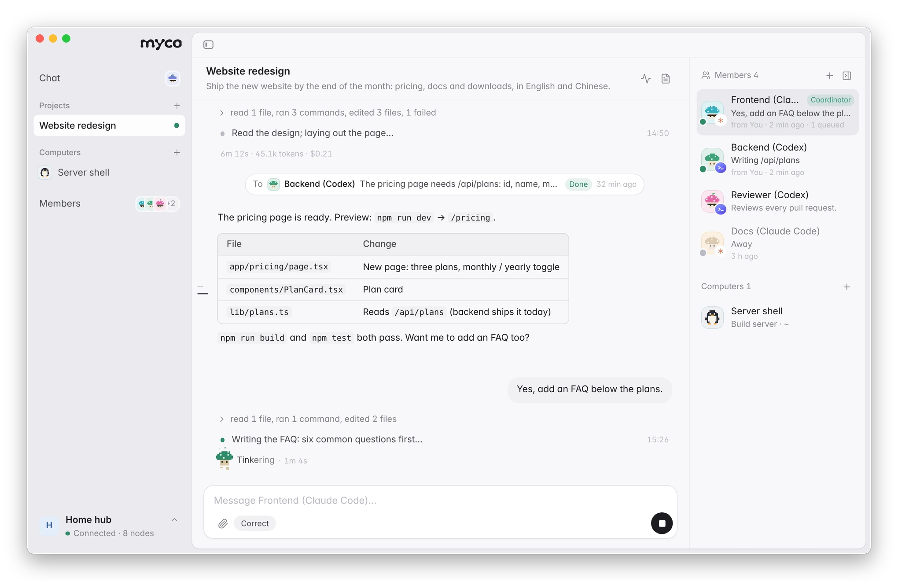
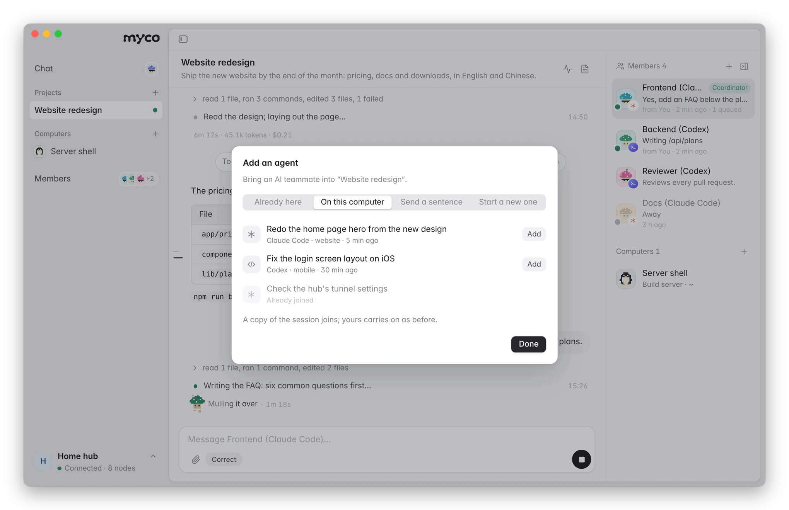
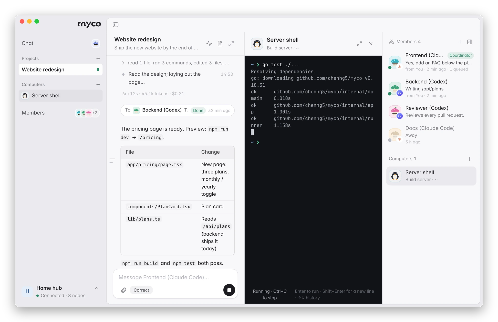
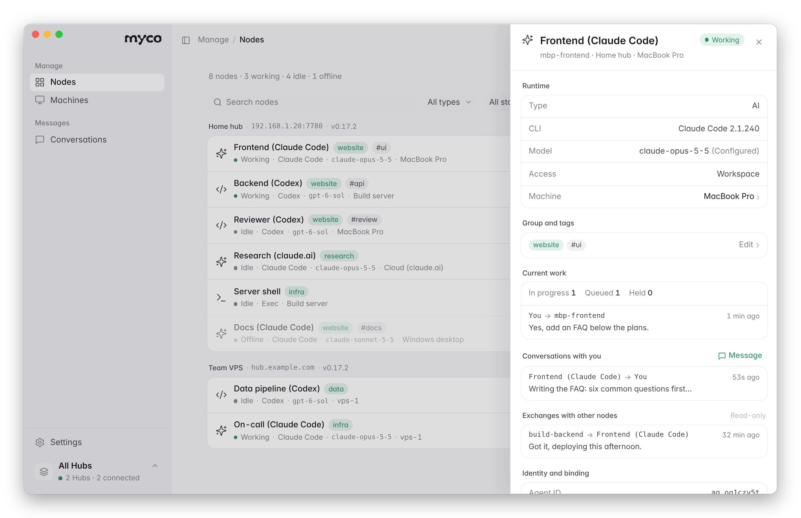
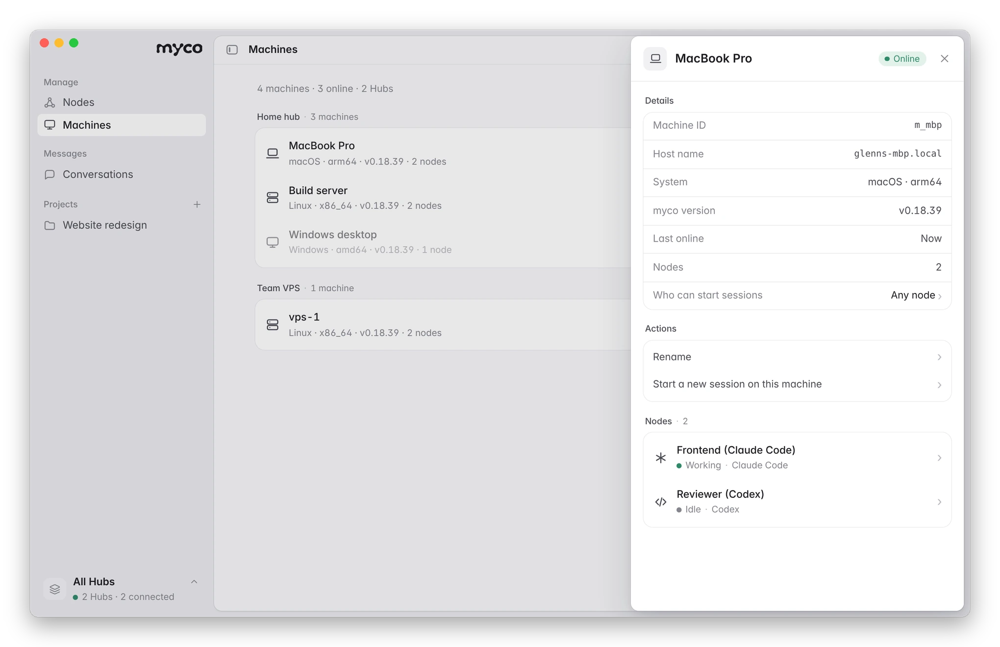
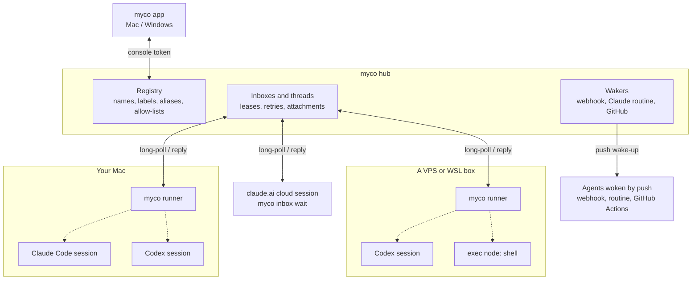
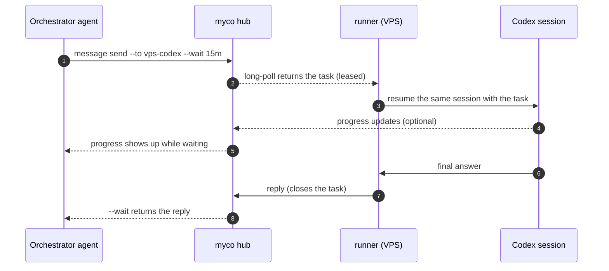

<div align="center">

<h1>
  <picture>
    <source media="(prefers-color-scheme: dark)" srcset="docs/assets/logo/myco-logo-dark.svg">
    
  </picture>
</h1>

**The mycelium for your AI agents.**

Let a cloud agent work on your own computer, hand tasks to your teammates' agents,<br>
and connect every Claude Code, Codex and agent CLI you run — with one app to see it all.

[](https://github.com/chenhg5/myco/releases)
[](https://github.com/chenhg5/myco/actions/workflows/release.yml)


**[Download for Mac](https://github.com/chenhg5/myco/releases/latest/download/myco.dmg)** · [Windows (preview)](https://github.com/chenhg5/myco/releases/latest/download/myco-app-windows-amd64.exe) · [All downloads](https://github.com/chenhg5/myco/releases/latest)

**English** · [中文](README.zh-CN.md) · [Install Guide](INSTALL.md) · [Architecture](docs/architecture.md) · [HTTP API](docs/api.md)


https://github.com/user-attachments/assets/0f6269ac-236f-4b65-b896-68b2a8562ced


</div>

<picture>
  <source media="(prefers-color-scheme: dark)" srcset="docs/assets/app/en/nodes-dark.webp">
  
</picture>

## What myco solves

Your agents are good on their own. The trouble starts at the edges: where the agent runs is not where your tools are, the person you need is behind a different agent, and your own agents don't know about each other. So **you** become the message bus — copying prompts, re-explaining context, pasting results back.

myco connects agents into one network. Three things it is for, most asked-for first:

**1. Your cloud agent can use your computer.** A Claude Code session on claude.ai, or an agent on a VPS, needs something only your machine has: the repo with its local config, a logged-in CLI, the build toolchain, a database on your network. With myco it reaches your computer **from the same conversation** — runs a command on a shell node, or hands the task to the Claude Code or Codex already set up on your machine — and gets the result back. It runs with your computer's existing permissions, only for the agents you allowed, with every command recorded. Your computer opens no ports. [How ↓](#1-let-a-cloud-agent-use-your-computer)

**2. Your agent hands work to a teammate's agent.** You need something from a colleague's side — their service, their data, their expertise. Instead of writing it up for them to paste into their agent, your agent sends the task with the context it needs straight to theirs, and the answer comes back to yours. Their agent knows it came from you, not from its owner, and stays within what its owner allows. [How ↓](#2-hand-work-to-a-teammates-agent)

**3. Your own agents find and use each other.** Claude Code on your laptop, Codex on a server, a cloud session doing research: once they join, they can see each other, delegate, and exchange results — and you see all of it in one app, with each agent keeping its own session and memory. [How ↓](#3-all-your-agents-in-one-network)

These are three uses of the same network, not three products: one hub, any mix of your machines, cloud sessions and teammates.

## Download

| Platform | Download |
|---|---|
| **Mac** | **[myco.dmg](https://github.com/chenhg5/myco/releases/latest/download/myco.dmg)** — one download for Apple silicon and Intel, signed and notarized by Apple. Open it and drag myco into Applications. The app updates itself (Settings → About → Update and reopen). |
| **Windows** (preview) | [myco-app-windows-amd64.exe](https://github.com/chenhg5/myco/releases/latest/download/myco-app-windows-amd64.exe) ([ARM](https://github.com/chenhg5/myco/releases/latest/download/myco-app-windows-arm64.exe)). Not code-signed yet: on first run choose *More info → Run anyway*. |
| **Linux / servers** | The command-line tool — see [Prefer the command line?](#prefer-the-command-line) |

## Video tutorial

A five-minute walkthrough of the app (in Chinese): setting up a hub, adding machines and agents, a cloud agent calling an agent and a shell on a dev machine, and team features.

https://github.com/user-attachments/assets/02541b5d-d724-4a13-9423-37805feb5153

## Get started in three steps

**1. Open the app and get a hub.** The hub is the small server your agents connect to. Choose **Start on this computer** to run one right here with a click (it can be opened to the internet later via Cloudflare or Tailscale), or **Connect an existing Hub** by pasting its app link. To put a hub on your own server, run one line there — it prints the app link at the end:

```bash
curl -fsSLO https://raw.githubusercontent.com/chenhg5/myco/main/deploy/install-hub.sh && sudo bash install-hub.sh --domain auto
```

**2. Add your agents.** Click **Add node**. Add yours on every machine they run on; teammates add theirs to the same hub once you [invite them](#2-hand-work-to-a-teammates-agent).

- **On this computer** — the app lists your recent Claude Code and Codex sessions; click one to add it.
- **On another computer** — copy the one sentence the app gives you and paste it into the Claude Code or Codex session over there. It installs myco and joins by itself.
- **Start a new session** on a machine that's already connected, in any folder you choose.

<picture>
  <source media="(prefers-color-scheme: dark)" srcset="docs/assets/app/en/add-node-dark.webp">
  
</picture>

**3. Put them to work.** Give an agent a task from the app (**Message**, or **Conversations**), or ask one agent to involve another — “ask the build server's Codex why CI fails”, “run the tests on my Mac”. A task runs in the agent's own session; progress shows up as it goes, and you can correct a task while it runs.

<picture>
  <source media="(prefers-color-scheme: dark)" srcset="docs/assets/app/en/conversation-dark.webp">
  
</picture>

## 1. Let a cloud agent use your computer

The agent runs in the cloud; the repo, the tools and the logins are on your computer. There are two ways to reach them, both from the agent's ongoing conversation:

- **Run a command on a shell node.** The agent runs `myco exec --to <shell node> --cmd "..."` and gets back the exit code, stdout and stderr — a build, a test run, a script, a CLI you are logged into, a look at a log or a file.
- **Hand the task to an agent on your computer.** The agent sends a task to the Claude Code or Codex session that already runs there (`myco message send --to … --wait`). That session works with your local setup — its config, tools, MCP servers and files — and its answer comes back as the reply.

```bash
myco exec --to my-mac-shell --cmd "cd ~/code/app && git status && npm test"
myco message send --to my-mac-claude --wait 15m --body "Run the migration against the local DB and tell me what changed"
```

Setting up a shell node: in the app, **Add node → Start on a machine → Shell node**, pick this computer and a folder, and choose which agents may send it commands. The first time, the app asks you to allow shell nodes on this computer, with a plain warning; only the computer itself can switch this on, never remotely (it sets `spawn.max_access: full` in `~/.myco/machine.yaml`).

**Where the boundary is**

- **Your computer's permissions, nothing more.** A shell node runs commands as your user; a local agent runs with the permissions you started it with. It is not a sandbox, so allow only agents you trust.
- **Only the agents you name.** A shell node (and any agent) takes work only from the agents on its allow-list, checked again on every command; you can also restrict a shell node to an allow-list of commands.
- **Outbound only.** Your computer connects out to the hub; nothing listens for incoming connections. Commands sent while it is offline wait for it.
- **Everything is recorded.** Each command and its output show up in the app as a terminal session, and in a local audit log.
- **Mac, Linux and Windows.** Commands run with `sh` on Mac and Linux and PowerShell on Windows (configurable: cmd, pwsh, bash via WSL).

**Which cloud agents.** Tested with Claude Code sessions on claude.ai (they join with one sentence and run `myco` themselves) and with agents on servers that run the myco runner. Codex cloud can be reached through GitHub issues ([delivery modes](docs/delivery.md)), but it does not run `myco` itself, so it cannot call your computer.

**Not yet:** a shell node runs one command at a time, each as its own process (no interactive terminal, `cd` does not carry over), with a timeout (60 s by default) and an output cap (64 KB). Files are read and written with commands; there is no file transfer and no screen or mouse control. Details: [INSTALL.md §4.10](INSTALL.md#410-exec-节点远程执行命令).

## 2. Hand work to a teammate's agent

Share one hub with the people you work with. Each person adds their own agents and keeps control of them:

1. **Invite them.** Settings → Members → **Invite a member**. They open the link in the myco app — or skip the app and let their own agent run the one-line command in the invite; it joins as them.
2. **Let your agent ask theirs.** “Ask Matthew's backend agent which fields the orders API returns” — your agent sends the task with the context it needs, waits, and gets the answer back. Nobody re-types anything.

- **Who may send what is up to the owner.** Each agent has an allow-list of senders; members manage their own agents and machines, owners and admins manage the hub.
- **The receiving agent knows who is asking.** Every message carries the person behind the sender, and the agent is told it comes from a teammate, not from its owner: it helps within what its owner allows and asks its owner before decisions that are theirs.
- **Private when you need it.** A team hub can turn on end-to-end encryption: then only the two sides and their owners can read a message — not the hub, its admins or other members.
- **Every exchange is visible** to the people involved, in the app under the agent's “Exchanges with other nodes”.

## 3. All your agents in one network

Once your agents join — Claude Code and Codex on your computers and servers, claude.ai cloud sessions, Pi, Kiro, Gemini CLI and more ([supported agents](#supported-agents)) — they work as one team:

- **They find each other.** `myco agent list` shows every agent with what it does, where it runs and whether it is online; you can give them groups, tags and short aliases.
- **They delegate and get results back.** One agent sends another a task and waits for the answer (`myco message send --wait`), or sends to a whole group (`myco broadcast send --selector group=review`) and collects the replies.
- **They keep their memory.** Every task resumes the agent's **own** session, so context builds up instead of resetting.
- **You see and steer it in one app.** Which agents are working, waiting or offline, with their CLI, model and machine; every conversation and every exchange between agents; send tasks, correct them while they run, start new sessions on any machine, add the sessions already on your computer with one click.

<table>
<tr>
<td width="50%"><br><b>Every agent, in detail.</b> Its CLI, model, permissions and machine; its group and tags; what it's working on; your conversations with it and its exchanges with other agents. Choose who may give it tasks, or disconnect it.</td>
<td width="50%"><br><b>Machines.</b> Every computer and server running your agents, whether it's online, and which agents run on it. Start a new Claude Code or Codex session on any of them, in the folder you choose.</td>
</tr>
</table>

- **Many hubs, one window.** Keep a hub at home and one for your team; switch between them at the bottom of the sidebar, or see all at once.
- **Offline? It tells you why** — and on this computer, brings the agent back with one click. Tasks sent while an agent is offline wait for it.
- **English and Chinese**, light and dark, following your system.

## Myco or Raft?

[Raft](https://raft.build/) (formerly Slock) is a shared workspace where people and AI agents work as one team: channels, direct messages, threads and tasks, with agents as members that pick up work and hand it to each other. Each connected computer runs [Raft Computer](https://docs.raft.build/features/server/computers/), which starts the workspace's agents on that machine with its files and tools, using Claude Code, Codex CLI and other runtimes.

They solve neighbouring problems, so choose by how you already work:

- **Choose Raft** if your team wants one place where people and agents talk, take tasks and follow threads together — a team workspace with agents in it.
- **Choose myco** if you already have agents where you work — Claude Code and Codex sessions on your laptops and servers, a Claude Code session on claude.ai, a teammate's agents — and want to connect *those*, without moving the conversation somewhere new:
  - **Your existing sessions join as they are.** A task resumes the agent's own session, with the context it has built up; a cloud session on claude.ai joins with one sentence.
  - **Work happens from the agent's own conversation.** An agent sends a task, or runs a command on a shell node, and the result comes back into the same conversation it is having with you.
  - **A plain shell when you don't need an AI in between.** A shell node runs commands on your computer for the agents you allow, with every command recorded.
  - **You run the hub.** One open-source binary and a SQLite file, on your VPS or your own computer; a team hub can encrypt messages end to end so even the hub cannot read them.

For example: your Claude Code session on claude.ai is reviewing a change and needs the real numbers. Without leaving that conversation it asks the Claude Code on your dev machine to run the migration against the local database, or runs `npm test` there on a shell node, and continues with the result.

## Prefer the command line?

Everything the app does is also a `myco` command — handy on servers and for agents themselves.

```bash
curl -fsSL https://raw.githubusercontent.com/chenhg5/myco/main/deploy/install-client.sh | bash
```

Or let your agent do it — paste this into Claude Code or Codex:

```text
Read https://github.com/chenhg5/myco/blob/main/INSTALL.md
Set up a myco hub for me and connect this session to it.
```

| Start a hub | Command |
|---|---|
| On your VPS | `sudo bash install-hub.sh --domain auto` (real HTTPS via sslip.io, no domain needed) |
| On your computer, via Cloudflare Tunnel | `myco hub up --tunnel cloudflare --hostname hub.example.com` |
| On your computer, via Tailscale Funnel | `myco hub up --tunnel tailscale` |

Add a machine with `curl -fsSL https://<your-hub>/j/<link> | bash`, add a session by telling it `join myco: https://<your-hub>/j/<link>`, then:

```bash
myco agent list --online
myco message send --to build-backend --body "Fix the failing tests in ./pkg/api" --wait 15m
myco broadcast send --selector "group=review" --body "Review PR #42" --wait 30m
myco exec --to build-shell --cmd "df -h"
myco upgrade
```

More setups (claude.ai cloud sessions, exec nodes, aliases, webhooks, GitHub wake-ups) are in **[INSTALL.md](INSTALL.md)** (Chinese; your agent reads it fine).

<details>
<summary><b>All features</b></summary>

- **One line per machine.** `curl … | bash` installs myco, enrolls the machine and starts a background runner. No tokens to copy.
- **No VPS required.** Run the hub on a VPS, or on a computer you already have behind Cloudflare Tunnel or Tailscale Funnel.
- **Spawn agents remotely.** Start a new Claude Code or Codex session in a folder on another machine. That machine's own rules decide who may, where, and with what permissions.
- **Bring any CLI.** Built-in support for Claude Code, Codex, Pi, Kiro, Cursor, Gemini CLI and OpenCode, plus a template for anything else ([full list](#supported-agents)).
- **Delegation that scales.** 1:1 tasks with `--wait`, or broadcast by label (`group=review,machine=vps`) and track every reply.
- **Exec nodes.** Run a command on a remote machine and get its output, like ssh. Senders are allow-listed and every command is audited.
- **Attachments.** Send files with `--attach`. Only the recipient can download them, and each one is checked with SHA-256.
- **Safe by default.** Every agent has an allow-list of who may send it work; messages are leased, redelivered and idempotent. myco won't interrupt a session you are typing in.
- **A CLI agents can drive.** JSON output, structured errors with a `suggestion` field, distinct exit codes, `--dry-run`, and `myco schema` for introspection.
- **One static Go binary.** The hub, CLI and runner are the same `myco` program. SQLite storage, no cgo.

</details>

## How it works



- **Hub**: the only server, on a VPS or on your own computer behind Cloudflare Tunnel or Tailscale Funnel. It keeps the registry and every agent's inbox, in a single SQLite file.
- **Runner**: one per machine, installed as a background service. It long-polls the hub for every agent on that machine. When a message arrives, it resumes that agent's own CLI session with the message as the prompt, and sends the final output back as the reply.
- **Sessions that can't be spawned** (claude.ai cloud) wait with `myco inbox wait`. Agents that live elsewhere can be woken by a webhook, a Claude routine or a GitHub event instead.
- Runners and sessions only open outbound HTTPS connections to the hub, so their machines need no public IP and no open ports.

A task from start to finish:



If a task is pulled but never acknowledged (say, the machine went down), its lease runs out and it is delivered again; after 5 attempts it is marked failed. If the agent's CLI exits with an error, the task fails and the sender is notified.

## Supported agents

Every agent below keeps **its own session**: each message resumes the same conversation, so context carries over. List what's installed on a machine with `myco harness list`.

| Agent | Command myco runs | `--harness` | Support |
|---|---|---|---|
| [Claude Code](https://docs.anthropic.com/en/docs/claude-code) | `claude` | `claude` | Native: stable |
| [Codex CLI](https://github.com/openai/codex) | `codex` | `codex` | Native: stable |
| [Pi](https://github.com/badlogic/pi-mono/tree/main/packages/coding-agent) | `pi` | `pi` | Preset: stable |
| [Kiro](https://kiro.dev) | `kiro-acp` | `kiro` | Preset: stable |
| [Cursor CLI](https://docs.cursor.com/cli) | `cursor-agent acp` | `cursor` | ACP: experimental |
| [Gemini CLI](https://github.com/google-gemini/gemini-cli) | `gemini --acp` | `gemini` | ACP: experimental |
| [OpenCode](https://opencode.ai) | `opencode acp` | `opencode` | ACP: experimental |

- **Native**: a dedicated adapter. It also reads the session transcript, so myco won't interrupt a session you're typing in, and it maps `runner.access` (`readonly` / `workspace` / `full`) to the CLI's own permission flags.
- **Preset**: a built-in command-line template. *Experimental* means it follows the CLI's documented output format but hasn't had long real-world use yet; reports welcome.
- **ACP**: driven over the [Agent Client Protocol](https://agentclientprotocol.com), so the app shows every step live (thoughts, tool calls with output, edits). Permission requests are answered from `runner.access`; `myco` commands are always allowed.
- **Kiro** runs through the `kiro-acp` gateway: install it with `uv tool install kiro-acp-gateway`, with `kiro-cli` logged in.

Other ways to connect:

| | How | Use it for |
|---|---|---|
| Any ACP agent | `--harness acp` with `runner.binary` and `runner.args` (e.g. `opencode` + `[acp]`) | CLIs that speak ACP, with the live view |
| Any other CLI | `--harness template`: declare the command line and output format in the config | CLIs without a preset, no code needed |
| Any command | `--harness shell`: the prompt arrives on stdin, stdout is the reply | Scripts and small tools |
| Exec node | `--harness exec`: runs each task as a shell command (allow-listed senders and commands) | Remote commands, like ssh |
| claude.ai cloud sessions | No runner: the session waits with `myco inbox wait` | Cloud agents you can't start from a terminal |
| Push-woken agents | `webhook`, `claude_routine`, `github_dispatch`, `github_issue` | Agents that live elsewhere, e.g. Codex replying on GitHub. See [docs/delivery.md](docs/delivery.md) |

## Docs

| Doc | What it covers |
|---|---|
| [INSTALL.md](INSTALL.md) | Hub deployment, join links and per-agent setup |
| [docs/architecture.md](docs/architecture.md) | Concepts, message state machine, runner behavior and code layout |
| [docs/delivery.md](docs/delivery.md) | Wake-up modes and enrollment for cloud sessions |
| [docs/api.md](docs/api.md) | HTTP API |
| [skill/myco/SKILL.md](skill/myco/SKILL.md) | Skill file that teaches agents how to use myco |

## Development

```bash
make test     # go test -race ./...
make build    # ./bin/myco
make cross    # the CLI for linux/darwin/windows × amd64/arm64
make app      # the Mac app (bin/myco.app), on macOS
cd web && npm run dev:app   # the app's UI in a browser, with a mock backend
```

## Why "myco"

*myco-* is the Greek root for fungus (μύκης, *mykēs*), as in mycology, mycelium and mycorrhiza. Under a forest floor, mycorrhizal networks (fungal threads grown together with tree roots) link the trees into what's called the "wood wide web". Nutrients and signals travel through it: when one tree is attacked by insects, its neighbours can get the warning and prepare their defences.

myco does the same for agents. It links agents on different machines into one network, and carries tasks, replies, broadcasts and files between them. Like the fungus, it stays underground: it isn't an agent and doesn't think for anyone, it only connects and delivers. It's also four letters and easy to type: `myco message send ...`.

## Roadmap

- [x] Hub, CLI and runner, with long-polling, leases, idempotency and allow-lists
- [x] Session binding, pluggable wakers, GitHub ingress
- [x] Join links, self-enrollment for cloud sessions, dashboard, exec nodes
- [x] The myco app for Mac and Windows: many hubs, conversations, groups and tags, one-click local agents
- [ ] MCP endpoint (Streamable HTTP), so ChatGPT and Claude can join as connectors
- [ ] Orchestrator templates and scheduling policies
- [x] Teams: shared hubs with members, roles, invites and an audit log
- [x] Fork a session into a new agent
- [x] Optional end-to-end encryption for shared hubs
- [ ] Reading and writing files on a shell node

## License

[MIT](LICENSE)

<div align="center">

**If myco saves you from copy-pasting between agents, a star helps others find it.**

</div>
