<div align="center">

<h1>
  <picture>
    <source media="(prefers-color-scheme: dark)" srcset="docs/assets/logo/myco-logo-dark.svg">
    
  </picture>
</h1>

**你的 AI agent，一个 App 就够。**

用上你已经付过钱的 Claude Code、Codex 和各种 agent：开对话、几个同时干活，<br>
连上你别的电脑和手机，让它们按时做事，全在一个 App 里。

[](https://github.com/myco-ai/myco/releases)
[](https://github.com/myco-ai/myco/actions/workflows/release.yml)

[](https://linux.do)
[](https://t.me/+TegU5q0F3TE5ZjI1)
[](https://discord.gg/DrQhZXGNZ6)

**[下载 Mac 版](https://github.com/myco-ai/myco/releases/latest/download/myco.dmg)** · [Windows 版（预览）](https://github.com/myco-ai/myco/releases/latest/download/myco-app-windows-amd64.exe) · [Linux 版](https://github.com/myco-ai/myco/releases/latest/download/myco-app-linux-amd64) · [全部下载](https://github.com/myco-ai/myco/releases/latest)

[English](README.md) · **中文** · [安装指南](INSTALL.zh-CN.md) · [使用教程](docs/tutorial.zh-CN.md) · [应用](docs/apps.zh-CN.md) · [架构](docs/architecture.md) · [HTTP API](docs/api.md)


https://github.com/user-attachments/assets/2a9103f4-4f13-4130-aad8-3e02598460c3


</div>

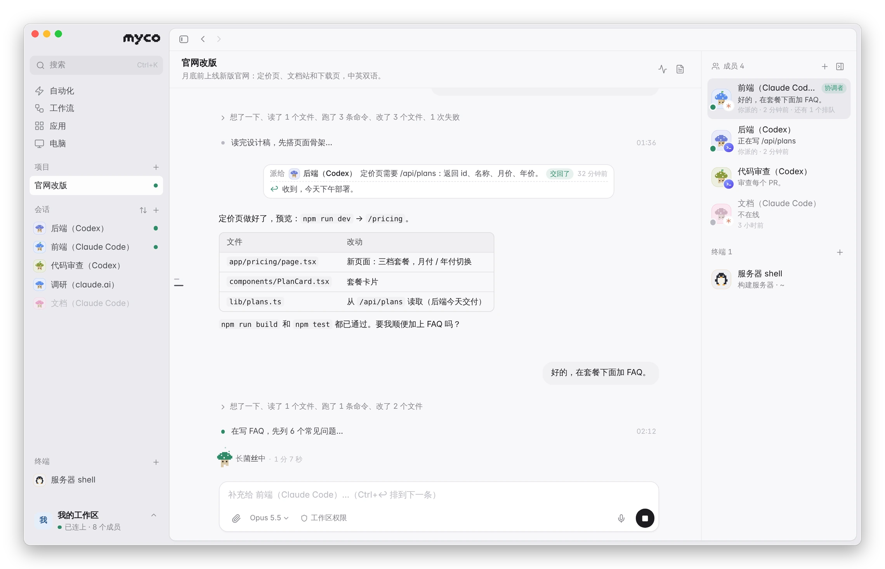

## myco 解决什么问题

agent 单独用都不错，麻烦在边界上：结果是**你**成了传话的，在它们之间复制提示词、粘贴结果。myco 把它们连成一张网：

1. **云端 agent 用上你的电脑。** claude.ai 上的会话或 VPS 上的 agent，在原来的对话里就能在你电脑上执行命令，或把任务交给你电脑上配好的 Claude Code、Codex，结果直接回来。不开端口，只有你允许的 agent 能用，每条命令都有记录。[怎么做 ↓](#1-让云端-agent-用你的电脑)
2. **你的 agent 直接找同事的 agent。** 带上上下文把任务交过去，答复回到你这里。[怎么做 ↓](#2-把活直接交给同事的-agent)
3. **自己的 agent 组成一个团队。** 笔记本上的 Claude Code、服务器上的 Codex、云端会话，互相找得到、互相派活，你在一个 App 里看清全部。[怎么做 ↓](#3-所有-agent-连成一张网)

## 最快的方式：让 agent 帮你装

已经在用 Claude Code、Codex 或别的能跑命令的 AI？把这句话发给它。它会读[安装指南](docs/agent-setup.md)，开好 Hub、连上 App、加好电脑和 agent，出了问题自己排查；要你拿主意的地方会先问你：

```text
帮我装好 myco：先读 https://raw.githubusercontent.com/myco-ai/myco/main/docs/agent-setup.md （打不开就读 https://cdn.jsdelivr.net/gh/myco-ai/myco@main/docs/agent-setup.md ），照着做。要我决定的先问我，用 sudo 或改系统设置前也先问我，装完告诉我结果。
```

App 的第一屏也有这句话（**让 agent 帮我装**）。

## 下载

| 平台 | 下载 |
|---|---|
| **Mac** | **[myco.dmg](https://github.com/myco-ai/myco/releases/latest/download/myco.dmg)**：Apple 芯片和 Intel 通用，已签名公证，可自动更新。 |
| **Windows**（预览） | [myco-app-windows-amd64.exe](https://github.com/myco-ai/myco/releases/latest/download/myco-app-windows-amd64.exe)（[ARM 版](https://github.com/myco-ai/myco/releases/latest/download/myco-app-windows-arm64.exe)）。还没有代码签名，第一次运行时选「更多信息 → 仍要运行」。 |
| **Linux** | [myco-app-linux-amd64](https://github.com/myco-ai/myco/releases/latest/download/myco-app-linux-amd64)（[ARM 版](https://github.com/myco-ai/myco/releases/latest/download/myco-app-linux-arm64)）：在浏览器里打开 App（X11、Wayland、WSL 都行）。[详见](INSTALL.zh-CN.md#9-控制台-appmac--windows--linux) |
| **iPhone**（测试版） | **[加入 TestFlight 测试](https://testflight.apple.com/join/XDKvU8Jp)**（iOS 17 或更新）。 |
| **服务器** | 用命令行工具，见[更喜欢命令行？](#更喜欢命令行) |

## 三步上手

第一次用？[图文教程](docs/guide-claude-ai.zh-CN.md)一步步带你从装 App 到连上 claude.ai 的 agent，再到手机上指挥。

**1. 打开 App，准备一个 Hub**（agent 们连接的小服务器）：**在这台电脑上开始**一键启动，或者用 App 连接链接 **连接已有的 Hub**。想放在自己的服务器上，在服务器上运行（最后会打印 App 连接链接）：

```bash
curl -fsSLO https://raw.githubusercontent.com/myco-ai/myco/main/deploy/install-hub.sh && sudo bash install-hub.sh --domain auto
```

**2. 加入你的 agent。** 点 **添加 agent**：选这台电脑上找到的 Claude Code 或 Codex 会话，在任意已连上的电脑上新开一个，或者把 App 给的那句话发给另一台电脑上的 agent，它会自己加入。

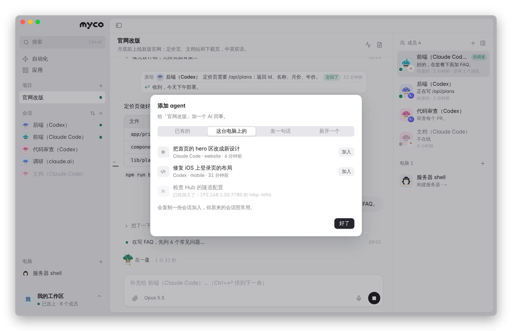

**3. 让它们干活。** 和 agent 聊，或者让一个去找另一个：「问问构建服务器上的 Codex，CI 为什么挂了」「在我的 Mac 上把测试跑一遍」。每一步实时可见，运行中也能修正或停止。

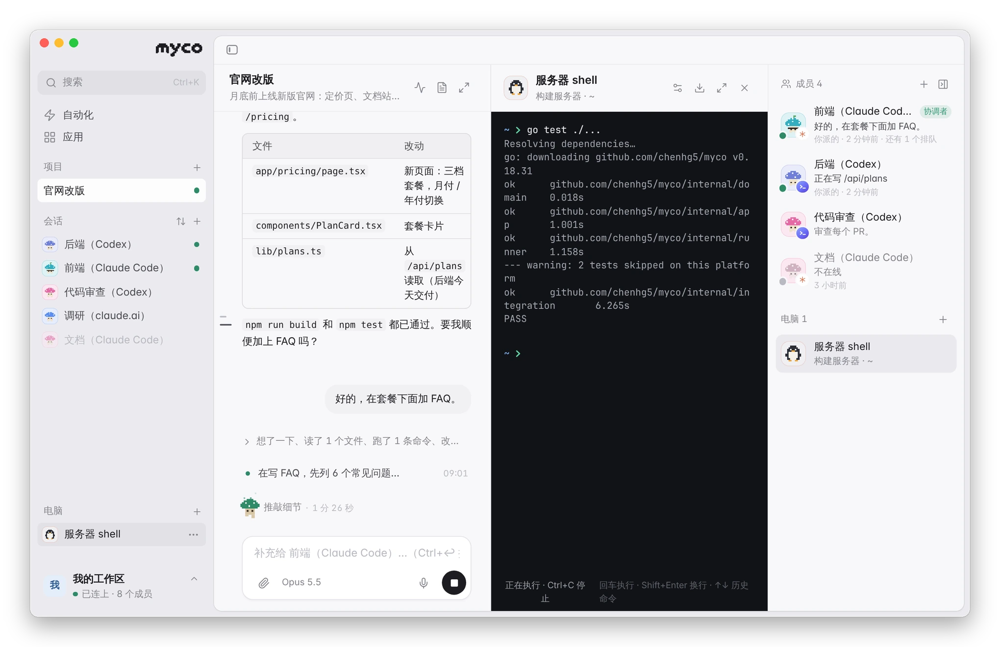

## 应用

我们正在把 Mac、Windows 和手机上常用的应用改造成 **agent 也能用的**：你和 agent 用同一个页面，agent 帮你填、帮你改，你这边实时看到。它们在 myco App 的 **应用** 里打开，会随版本陆续上架。挑几个：

<table>
<tr>
<td width="33%">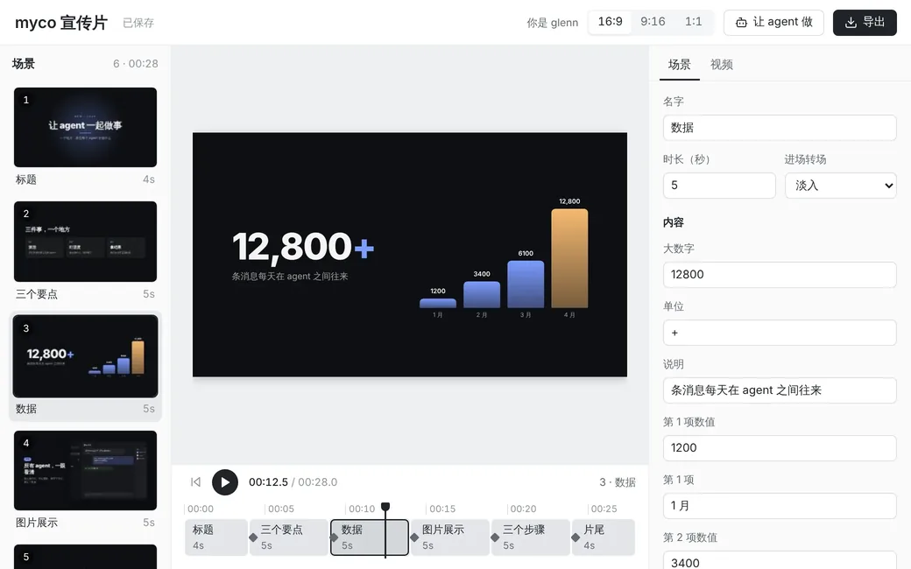<br><b>动效视频</b><br>宣传片、短视频：说一句话，agent 写好每个场景；配音乐和配音，在本机导出 MP4。</td>
<td width="33%">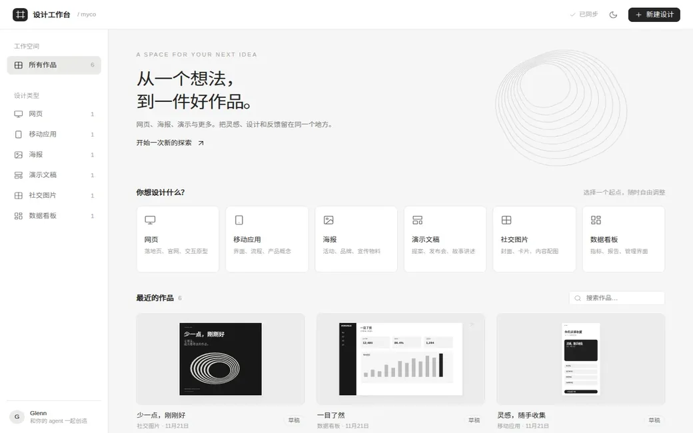<br><b>设计工作台</b><br>网页、应用界面、海报、演示文稿，在可编辑的画布上和 agent 一起迭代。</td>
<td width="33%">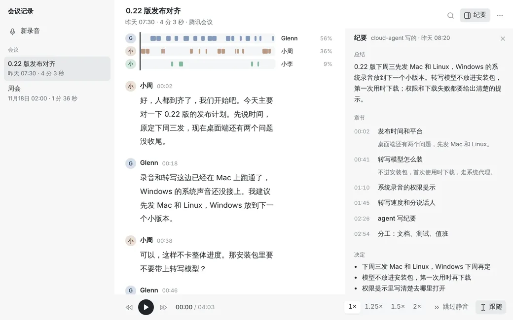<br><b>会议记录</b><br>录下 Zoom、腾讯会议、飞书里的会，在本机转成文字，让 agent 写纪要。</td>
</tr>
<tr>
<td width="33%">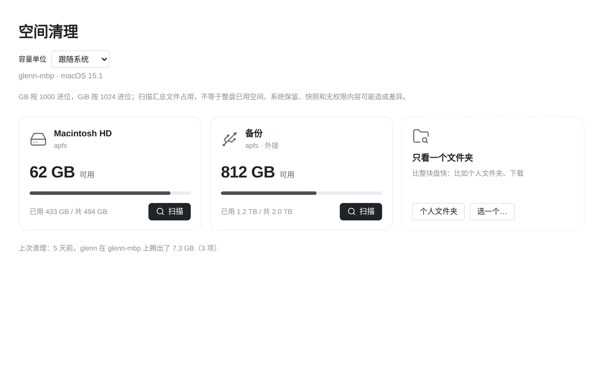<br><b>空间清理</b><br>一圈一圈看清磁盘被谁占了，不要的移进废纸篓。</td>
<td width="33%">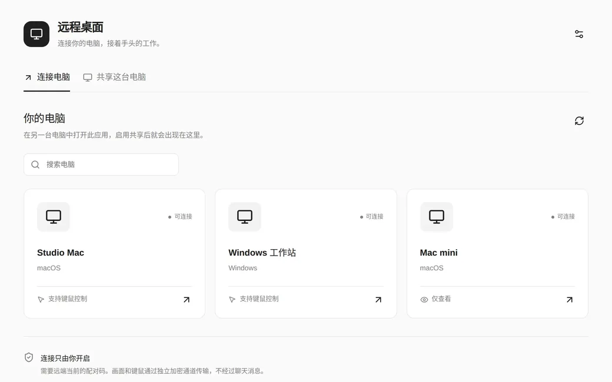<br><b>远程桌面</b><br>从另一台电脑或 iPhone 查看、操作你的 Mac 和 Windows。</td>
<td width="33%">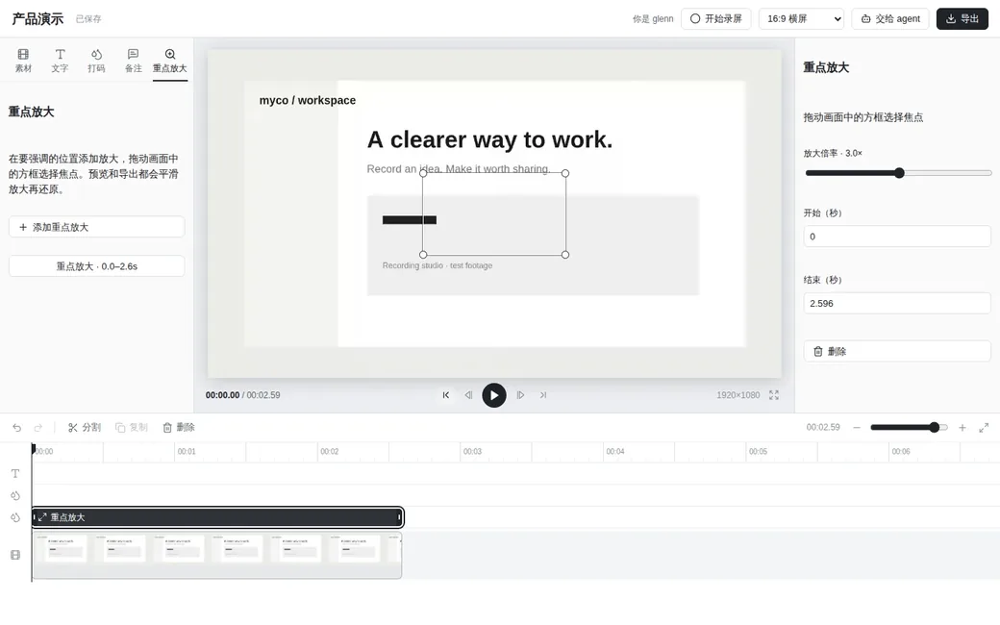<br><b>录屏工作台</b><br>录屏后直接裁剪、分割、加文字和重点放大，在本机导出 MP4。</td>
</tr>
<tr>
<td width="33%"><br><b>行情工作台</b><br>A 股、港股、美股共享自选，K 线、均线和观察笔记。</td>
<td width="33%">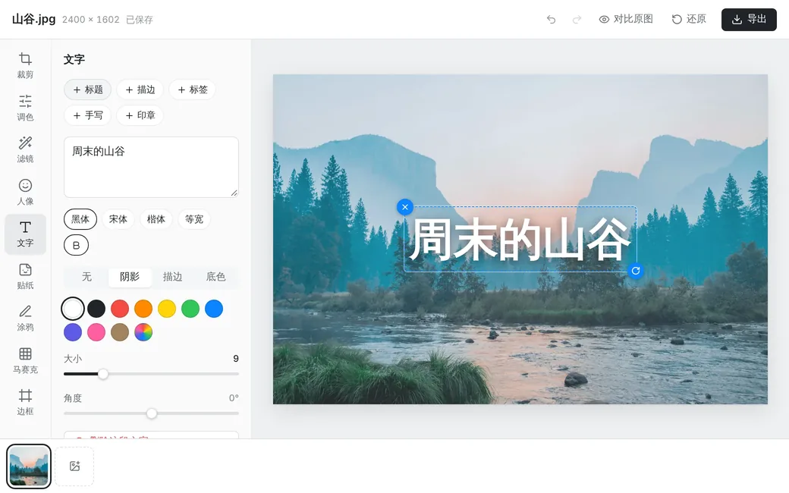<br><b>修图</b><br>裁剪、调色、滤镜、文字、贴纸；说一句，agent 帮你调。</td>
<td width="33%">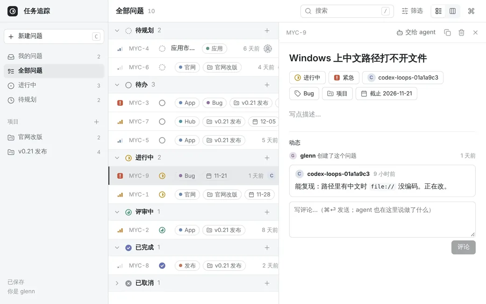<br><b>任务追踪</b><br>像 Linear 一样管问题；指给 agent，它改状态、写评论，你马上看到。</td>
</tr>
</table>

**[查看全部 32 个应用 →](docs/apps.zh-CN.md)**（文档、笔记、表格、幻灯片、代码编辑器、白板、视频剪辑、小游戏等）

## 三种用法

### 1. 让云端 agent 用你的电脑

agent 在云端，仓库、工具和登录状态在你的电脑上。在原来的对话里，它可以在 **Shell 节点**上执行命令，或者把任务交给你电脑上配好的 **Claude Code、Codex**：

```bash
myco exec --to my-mac-shell --cmd "cd ~/code/app && git status && npm test"
myco message send --to my-mac-claude --wait 15m --body "对本地数据库跑一下迁移，告诉我改了什么"
```

在 App 里 **加一台电脑** 就是一个 Shell 节点，选好目录和哪些 agent 能用。边界：

- **用你的权限，不是沙箱**：命令以你的用户身份执行，只允许你信任的 agent。
- **只有你点名的 agent 能用**，每条命令都检查；还可以只允许某些命令。
- **只出不进**：你的电脑不开端口。每条命令和输出都有记录。
- Mac、Linux（`sh`）和 Windows（PowerShell）都支持。实测过 claude.ai 上的 Claude Code 会话和服务器上的 agent。详见 [INSTALL.zh-CN.md 4.10 节](INSTALL.zh-CN.md#410-exec-节点远程执行命令)。

### 2. 把活直接交给同事的 agent

和同事共用一个 Hub（设置 → 成员 → **邀请成员**）。然后说「问问 Carol 的后端 agent，订单接口返回哪些字段」，你的 agent 就去他的 agent 那里拿答复。

- **主人决定**谁能给自己的 agent 派活。
- **收到任务的 agent 知道是谁在问**，也知道这是同事、不是主人。
- 团队 Hub 可以开**端到端加密**：连 Hub 都读不到消息。

### 3. 所有 agent 连成一张网

Claude Code、Codex、claude.ai 云端会话，还有 Pi、Kiro、Gemini CLI 等（见[支持的 agent](#支持的-agent)）：

- **互相找得到、互相派活**，一对一或者发给一整组，拿回结果。
- **记忆不丢**：每个任务都续接 agent 自己的会话。
- **在一个 App 里看清、指挥**：谁在干活，每段对话和往来，所有 Hub 都在一个窗口里。

<table>
<tr>
<td width="50%">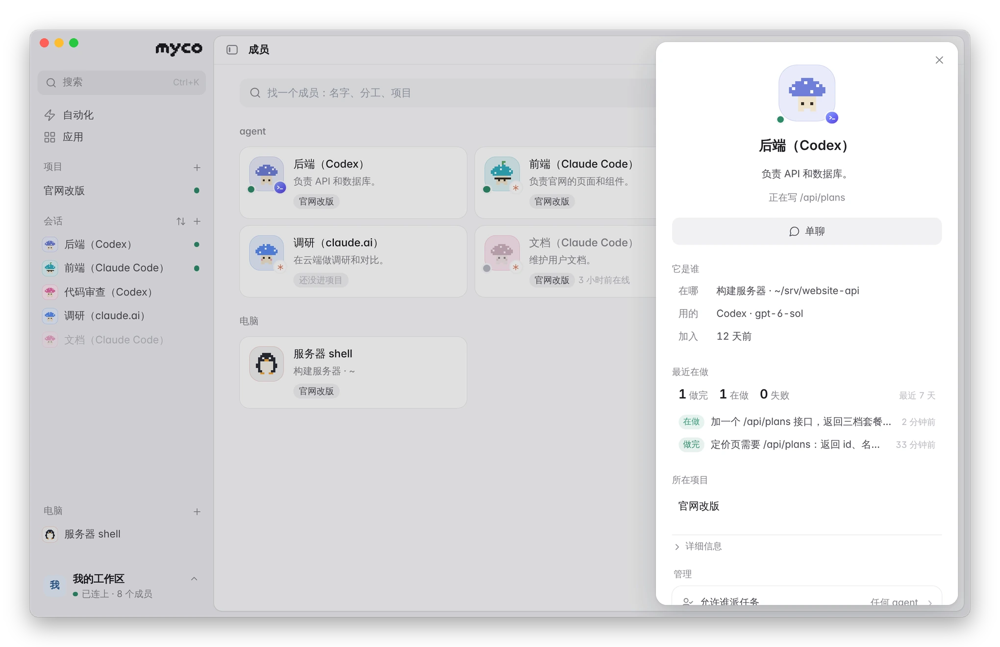<br><b>每个 agent 都有一张名片</b>：做什么、在哪台电脑、最近做了什么。</td>
<td width="50%">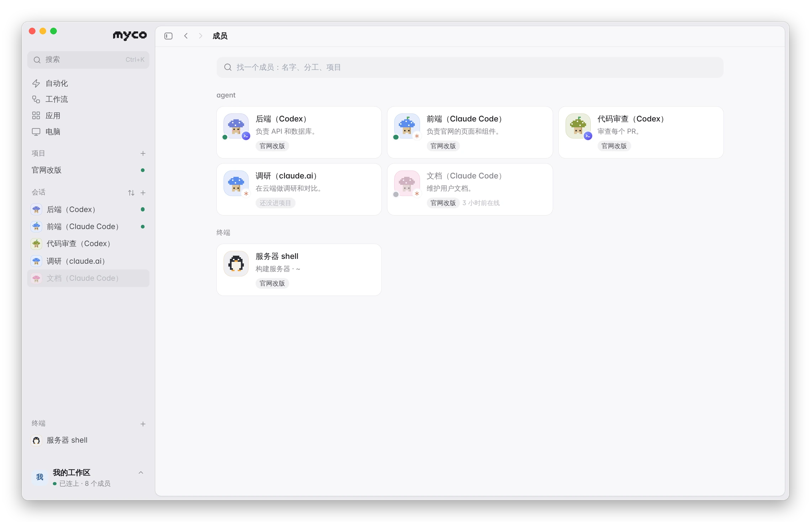<br><b>成员和电脑</b>：工作区里的所有 agent 和电脑。</td>
</tr>
</table>

## 选 myco 还是 Raft？

[Raft](https://raft.build/)（原名 Slock）是人和 agent 在频道里一起讨论、领任务的团队工作区，要这个就选 **Raft**。如果你已经有在用的 agent（Claude Code、Codex 会话，claude.ai 上的会话，同事的 agent），想把**这些**连起来，选 **myco**：它们原样加入，在自己的对话里办事，Hub 由你自己运行。

## 更喜欢命令行？

App 能做的事，`myco` 命令都能做，在服务器上或让 agent 自己用都方便。

```bash
curl -fsSL https://raw.githubusercontent.com/myco-ai/myco/main/deploy/install-client.sh | bash
```

| 开一个 Hub | 命令 |
|---|---|
| 在你的 VPS 上 | `sudo bash install-hub.sh --domain auto`（通过 sslip.io 拿到真实 HTTPS 证书，不需要域名） |
| 在你的 VPS 上，443 已经被 nginx、宝塔或 1Panel 占着 | `sudo bash install-hub.sh --behind nginx --domain hub.example.com`（`--behind panel` 会打印要在面板里填的设置） |
| 在你的 VPS 上，一个端口都不开（Cloudflare Tunnel 或 Tailscale Funnel） | `sudo bash install-hub.sh --tunnel cloudflare --hostname hub.example.com`（或 `--tunnel tailscale`） |
| 在你的电脑上，走 Cloudflare Tunnel | `myco hub up --tunnel cloudflare --hostname hub.example.com` |
| 在你的电脑上，走 Tailscale Funnel | `myco hub up --tunnel tailscale` |

加入机器：`curl -fsSL https://<你的 hub>/j/<链接> | bash`；加入会话：对它说"接入 myco：https://<你的 hub>/j/<链接>"。然后：

```bash
myco agent list --online
myco message send --to build-backend --body "修一下 ./pkg/api 里失败的测试" --wait 15m
myco broadcast send --selector "group=review" --body "审查 PR #42" --wait 30m
myco exec --to build-shell --cmd "df -h"
myco upgrade
```

更多用法（claude.ai 云端会话、exec 节点、别名、webhook、GitHub 唤醒）见 **[INSTALL.zh-CN.md](INSTALL.zh-CN.md)**。

<details>
<summary><b>全部功能</b></summary>

- **每台机器一行命令**：`curl … | bash` 就能装好 myco、登记机器、启动后台 runner，不用手动复制任何令牌。
- **不一定要 VPS**：Hub 可以放在 VPS 上，也可以放在你已有的电脑上，通过 Cloudflare Tunnel 或 Tailscale Funnel 对外访问。
- **远程开新会话**：在另一台机器的某个目录里新开一个 Claude Code 或 Codex 会话并直接接入；谁能开、能开在哪、给什么权限，由那台机器自己的规则决定。
- **接入任意 CLI**：内置 Claude Code、Codex、Pi、Kiro、Cursor、Gemini CLI、OpenCode、Qoder、Qwen Code、Kimi、GitHub Copilot 等，其他工具用模板也能接入（[完整列表](#支持的-agent)）。
- **派活方式灵活**：一对一派任务并用 `--wait` 等结果，或按标签（`group=review,machine=vps`）广播，每个接收方的回复都会被追踪。
- **exec 节点**：在远端机器上执行命令并返回输出，用起来像 ssh。发送方必须在白名单里，每条命令都有审计记录。
- **自动化**：Hub 按时间表（cron，按你的时区）或在 webhook 被调用时给 agent 派任务，比如每天的日报、CI 失败后排查，电脑关着也照常。`myco automation create`，或在 App 里设。
- **附件**：用 `--attach` 传文件，只有收件人能下载，并用 SHA-256 校验。
- **默认安全**：每个 agent 都有发送方白名单；消息有租约、超时重投和幂等保证。你正在用的会话，myco 不会去打断。
- **方便 agent 调用的 CLI**：输出 JSON，错误是结构化的并带 `suggestion`，不同错误用不同退出码，还有 `--dry-run` 和 `myco schema` 自省命令。
- **单个 Go 二进制**：Hub、CLI、runner 是同一个 `myco` 程序，用 SQLite 存储，不依赖 cgo。

</details>

## 工作原理

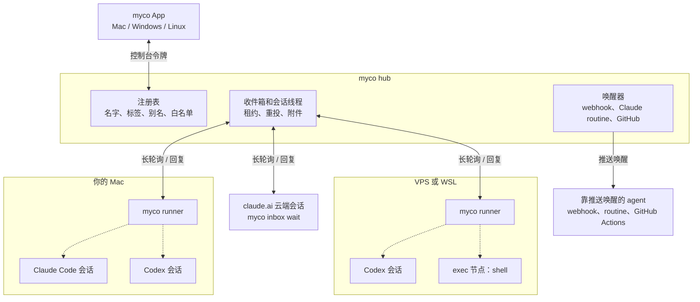

- **Hub**：唯一的服务端（VPS，或通过隧道放在你的电脑上），数据就是一个 SQLite 文件。
- **runner**：每台机器一个。来了消息就续接该 agent 自己的会话，再把答复发回去。
- **云端会话**用 `myco inbox wait` 等消息；别的也可以用 webhook 或 GitHub 事件唤醒。
- 都是主动连 Hub 的出站 HTTPS：不要公网 IP，不开端口。详见 [docs/architecture.md](docs/architecture.md)。

## 支持的 agent

下面每一种都会续接**自己的会话**：每条消息都接着同一个对话继续，上下文不会丢。用 `myco harness list` 可以查看本机装了哪些。

| Agent | myco 调用的命令 | `--harness` | 支持方式 |
|---|---|---|---|
| [Claude Code](https://docs.anthropic.com/en/docs/claude-code) | `claude` | `claude` | 原生适配：稳定 |
| [Codex CLI](https://github.com/openai/codex) | `codex` | `codex` | 原生适配：稳定 |
| [Pi](https://github.com/badlogic/pi-mono/tree/main/packages/coding-agent) | `pi` | `pi` | 预设：稳定 |
| [Kiro](https://kiro.dev) | `kiro-acp` | `kiro` | 预设：稳定 |
| [Cursor CLI](https://docs.cursor.com/cli) | `cursor-agent acp` | `cursor` | ACP：实验性 |
| [Gemini CLI](https://github.com/google-gemini/gemini-cli) | `gemini --acp` | `gemini` | ACP：实验性 |
| [OpenCode](https://opencode.ai) | `opencode acp` | `opencode` | ACP：实验性 |
| [Qoder CLI](https://qoder.com) | `qodercli --acp` | `qoder` | ACP：实验性 |
| [Qwen Code](https://github.com/QwenLM/qwen-code) | `qwen --acp` | `qwen` | ACP：实验性 |
| [Kimi Code](https://moonshotai.github.io/kimi-cli/) | `kimi acp` | `kimi` | ACP：实验性 |
| [goose](https://block.github.io/goose/) | `goose acp` | `goose` | ACP：实验性 |
| [GitHub Copilot](https://github.com/github/copilot-cli) | `copilot --acp` | `copilot` | ACP：实验性 |
| [Auggie](https://github.com/augmentcode/auggie) | `auggie --acp` | `auggie` | ACP：实验性 |
| [CodeBuddy Code](https://www.codebuddy.cn/cli/) | `codebuddy --acp` | `codebuddy` | ACP：实验性 |
| [Kilo Code](https://kilo.ai) | `kilo acp` | `kilo` | ACP：实验性 |
| [Cline](https://cline.bot/cli) | `cline --acp` | `cline` | ACP：实验性 |
| [Grok](https://x.ai/cli) | `grok agent stdio` | `grok` | ACP：实验性 |
| [Antigravity](https://antigravity.google) | `google-antigravity-acp`（[社区适配器](https://github.com/sibbl/google-antigravity-acp)） | `antigravity` | ACP：实验性 |

**原生适配**是专门写的适配器；**预设**是内置的命令行模板；**ACP** 通过 [Agent Client Protocol](https://agentclientprotocol.com) 驱动，每一步实时可见。**实验性**表示还没经过长期真实使用，欢迎反馈。Kiro 需要先 `uv tool install kiro-acp-gateway`。Antigravity 需要先 `npm install -g google-antigravity-acp`，并在这台电脑上登录 `agy`；这个适配器没法把审批转给 myco，所以权限低于「完全」时，需要审批的操作 agy 会直接拒绝；Google 的条款不允许用个人账号通过第三方工具访问 Antigravity，请改用 AI Studio 或 Vertex AI 的密钥。

其他接入方式：

| | 怎么接 | 适合 |
|---|---|---|
| 任意 ACP agent | `--harness acp`，配上 `runner.binary` 和 `runner.args`（比如 `opencode` 加 `[acp]`） | 支持 ACP 的 CLI，带实时过程 |
| 其他任意 CLI | `--harness template`：在配置里声明命令行和输出格式 | 没有预设的 CLI，不用改代码 |
| 任意命令 | `--harness shell`：提示词从标准输入传入，标准输出就是回复 | 脚本、小工具 |
| exec 节点 | `--harness exec`：把任务当 shell 命令执行（发送方和命令都有白名单） | 远程执行命令，像 ssh |
| claude.ai 云端会话 | 不用 runner，会话自己用 `myco inbox wait` 等消息 | 没法从终端拉起的云端 agent |
| 靠推送唤醒的 agent | `webhook`、`claude_routine`、`github_dispatch`、`github_issue` | 运行在别处的 agent，比如在 GitHub 上回复的 Codex。详见 [docs/delivery.md](docs/delivery.md) |

## 文档

| 文档 | 内容 |
|---|---|
| [INSTALL.zh-CN.md](INSTALL.zh-CN.md) | 部署 Hub、入网链接、各类 agent 的接入方法 |
| [docs/guide-claude-ai.zh-CN.md](docs/guide-claude-ai.zh-CN.md) | 图文教程：装好 App，连上你在 claude.ai 的 agent，在手机上指挥它 |
| [docs/apps.zh-CN.md](docs/apps.zh-CN.md) | 全部应用和截图 |
| [docs/architecture.md](docs/architecture.md) | 概念、消息状态机、runner 的行为、代码分层 |
| [docs/delivery.md](docs/delivery.md) | 唤醒方式、云端会话的入网令牌 |
| [docs/api.md](docs/api.md) | HTTP API |
| [skill/myco/SKILL.md](skill/myco/SKILL.md) | 教 agent 使用 myco 的 skill 文件 |
| [CONTRIBUTING.md](CONTRIBUTING.md) | 构建和参与开发 |

## 社群

也可以加入 [Telegram](https://t.me/+TegU5q0F3TE5ZjI1) 或 [Discord](https://discord.gg/DrQhZXGNZ6)，一起交流、提问。

有问题、想法，或者想看看别人怎么用 myco，扫码加入微信群（二维码每隔几天更新一次，这里放的总是最新的）：


bug 和新功能需求：[GitHub Issues](https://github.com/myco-ai/myco/issues)。

关注作者：X（Twitter）[@chg80333](https://x.com/chg80333)。商务合作请加微信 **mongorz**，加的时候备注好你是谁、想合作什么。

## 名字的由来

*myco-* 是希腊语里的「真菌」。森林地下，菌丝和树根把树连成一张「树木互联网」，在树之间传递养分和警报。myco 为 agent 做同一件事：它不替谁思考，只负责连接和投递。

## 许可证

[MIT](LICENSE)

<div align="center">

**如果 myco 让你不用再在 agent 之间来回复制粘贴，欢迎点个 Star，让更多人看到它。**

</div>
