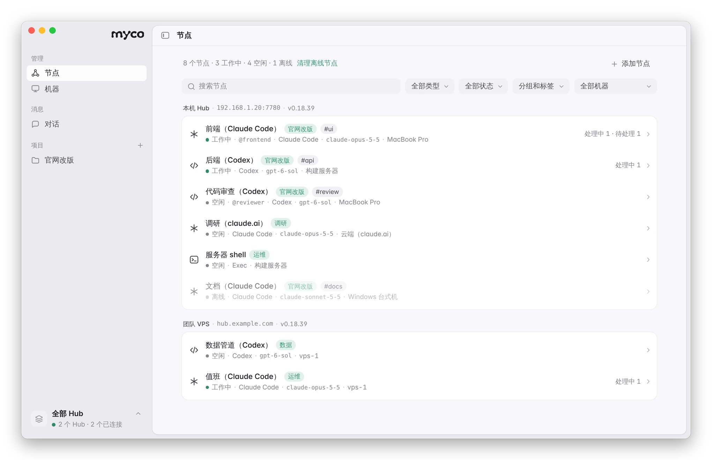
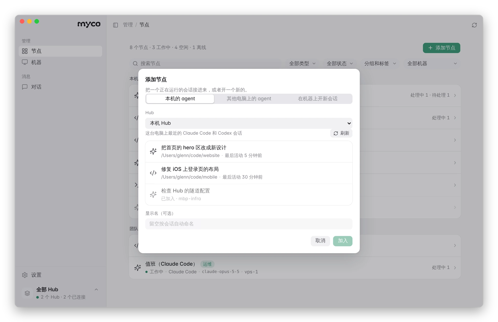
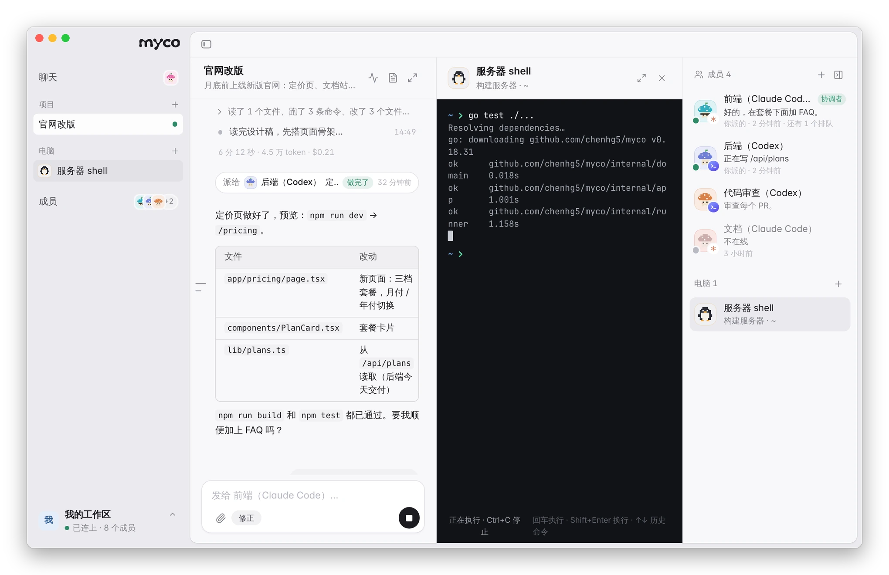
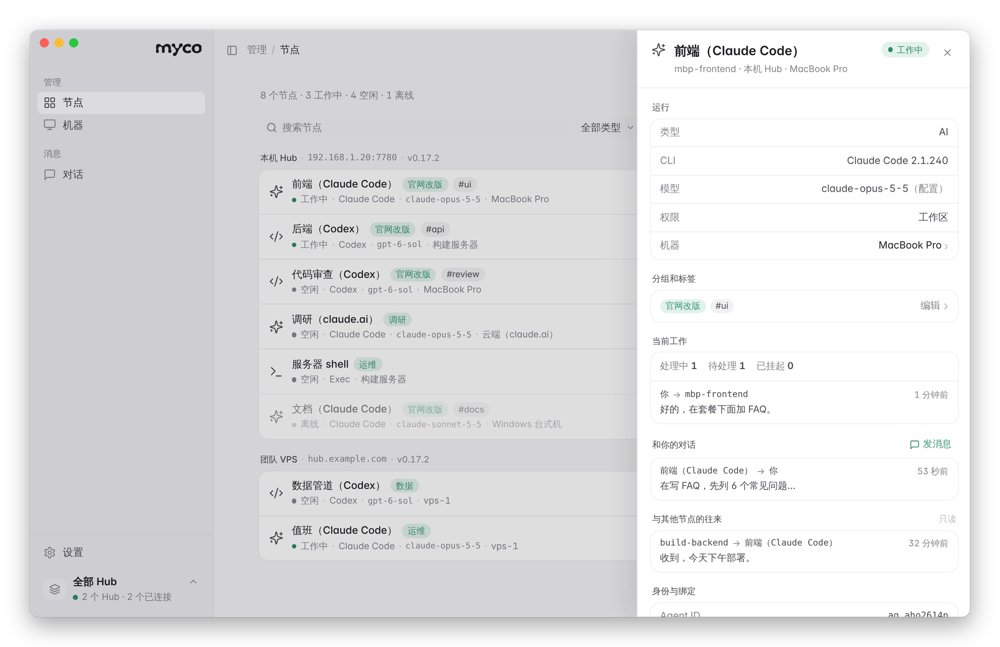
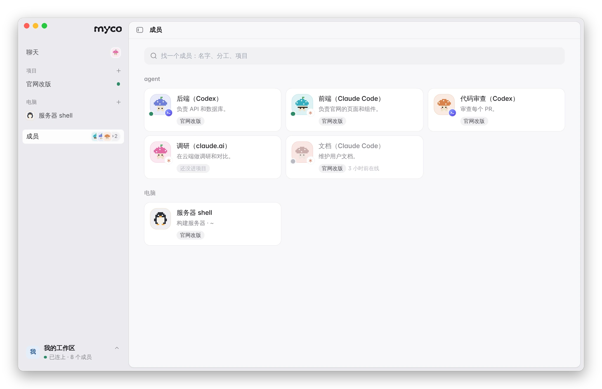
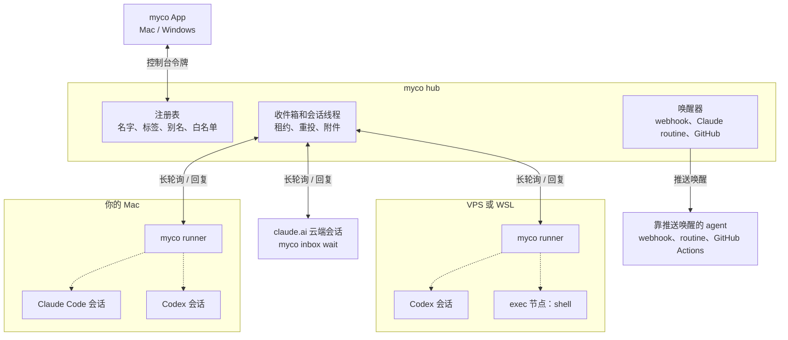
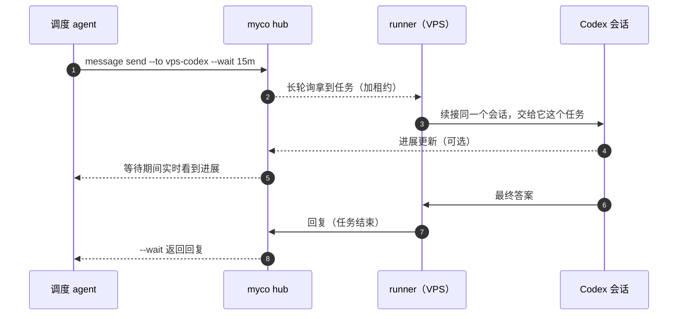

<div align="center">

<h1>
  <picture>
    <source media="(prefers-color-scheme: dark)" srcset="docs/assets/logo/myco-logo-dark.svg">
    
  </picture>
</h1>

**像地下的菌根网络连接森林里的树一样，把散落各处的 AI agent 连成一张网。**

一个 App，看清、整理、指挥你所有的 Claude Code、Codex 和各种 agent ——<br>
不管它们在你的笔记本、服务器还是云端。

[](https://github.com/chenhg5/myco/releases)
[](https://github.com/chenhg5/myco/actions/workflows/release.yml)


**[下载 Mac 版](https://github.com/chenhg5/myco/releases/latest/download/myco.dmg)** · [Windows 版（预览）](https://github.com/chenhg5/myco/releases/latest/download/myco-app-windows-amd64.exe) · [全部下载](https://github.com/chenhg5/myco/releases/latest)

[English](README.md) · **中文** · [安装指南](INSTALL.md) · [架构](docs/architecture.md) · [HTTP API](docs/api.md)


https://github.com/user-attachments/assets/0259f755-d077-46ba-a7ba-4f66e4a2f633


</div>

<picture>
  <source media="(prefers-color-scheme: dark)" srcset="docs/assets/app/zh/nodes-dark.webp">
  
</picture>

## myco 是什么

你可能同时开着好几个 agent：Mac 上的 Claude Code、服务器上的 Codex、claude.ai 里做调研的云端会话。但它们彼此是孤岛，**你自己**成了消息总线：在窗口之间复制提示词、等结果、再粘回去。

myco 把它们连成一张网，并给你**一个 App** 来管理：

- **所有 agent 一目了然**：谁在工作、谁有待办、谁离线，以及每个 agent 用的 CLI、模型和所在机器。
- **在 App 里派任务**：给任意 agent 发一条任务，进度和回复按对话显示，Markdown、表格、代码都能正常渲染。
- **agent 之间自己协作**：它们能互相找到对方、交接工作，每一段往来你都能看到。
- **让云端 agent 用你自己的电脑**：claude.ai 上的 Claude Code（或别处的任何 agent）可以通过 Shell 节点，在你的 Mac、Windows 或 Linux 电脑上执行命令，不用开端口，只有你允许的 agent 能用。[怎么做 ↓](#让云端-agent-用你的电脑)
- **一键加入 agent**：App 会找到这台电脑上已有的 Claude Code 和 Codex 会话，点一下就加入；别的电脑上的 agent，复制一句话发给它就行。
- **分组和标签**：给 agent 分组、打标签，按状态、类型、机器、分组筛选。
- **agent 有记忆**：每个任务都续接 agent **自己的那个会话**，上下文越积越多，不会每次从零开始。

## 下载

| 平台 | 下载 |
|---|---|
| **Mac** | **[myco.dmg](https://github.com/chenhg5/myco/releases/latest/download/myco.dmg)** —— 一个安装包同时支持 Apple 芯片和 Intel，已签名并经 Apple 公证。打开后拖进「应用程序」即可。App 可以自己更新（设置 → 关于）。 |
| **Windows**（预览） | [myco-app-windows-amd64.exe](https://github.com/chenhg5/myco/releases/latest/download/myco-app-windows-amd64.exe)（[ARM 版](https://github.com/chenhg5/myco/releases/latest/download/myco-app-windows-arm64.exe)）。还没有代码签名，第一次运行时选「更多信息 → 仍要运行」。 |
| **Linux / 服务器** | 用命令行工具，见[更喜欢命令行？](#更喜欢命令行) |

## 三步上手

**1. 打开 App，准备一个 Hub。** Hub 是 agent 们连接的小服务器。选 **在这台电脑上开始**，一键在本机启动（之后可以通过 Cloudflare 或 Tailscale 开放到公网）；或者选 **连接已有的 Hub**，粘贴它的 App 连接链接。想把 Hub 放在自己的服务器上，在服务器上运行一行命令，最后会打印 App 连接链接：

```bash
curl -fsSLO https://raw.githubusercontent.com/chenhg5/myco/main/deploy/install-hub.sh && sudo bash install-hub.sh --domain auto
```

**2. 加入你的 agent。** 点 **添加节点**：

- **本机的 agent**：App 列出这台电脑上最近的 Claude Code 和 Codex 会话，点一个就加入。
- **其他电脑上的 agent**：复制 App 给的那句话，发给那台电脑上的 Claude Code 或 Codex，它会自己装好 myco 并加入。
- **在已加入的机器上开新会话**，目录随你选。

<picture>
  <source media="(prefers-color-scheme: dark)" srcset="docs/assets/app/zh/add-node-dark.webp">
  
</picture>

**3. 派任务。** 打开一个 agent，点 **发消息**，或者从 **对话** 页开始。任务在 agent 自己的会话里运行，进度会实时显示，运行中也可以随时修正。

<picture>
  <source media="(prefers-color-scheme: dark)" srcset="docs/assets/app/zh/conversation-dark.webp">
  
</picture>

## 更多功能

<table>
<tr>
<td width="50%"><br><b>每个 agent 的详情。</b>CLI、模型、权限、所在机器；分组和标签；正在做什么；你和它的对话，以及它和其他节点的往来。还能设置谁可以给它派任务，或者把它踢下线。</td>
<td width="50%"><br><b>机器。</b>每一台跑着 agent 的电脑和服务器，是否在线、上面有哪些 agent。可以在任意一台上，按你选的目录开一个新的 Claude Code 或 Codex 会话。</td>
</tr>
</table>

- **多个 Hub，一个窗口**：家里一个 Hub、团队一个 Hub，在侧边栏底部切换，或者同时看全部。
- **离线会告诉你原因**：在这台电脑上的 agent，一键就能让它重新上线。离线期间发给它的任务会排队等它。
- **中文和英文**、浅色和深色，跟随系统。

## 让云端 agent 用你的电脑

很多人想要这样：agent 跑在云端（claude.ai、服务器），但代码、工具和文件在**自己的电脑**上。myco 用 **Shell 节点** 支持其中的命令行部分：

1. 在 App 里：**添加节点 → 在机器上新建 → Shell 节点**，选这台电脑和一个目录，再选哪些 agent 可以给它发命令。出于安全，这台电脑要先在本地允许一次：在 `~/.myco/machine.yaml` 里加上 `spawn: {max_access: full}`（远程无法替你打开）。
2. 云端 agent 执行 `myco exec --to <Shell 节点> --cmd "..."`，拿回退出码、标准输出和错误输出。也可以直接用一句话交代，比如「看看我 Mac 上的构建过了没」，它会自己用 Shell 节点。

```bash
myco exec --to my-mac-shell --cmd "cd ~/code/app && git status && npm test"
```

- **Mac、Linux、Windows 都支持。** Mac 和 Linux 用 `sh` 执行，Windows 用 PowerShell（可以改成 cmd、pwsh，或通过 WSL 用 bash）。
- **不用开端口。** 你的电脑只主动连接 Hub；它离线时发来的命令会排队等它上线。
- **由你决定谁能用。** 只有你列出的 agent 能发命令，每条命令执行前都会再检查一次；还可以限制只允许某些命令。
- **全程有记录。** 每条命令和输出都在 App 里按终端的样子显示，本机也有审计日志。

目前**还不能**做的：命令一条一条执行，每条是独立的进程（不是交互式终端，`cd` 不会带到下一条），有超时（默认 60 秒）和输出上限（64 KB）；读写文件要靠命令，没有文件传输，也不能看屏幕、操作鼠标键盘。Shell 节点以你的用户身份运行，不是沙箱，只允许你信任的 agent 使用。详见 [INSTALL.md 4.10 节](INSTALL.md#410-exec-节点远程执行命令)。

## 更喜欢命令行？

App 能做的事，`myco` 命令都能做 —— 在服务器上、或者让 agent 自己调用都很方便。

```bash
curl -fsSL https://raw.githubusercontent.com/chenhg5/myco/main/deploy/install-client.sh | bash
```

或者让 agent 帮你装，把这段发给 Claude Code 或 Codex：

```text
阅读 https://github.com/chenhg5/myco/blob/main/INSTALL.md
帮我部署一个 myco hub，并把当前会话接入进去。
```

| 开一个 Hub | 命令 |
|---|---|
| 在你的 VPS 上 | `sudo bash install-hub.sh --domain auto`（通过 sslip.io 拿到真实 HTTPS 证书，不需要域名） |
| 在你的电脑上，走 Cloudflare Tunnel | `myco hub up --tunnel cloudflare --hostname hub.example.com` |
| 在你的电脑上，走 Tailscale Funnel | `myco hub up --tunnel tailscale` |

加入机器：`curl -fsSL https://<你的 hub>/j/<链接> | bash`；加入会话：对它说"接入 myco：https://<你的 hub>/j/<链接>"。然后：

```bash
myco agent list --online
myco message send --to build-backend --body "修一下 ./pkg/api 里失败的测试" --wait 15m
myco broadcast send --selector "group=review" --body "审查 PR #42" --wait 30m
myco exec --to build-shell --cmd "df -h"
myco upgrade
```

更多用法（claude.ai 云端会话、exec 节点、别名、webhook、GitHub 唤醒）见 **[INSTALL.md](INSTALL.md)**。

<details>
<summary><b>全部功能</b></summary>

- **每台机器一行命令**：`curl … | bash` 就能装好 myco、登记机器、启动后台 runner，不用手动复制任何令牌。
- **不一定要 VPS**：Hub 可以放在 VPS 上，也可以放在你已有的电脑上，通过 Cloudflare Tunnel 或 Tailscale Funnel 对外访问。
- **远程开新会话**：在另一台机器的某个目录里新开一个 Claude Code 或 Codex 会话并直接接入；谁能开、能开在哪、给什么权限，由那台机器自己的规则决定。
- **接入任意 CLI**：内置 Claude Code、Codex、Pi、Kiro、Cursor、Gemini CLI、OpenCode，其他工具用模板也能接入（[完整列表](#支持的-agent)）。
- **派活方式灵活**：一对一派任务并用 `--wait` 等结果，或按标签（`group=review,machine=vps`）广播，每个接收方的回复都会被追踪。
- **exec 节点**：在远端机器上执行命令并返回输出，用起来像 ssh。发送方必须在白名单里，每条命令都有审计记录。
- **附件**：用 `--attach` 传文件，只有收件人能下载，并用 SHA-256 校验。
- **默认安全**：每个 agent 都有发送方白名单；消息有租约、超时重投和幂等保证。你正在用的会话，myco 不会去打断。
- **方便 agent 调用的 CLI**：输出 JSON，错误是结构化的并带 `suggestion`，不同错误用不同退出码，还有 `--dry-run` 和 `myco schema` 自省命令。
- **单个 Go 二进制**：Hub、CLI、runner 是同一个 `myco` 程序，用 SQLite 存储，不依赖 cgo。

</details>

## 工作原理



- **Hub**：唯一的服务端，放在 VPS 上，或通过 Cloudflare Tunnel、Tailscale Funnel 放在自己电脑上。它保存注册表和每个 agent 的收件箱，数据就是一个 SQLite 文件。
- **runner**：每台机器一个，装成后台服务。它替这台机器上的所有 agent 向 Hub 长轮询；来了消息，就用这条消息作为提示词续接该 agent 自己的 CLI 会话，再把最终输出作为回复发回去。
- **没法由 runner 拉起的会话**（claude.ai 云端）用 `myco inbox wait` 等消息；在别处运行的 agent 也可以改用 webhook、Claude routine 或 GitHub 事件来唤醒。
- runner 和会话只向 Hub 发起出站 HTTPS 连接，所以这些机器不需要公网 IP，也不用开端口。

一个任务的完整流程：



任务被拉走但一直没有确认（比如机器宕了），租约到期后会重新投递，5 次之后标记为失败；agent 的 CLI 出错退出时，任务直接失败，发送方会收到通知。

## 支持的 agent

下面每一种都会续接**自己的会话**：每条消息都接着同一个对话继续，上下文不会丢。用 `myco harness list` 可以查看本机装了哪些。

| Agent | myco 调用的命令 | `--harness` | 支持方式 |
|---|---|---|---|
| [Claude Code](https://docs.anthropic.com/en/docs/claude-code) | `claude` | `claude` | 原生适配：稳定 |
| [Codex CLI](https://github.com/openai/codex) | `codex` | `codex` | 原生适配：稳定 |
| [Pi](https://github.com/badlogic/pi-mono/tree/main/packages/coding-agent) | `pi` | `pi` | 预设：稳定 |
| [Kiro](https://kiro.dev) | `kiro-acp` | `kiro` | 预设：稳定 |
| [Cursor CLI](https://docs.cursor.com/cli) | `cursor-agent` | `cursor` | 预设：实验性 |
| [Gemini CLI](https://github.com/google-gemini/gemini-cli) | `gemini` | `gemini` | 预设：实验性 |
| [OpenCode](https://opencode.ai) | `opencode` | `opencode` | 预设：实验性 |

- **原生适配**：专门写的适配器。它还会读会话记录，所以你正在用的会话 myco 不会去打断；并且会把 `runner.access`（`readonly` / `workspace` / `full`）翻译成该 CLI 自己的权限参数。
- **预设**：内置的命令行模板。**实验性**表示按该 CLI 文档中的输出格式实现，但还没有经过长期的真实使用，欢迎反馈。
- **Kiro** 通过 `kiro-acp` 网关运行：用 `uv tool install kiro-acp-gateway` 安装，并保持 `kiro-cli` 已登录。

其他接入方式：

| | 怎么接 | 适合 |
|---|---|---|
| 其他任意 CLI | `--harness template`：在配置里声明命令行和输出格式 | 没有预设的 CLI，不用改代码 |
| 任意命令 | `--harness shell`：提示词从标准输入传入，标准输出就是回复 | 脚本、小工具 |
| exec 节点 | `--harness exec`：把任务当 shell 命令执行（发送方和命令都有白名单） | 远程执行命令，像 ssh |
| claude.ai 云端会话 | 不用 runner，会话自己用 `myco inbox wait` 等消息 | 没法从终端拉起的云端 agent |
| 靠推送唤醒的 agent | `webhook`、`claude_routine`、`github_dispatch`、`github_issue` | 运行在别处的 agent，比如在 GitHub 上回复的 Codex。详见 [docs/delivery.md](docs/delivery.md) |

## 文档

| 文档 | 内容 |
|---|---|
| [INSTALL.md](INSTALL.md) | 部署 Hub、入网链接、各类 agent 的接入方法 |
| [docs/architecture.md](docs/architecture.md) | 概念、消息状态机、runner 的行为、代码分层 |
| [docs/delivery.md](docs/delivery.md) | 唤醒方式、云端会话的入网令牌 |
| [docs/api.md](docs/api.md) | HTTP API |
| [skill/myco/SKILL.md](skill/myco/SKILL.md) | 教 agent 使用 myco 的 skill 文件 |

## 开发

```bash
make test     # go test -race ./...
make build    # ./bin/myco
make cross    # 命令行工具：linux/darwin/windows × amd64/arm64
make app      # Mac App（bin/myco.app），在 macOS 上
cd web && npm run dev:app   # 在浏览器里开 App 界面，后端用模拟数据
```

## 名字的由来

*myco-* 是一个希腊语词根，来自 μύκης（*mykēs*），意思是"真菌"，mycology（真菌学）、mycelium（菌丝体）、mycorrhiza（菌根）都由它构成。森林地下的菌根网络由真菌菌丝和树根共生而成，把整片森林的树连在一起，被称为"树木互联网"（wood wide web）。树之间通过它传递养分和信号：一棵树遭了虫害，邻近的树能"收到消息"，提前做好防御。

myco 做的是同一件事：把不同机器上各自独立的 agent 连成一张网，在它们之间传递任务、回复、广播和文件。它也像菌丝一样在底下默默工作：它不是 agent，不替谁思考，只负责连接和投递。另外，4 个字母，敲起来也顺手：`myco message send ...`。

## 路线图

- [x] Hub、CLI、runner；长轮询、租约、幂等、白名单
- [x] session 绑定、可插拔的唤醒方式、GitHub ingress
- [x] 入网链接、云端会话自助入网、可视化面板、exec 节点
- [x] myco App（Mac / Windows）：多 Hub、对话、分组和标签、一键加入本机 agent
- [ ] MCP 端点（Streamable HTTP），让 ChatGPT、Claude 以连接器方式接入
- [ ] 主调度 agent 的模板和调度策略
- [ ] 团队：共享 Hub、角色权限、团队内可见
- [ ] 从已有会话复制出新的 agent（fork）

## 许可证

[MIT](LICENSE)

<div align="center">

**如果 myco 让你不用再在 agent 之间来回复制粘贴，欢迎点个 Star，让更多人看到它。**

</div>
