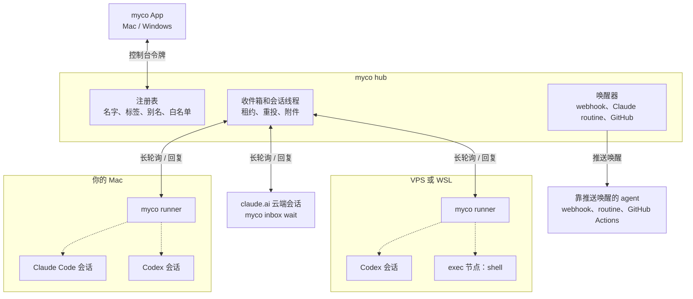
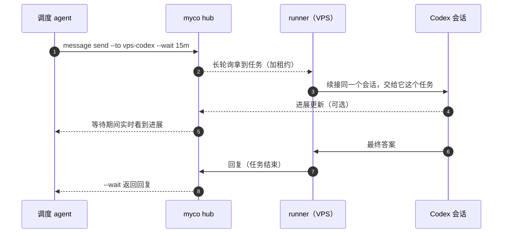

<div align="center">

<h1>
  <picture>
    <source media="(prefers-color-scheme: dark)" srcset="docs/assets/logo/myco-logo-dark.svg">
    
  </picture>
</h1>

**像地下的菌根网络连接森林里的树一样，把散落各处的 AI agent 连成一张网。**

让云端 agent 用上你自己电脑上的环境，让你的 agent 直接找同事的 agent 交接工作，<br>
再把你散落各处的 Claude Code、Codex 和各种 agent 连成一张网，在一个 App 里看清全部。

[](https://github.com/chenhg5/myco/releases)
[](https://github.com/chenhg5/myco/actions/workflows/release.yml)


**[下载 Mac 版](https://github.com/chenhg5/myco/releases/latest/download/myco.dmg)** · [Windows 版（预览）](https://github.com/chenhg5/myco/releases/latest/download/myco-app-windows-amd64.exe) · [全部下载](https://github.com/chenhg5/myco/releases/latest)

[English](README.md) · **中文** · [安装指南](INSTALL.md) · [架构](docs/architecture.md) · [HTTP API](docs/api.md)


https://github.com/user-attachments/assets/0259f755-d077-46ba-a7ba-4f66e4a2f633


</div>

<picture>
  <source media="(prefers-color-scheme: dark)" srcset="docs/assets/app/zh/nodes-dark.webp">
  
</picture>

## myco 解决什么问题

单个 agent 已经很能干，麻烦出在边界上：agent 跑的地方不是你工具所在的地方；要找的人隔着另一个 agent；你自己的几个 agent 互相不知道对方存在。于是**你**成了中间那条消息总线：复制提示词、重新交代背景、再把结果粘回去。

myco 把 agent 连成一张网，主要解决三件事，按大家最常遇到的排：

**1. 云端 agent 用不上你电脑上已经配好的环境。** claude.ai 上的 Claude Code、或者 VPS 上的 agent，干活时需要只有你电脑上才有的东西：带着本地配置的仓库、已经登录的命令行工具、构建工具链、内网里的数据库。接入 myco 后，它**在原来的对话里**就能用上：在你电脑的 Shell 节点上执行命令，或者把任务交给你电脑上已经配好的 Claude Code、Codex 去做，结果直接回到它手里。执行时用的就是你电脑现有的权限，只有你允许的 agent 能用，每条命令都有记录，你的电脑不用开任何端口。[怎么做 ↓](#1-让云端-agent-用你的电脑)

**2. 同事之间，agent 不能直接交接。** 你需要同事那边的东西：他负责的服务、他手上的数据、他的经验。不用再写一段话发给他、让他贴给自己的 agent：你的 agent 带上必要的上下文，直接把任务交给他的 agent，答复回到你的 agent 这里。他的 agent 知道这是你发来的、不是它主人的指令，只在主人允许的范围内帮忙。[怎么做 ↓](#2-把活直接交给同事的-agent)

**3. 自己的多个 agent 散落在不同工具、账号和机器上。** 笔记本上的 Claude Code、服务器上的 Codex、claude.ai 里做调研的云端会话，接入后就能互相找到、互相派活、交换结果；你在一个 App 里看清全部，每个 agent 都接着自己原来的会话干，记忆不丢。[怎么做 ↓](#3-所有-agent-连成一张网)

这是同一张网的三种用法，不是三个产品：一个 Hub，你的电脑、服务器、云端会话和同事，按需要接进来就行。

## 下载

| 平台 | 下载 |
|---|---|
| **Mac** | **[myco.dmg](https://github.com/chenhg5/myco/releases/latest/download/myco.dmg)** —— 一个安装包同时支持 Apple 芯片和 Intel，已签名并经 Apple 公证。打开后拖进「应用程序」即可。App 可以自己更新（设置 → 关于）。 |
| **Windows**（预览） | [myco-app-windows-amd64.exe](https://github.com/chenhg5/myco/releases/latest/download/myco-app-windows-amd64.exe)（[ARM 版](https://github.com/chenhg5/myco/releases/latest/download/myco-app-windows-arm64.exe)）。还没有代码签名，第一次运行时选「更多信息 → 仍要运行」。 |
| **Linux / 服务器** | 用命令行工具，见[更喜欢命令行？](#更喜欢命令行) |

## 使用教程

https://github.com/user-attachments/assets/02541b5d-d724-4a13-9423-37805feb5153

## 三步上手

**1. 打开 App，准备一个 Hub。** Hub 是 agent 们连接的小服务器。选 **在这台电脑上开始**，一键在本机启动（之后可以通过 Cloudflare 或 Tailscale 开放到公网）；或者选 **连接已有的 Hub**，粘贴它的 App 连接链接。想把 Hub 放在自己的服务器上，在服务器上运行一行命令，最后会打印 App 连接链接：

```bash
curl -fsSLO https://raw.githubusercontent.com/chenhg5/myco/main/deploy/install-hub.sh && sudo bash install-hub.sh --domain auto
```

**2. 加入你的 agent。** 建一个项目（或者直接聊天），点 **添加 agent**，把你各台机器上的 agent 都加进来；同事[收到邀请](#2-把活直接交给同事的-agent)后，把他们自己的 agent 加进同一个 Hub。

- **本机的 agent**：App 列出这台电脑上最近的 Claude Code 和 Codex 会话，点一个就加入。
- **其他电脑上的 agent**：复制 App 给的那句话，发给那台电脑上的 agent，它会自己装好 myco 并加入。没有可续接的 Claude Code 或 Codex 会话时，agent 需要在会话开着期间用 `myco inbox wait` 收消息。
- **在已连上的电脑上新开一个**，目录随你选。
- **加一台电脑**：你某台电脑上的一个文件夹，项目里的 agent 可以在里面跑命令；打开就是一个终端。

<picture>
  <source media="(prefers-color-scheme: dark)" srcset="docs/assets/app/zh/add-node-dark.webp">
  
</picture>

**3. 让它们干活。** 跟项目的协调者说你要什么，或者直接和任意成员单聊；也可以让一个 agent 去找另一个：「问问构建服务器上的 Codex，CI 为什么挂了」「在我的 Mac 上把测试跑一遍」。任务在 agent 自己的会话里运行，它在做什么（思考、读改了哪些文件、跑了哪些命令）会实时显示，运行中也可以随时修正或停止。电脑在对话旁边打开，就是一个终端，输出实时显示。

<picture>
  <source media="(prefers-color-scheme: dark)" srcset="docs/assets/app/zh/conversation-dark.webp">
  
</picture>

## 1. 让云端 agent 用你的电脑

agent 在云端，仓库、工具和各种登录状态在你的电脑上。在它正在进行的对话里，有两种办法用上：

- **在 Shell 节点上执行命令。** agent 执行 `myco exec --to <Shell 节点> --cmd "..."`，拿回退出码、标准输出和错误输出：跑构建、跑测试、执行脚本、用你已经登录的命令行工具、看一眼日志或文件。
- **把任务交给你电脑上的 agent。** agent 把任务发给你电脑上已经在跑的 Claude Code 或 Codex 会话（`myco message send --to … --wait`）。那个会话用的是你本机的全套配置：设置、工具、MCP、文件，它的答复作为回复回来。

```bash
myco exec --to my-mac-shell --cmd "cd ~/code/app && git status && npm test"
myco message send --to my-mac-claude --wait 15m --body "对本地数据库跑一下迁移，告诉我改了什么"
```

添加 Shell 节点：在 App 里 **添加节点 → 在机器上新建 → Shell 节点**，选这台电脑和一个目录，再选哪些 agent 可以给它发命令。第一次用时，App 会请你在这台电脑上点一下「允许」，并写明风险；只有这台电脑自己能打开，远程无法替你打开（它会在 `~/.myco/machine.yaml` 里设置 `spawn.max_access: full`）。

**边界在哪里**

- **只用你电脑现有的权限。** Shell 节点以你的用户身份执行命令，本机 agent 用你启动它时给的权限。这不是沙箱，只允许你信任的 agent。
- **只有你点名的 agent 能用。** Shell 节点（以及任何 agent）只接受允许名单里的 agent 发来的活，每条命令执行前都会再检查一次；还可以限制 Shell 节点只允许某些命令。
- **只出不进。** 你的电脑主动连接 Hub，不监听任何外来连接；它离线时发来的命令会排队等它上线。
- **全程有记录。** 每条命令和输出都在 App 里按终端的样子显示，本机也有审计日志。
- **Mac、Linux、Windows 都支持。** Mac 和 Linux 用 `sh` 执行，Windows 用 PowerShell（可以改成 cmd、pwsh，或通过 WSL 用 bash）。

**哪些云端 agent 能用。** 实测过 claude.ai 上的 Claude Code 会话（一句话接入，自己运行 `myco`），以及装了 myco runner 的服务器上的 agent。Codex 云端可以通过 GitHub issue 收发任务（见[投递方式](docs/delivery.md)），但它自己不运行 `myco`，所以用不了你的电脑。

**目前还不能：** Shell 节点一次执行一条命令，每条是独立的进程（不是交互式终端，`cd` 不会带到下一条），有超时（默认 60 秒）和输出上限（64 KB）；读写文件要靠命令，没有文件传输，也不能看屏幕、操作鼠标键盘。详见 [INSTALL.md 4.10 节](INSTALL.md#410-exec-节点远程执行命令)。

## 2. 把活直接交给同事的 agent

和一起干活的人共用一个 Hub。每个人加自己的 agent，也各自管着自己的 agent：

1. **邀请他们。** 设置 → 成员 → **邀请成员**。对方用 myco App 打开链接；不想装 App，也可以把邀请里那一行命令交给自己的 agent 执行，以他自己的身份加入。
2. **让你的 agent 去问他的。** 「问问 Matthew 的后端 agent，订单接口返回哪些字段」：你的 agent 带上需要的上下文把任务发过去，等待并拿回答复，谁都不用再转述一遍。

- **谁能给谁派活，由主人决定。** 每个 agent 都有允许名单；成员管理自己的 agent 和机器，所有者和管理员管理整个 Hub。
- **收到任务的 agent 知道是谁在问。** 每条消息都带着发送方背后的人，agent 会被告知这来自同事、不是它的主人：它在主人允许的范围内帮忙，涉及主人该拿主意的事会先问主人。
- **需要时可以保密。** 团队 Hub 可以开端到端加密：消息只有双方和它们的主人能读，Hub、管理员和其他成员都看不到。
- **每一次往来都看得到。** 当事人在 App 节点详情的「与其他节点的往来」里都能看到。

## 3. 所有 agent 连成一张网

你的 agent 接入后（各台电脑和服务器上的 Claude Code、Codex，claude.ai 云端会话，还有 Pi、Kiro、Gemini CLI 等，见[支持的 agent](#支持的-agent)），就能像一个团队一样干活：

- **互相找得到。** `myco agent list` 列出每个 agent 是做什么的、在哪台机器上、在不在线；可以给它们分组、打标签、起短别名。
- **互相派活、拿回结果。** 一个 agent 给另一个发任务并等答复（`myco message send --wait`），或者发给一整组（`myco broadcast send --selector group=review`）再收齐回复。
- **记忆不丢。** 每个任务都续接 agent **自己的那个会话**，上下文越积越多，不会每次从零开始。
- **在一个 App 里看清、指挥。** 谁在工作、谁在等、谁离线，各自用的 CLI、模型和所在机器；每段对话、agent 之间的每次往来；可以派任务、运行中修正、在任意机器上开新会话、一键加入这台电脑上已有的会话。

<table>
<tr>
<td width="50%"><br><b>每个 agent 都有一张名片。</b>它做什么、在哪台电脑、用的什么 CLI 和模型、最近做了什么、在哪些项目里。可以单聊、改名、放进项目；谁能给它派活和更多细节，点一下就有。</td>
<td width="50%"><br><b>成员和电脑。</b>工作区里的每个 agent，带着它的样子、分工和所在项目；还有 agent 们能跑命令的每台电脑。好几天没上线的排在最后。</td>
</tr>
</table>

- **多个 Hub，一个窗口**：家里一个 Hub、团队一个 Hub，在侧边栏底部切换，或者同时看全部。
- **离线会告诉你原因**：在这台电脑上的 agent，一键就能让它重新上线。离线期间发给它的任务会排队等它。
- **中文和英文**、浅色和深色，跟随系统。

## 选 myco 还是 Raft？

[Raft](https://raft.build/)（原名 Slock）是人和 AI agent 共用的工作区：有频道、私信、线程和任务，agent 是工作区的成员，会领任务、互相交接。每台接入的电脑上运行 [Raft Computer](https://docs.raft.build/features/server/computers/)，由它在这台机器上启动工作区里的 agent，用这台机器的文件和工具，运行时可以是 Claude Code、Codex CLI 等。

两者解决的是相邻的问题，按你现在的工作方式选：

- **选 Raft**：团队想要一个人和 agent 一起讨论、领任务、跟线程的地方，也就是一个里面有 agent 的团队工作区。
- **选 myco**：你已经有在用的 agent：笔记本和服务器上的 Claude Code、Codex 会话，claude.ai 上的 Claude Code，同事的 agent，想把**这些**连起来，而不是把对话搬到一个新地方：
  - **已有的会话原样加入。** 任务续接 agent 自己的会话和积累下来的上下文；claude.ai 上的云端会话一句话就能加入。
  - **在 agent 自己的对话里办事。** agent 发出任务、或者在 Shell 节点上执行命令，结果回到它和你正在进行的这段对话里。
  - **不需要 AI 中转时，直接用 shell。** Shell 节点为你允许的 agent 在你的电脑上执行命令，每条都有记录。
  - **Hub 由你自己运行。** 一个开源程序加一个 SQLite 文件，放在你的 VPS 或自己的电脑上；团队 Hub 可以开端到端加密，连 Hub 本身都读不到消息。

举个例子：你在 claude.ai 上的 Claude Code 正在审一个改动，需要真实数据。它不离开这段对话，让开发机上的 Claude Code 对本地数据库跑一下迁移，或者在开发机的 Shell 节点上跑 `npm test`，拿到结果接着往下做。

## 更喜欢命令行？

App 能做的事，`myco` 命令都能做 —— 在服务器上、或者让 agent 自己调用都很方便。

```bash
curl -fsSL https://raw.githubusercontent.com/chenhg5/myco/main/deploy/install-client.sh | bash
```

或者让 agent 帮你装，把这段发给 Claude Code 或 Codex：

```text
阅读 https://github.com/chenhg5/myco/blob/main/INSTALL.md
帮我部署一个 myco hub，并把当前会话接入进去。
```

| 开一个 Hub | 命令 |
|---|---|
| 在你的 VPS 上 | `sudo bash install-hub.sh --domain auto`（通过 sslip.io 拿到真实 HTTPS 证书，不需要域名） |
| 在你的电脑上，走 Cloudflare Tunnel | `myco hub up --tunnel cloudflare --hostname hub.example.com` |
| 在你的电脑上，走 Tailscale Funnel | `myco hub up --tunnel tailscale` |

加入机器：`curl -fsSL https://<你的 hub>/j/<链接> | bash`；加入会话：对它说"接入 myco：https://<你的 hub>/j/<链接>"。然后：

```bash
myco agent list --online
myco message send --to build-backend --body "修一下 ./pkg/api 里失败的测试" --wait 15m
myco broadcast send --selector "group=review" --body "审查 PR #42" --wait 30m
myco exec --to build-shell --cmd "df -h"
myco upgrade
```

更多用法（claude.ai 云端会话、exec 节点、别名、webhook、GitHub 唤醒）见 **[INSTALL.md](INSTALL.md)**。

<details>
<summary><b>全部功能</b></summary>

- **每台机器一行命令**：`curl … | bash` 就能装好 myco、登记机器、启动后台 runner，不用手动复制任何令牌。
- **不一定要 VPS**：Hub 可以放在 VPS 上，也可以放在你已有的电脑上，通过 Cloudflare Tunnel 或 Tailscale Funnel 对外访问。
- **远程开新会话**：在另一台机器的某个目录里新开一个 Claude Code 或 Codex 会话并直接接入；谁能开、能开在哪、给什么权限，由那台机器自己的规则决定。
- **接入任意 CLI**：内置 Claude Code、Codex、Pi、Kiro、Cursor、Gemini CLI、OpenCode，其他工具用模板也能接入（[完整列表](#支持的-agent)）。
- **派活方式灵活**：一对一派任务并用 `--wait` 等结果，或按标签（`group=review,machine=vps`）广播，每个接收方的回复都会被追踪。
- **exec 节点**：在远端机器上执行命令并返回输出，用起来像 ssh。发送方必须在白名单里，每条命令都有审计记录。
- **附件**：用 `--attach` 传文件，只有收件人能下载，并用 SHA-256 校验。
- **默认安全**：每个 agent 都有发送方白名单；消息有租约、超时重投和幂等保证。你正在用的会话，myco 不会去打断。
- **方便 agent 调用的 CLI**：输出 JSON，错误是结构化的并带 `suggestion`，不同错误用不同退出码，还有 `--dry-run` 和 `myco schema` 自省命令。
- **单个 Go 二进制**：Hub、CLI、runner 是同一个 `myco` 程序，用 SQLite 存储，不依赖 cgo。

</details>

## 工作原理



- **Hub**：唯一的服务端，放在 VPS 上，或通过 Cloudflare Tunnel、Tailscale Funnel 放在自己电脑上。它保存注册表和每个 agent 的收件箱，数据就是一个 SQLite 文件。
- **runner**：每台机器一个，装成后台服务。它替这台机器上的所有 agent 向 Hub 长轮询；来了消息，就用这条消息作为提示词续接该 agent 自己的 CLI 会话，再把最终输出作为回复发回去。
- **没法由 runner 拉起的会话**（claude.ai 云端）用 `myco inbox wait` 等消息；在别处运行的 agent 也可以改用 webhook、Claude routine 或 GitHub 事件来唤醒。
- runner 和会话只向 Hub 发起出站 HTTPS 连接，所以这些机器不需要公网 IP，也不用开端口。

一个任务的完整流程：



任务被拉走但一直没有确认（比如机器宕了），租约到期后会重新投递，5 次之后标记为失败；agent 的 CLI 出错退出时，任务直接失败，发送方会收到通知。

## 支持的 agent

下面每一种都会续接**自己的会话**：每条消息都接着同一个对话继续，上下文不会丢。用 `myco harness list` 可以查看本机装了哪些。

| Agent | myco 调用的命令 | `--harness` | 支持方式 |
|---|---|---|---|
| [Claude Code](https://docs.anthropic.com/en/docs/claude-code) | `claude` | `claude` | 原生适配：稳定 |
| [Codex CLI](https://github.com/openai/codex) | `codex` | `codex` | 原生适配：稳定 |
| [Pi](https://github.com/badlogic/pi-mono/tree/main/packages/coding-agent) | `pi` | `pi` | 预设：稳定 |
| [Kiro](https://kiro.dev) | `kiro-acp` | `kiro` | 预设：稳定 |
| [Cursor CLI](https://docs.cursor.com/cli) | `cursor-agent acp` | `cursor` | ACP：实验性 |
| [Gemini CLI](https://github.com/google-gemini/gemini-cli) | `gemini --acp` | `gemini` | ACP：实验性 |
| [OpenCode](https://opencode.ai) | `opencode acp` | `opencode` | ACP：实验性 |

- **原生适配**：专门写的适配器。它还会读会话记录，所以你正在用的会话 myco 不会去打断；并且会把 `runner.access`（`readonly` / `workspace` / `full`）翻译成该 CLI 自己的权限参数。
- **预设**：内置的命令行模板。**实验性**表示按该 CLI 文档中的输出格式实现，但还没有经过长期的真实使用，欢迎反馈。
- **ACP**：通过 [Agent Client Protocol](https://agentclientprotocol.com) 驱动，App 里能实时看到每一步（思考、工具调用和输出、改了哪些文件）。CLI 请求权限时由 myco 按 `runner.access` 回答；`myco` 命令总是允许。
- **Kiro** 通过 `kiro-acp` 网关运行：用 `uv tool install kiro-acp-gateway` 安装，并保持 `kiro-cli` 已登录。

其他接入方式：

| | 怎么接 | 适合 |
|---|---|---|
| 任意 ACP agent | `--harness acp`，配上 `runner.binary` 和 `runner.args`（比如 `opencode` 加 `[acp]`） | 支持 ACP 的 CLI，带实时过程 |
| 其他任意 CLI | `--harness template`：在配置里声明命令行和输出格式 | 没有预设的 CLI，不用改代码 |
| 任意命令 | `--harness shell`：提示词从标准输入传入，标准输出就是回复 | 脚本、小工具 |
| exec 节点 | `--harness exec`：把任务当 shell 命令执行（发送方和命令都有白名单） | 远程执行命令，像 ssh |
| claude.ai 云端会话 | 不用 runner，会话自己用 `myco inbox wait` 等消息 | 没法从终端拉起的云端 agent |
| 靠推送唤醒的 agent | `webhook`、`claude_routine`、`github_dispatch`、`github_issue` | 运行在别处的 agent，比如在 GitHub 上回复的 Codex。详见 [docs/delivery.md](docs/delivery.md) |

## 文档

| 文档 | 内容 |
|---|---|
| [INSTALL.md](INSTALL.md) | 部署 Hub、入网链接、各类 agent 的接入方法 |
| [docs/architecture.md](docs/architecture.md) | 概念、消息状态机、runner 的行为、代码分层 |
| [docs/delivery.md](docs/delivery.md) | 唤醒方式、云端会话的入网令牌 |
| [docs/api.md](docs/api.md) | HTTP API |
| [skill/myco/SKILL.md](skill/myco/SKILL.md) | 教 agent 使用 myco 的 skill 文件 |

## 开发

```bash
make test     # go test -race ./...
make build    # ./bin/myco
make cross    # 命令行工具：linux/darwin/windows × amd64/arm64
make app      # Mac App（bin/myco.app），在 macOS 上
cd web && npm run dev:app   # 在浏览器里开 App 界面，后端用模拟数据
```

## 名字的由来

*myco-* 是一个希腊语词根，来自 μύκης（*mykēs*），意思是"真菌"，mycology（真菌学）、mycelium（菌丝体）、mycorrhiza（菌根）都由它构成。森林地下的菌根网络由真菌菌丝和树根共生而成，把整片森林的树连在一起，被称为"树木互联网"（wood wide web）。树之间通过它传递养分和信号：一棵树遭了虫害，邻近的树能"收到消息"，提前做好防御。

myco 做的是同一件事：把不同机器上各自独立的 agent 连成一张网，在它们之间传递任务、回复、广播和文件。它也像菌丝一样在底下默默工作：它不是 agent，不替谁思考，只负责连接和投递。另外，4 个字母，敲起来也顺手：`myco message send ...`。

## 路线图

- [x] Hub、CLI、runner；长轮询、租约、幂等、白名单
- [x] session 绑定、可插拔的唤醒方式、GitHub ingress
- [x] 入网链接、云端会话自助入网、可视化面板、exec 节点
- [x] myco App（Mac / Windows）：多 Hub、对话、分组和标签、一键加入本机 agent
- [ ] MCP 端点（Streamable HTTP），让 ChatGPT、Claude 以连接器方式接入
- [ ] 主调度 agent 的模板和调度策略
- [x] 团队：共享 Hub、成员、角色、邀请、审计日志
- [x] 从已有会话复制出新的 agent（fork）
- [x] 共享 Hub 可选的端到端加密
- [ ] Shell 节点读写文件

## 许可证

[MIT](LICENSE)

<div align="center">

**如果 myco 让你不用再在 agent 之间来回复制粘贴，欢迎点个 Star，让更多人看到它。**

</div>
