# Apps

**English** · [中文](apps.zh-CN.md) · [README](../README.md)

We are rebuilding the apps people use every day on Mac, Windows and phone so that **agents can use them too**. You and your agent work on the same page: the agent fills it in or edits it, and you see the change live. Open them in the myco app under **Apps**; new ones arrive release by release.

This is part of **[Rebuild 100 great apps with agents, free and open, always improving](open-apps.md)**: why we are doing it, what we stand by, how to nominate the next app and how to build one yourself.

Apps that need the computer itself (files, the screen, the microphone, the network) ask it through the myco app; see [`myco.os`](app-os.md). Recordings, photos and videos stay on the computer that opened them.

## Creative

<table>
<tr>
<td width="50%"><picture><source media="(prefers-color-scheme: dark)" srcset="assets/apps/motion-dark.webp">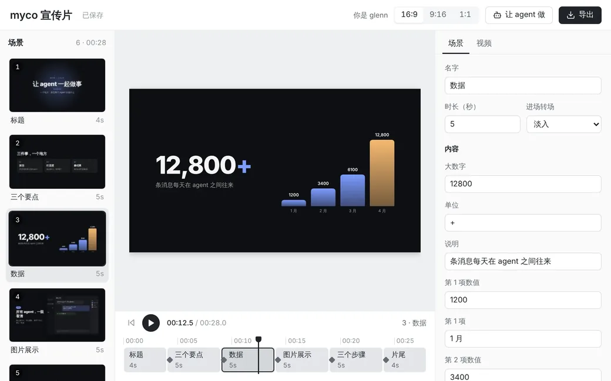</picture> <b>Motion video</b> Promo clips, data recaps and vertical shorts: start from a template or describe it and the agent writes each scene (HTML and animation). Comment at a point in time for changes, remake from a reference video, add music and voice-over with captions, export MP4 on your computer.</td>
<td width="50%"><picture><source media="(prefers-color-scheme: dark)" srcset="assets/apps/design-studio-dark.webp">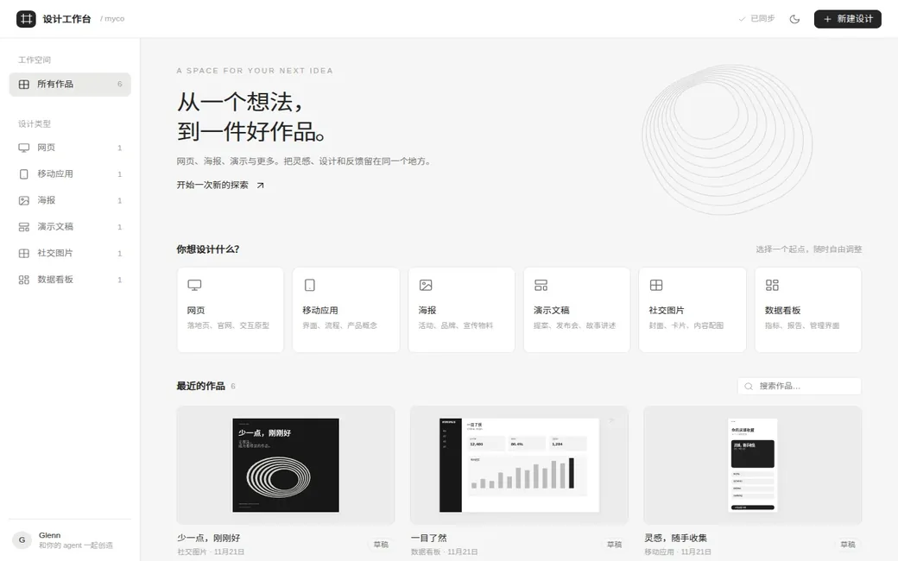</picture> <b>Design studio</b> From a design brief to the finished piece: web pages, app screens, posters, slides, social images and dashboards. Edit on a canvas with layers, preview HTML prototypes, collect feedback, keep versions, export SVG, PNG or HTML.</td>
</tr>
<tr>
<td width="50%"><picture><source media="(prefers-color-scheme: dark)" srcset="assets/apps/photo-dark.webp">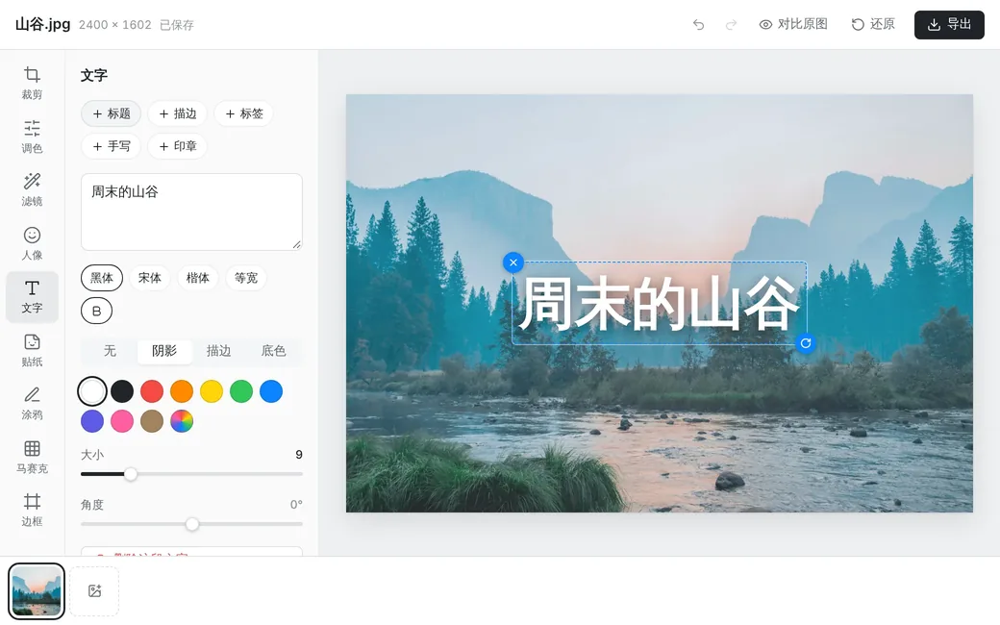</picture> <b>Photo editor</b> Crop and rotate, adjust colour, a dozen filters, retouching, text, stickers, doodles, mosaic and frames; hold to compare with the original. Photos stay on the computer that opened them; the agent can make the edits you describe.</td>
<td width="50%"><picture><source media="(prefers-color-scheme: dark)" srcset="assets/apps/video-dark.webp">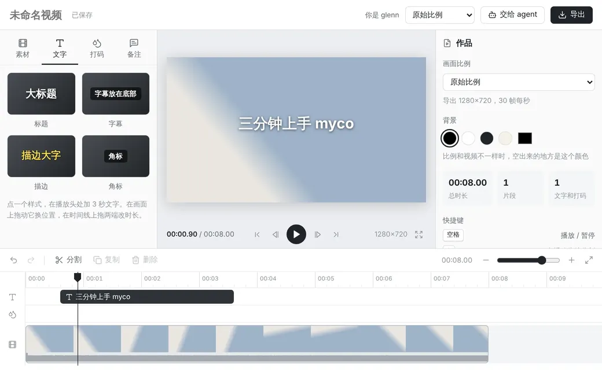</picture> <b>Video editor</b> Import an MP4, split, trim, reorder and change speed on a timeline, add text, blur faces and number plates, export MP4 on your computer. The agent edits from your notes.</td>
</tr>
<tr>
<td width="50%"><picture><source media="(prefers-color-scheme: dark)" srcset="assets/apps/recorder-dark.webp">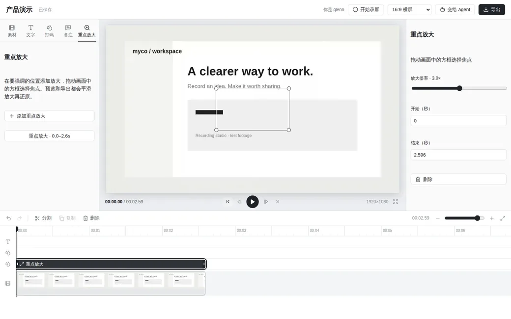</picture> <b>Screen recorder</b> Record the screen, then trim, split, add text and zoom in on what matters, and export MP4 on your computer. The edit plan can be shared with an agent.</td>
<td width="50%"><picture><source media="(prefers-color-scheme: dark)" srcset="assets/apps/mindmap-dark.webp">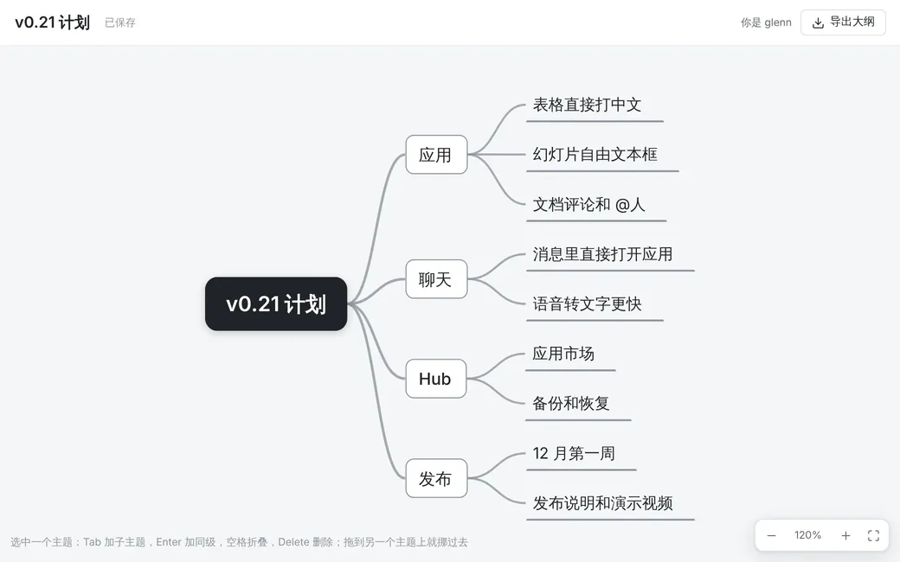</picture> <b>Mind map</b> The agent writes an outline and the page draws it as a mind map: Tab adds a child, Enter a sibling, drag to move, fold branches, export a Markdown outline.</td>
</tr>
<tr>
<td width="50%"><picture><source media="(prefers-color-scheme: dark)" srcset="assets/apps/whiteboard-dark.webp">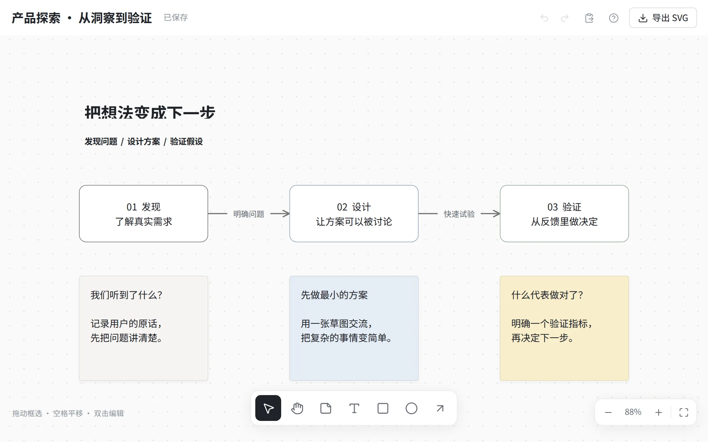</picture> <b>Whiteboard</b> An endless canvas with sticky notes, text, shapes and connectors. The agent can add notes too: good for brainstorms, retros and flowcharts.</td>
<td width="50%"></td>
</tr>
</table>

## Office

<table>
<tr>
<td width="50%"><picture><source media="(prefers-color-scheme: dark)" srcset="assets/apps/doc-dark.webp">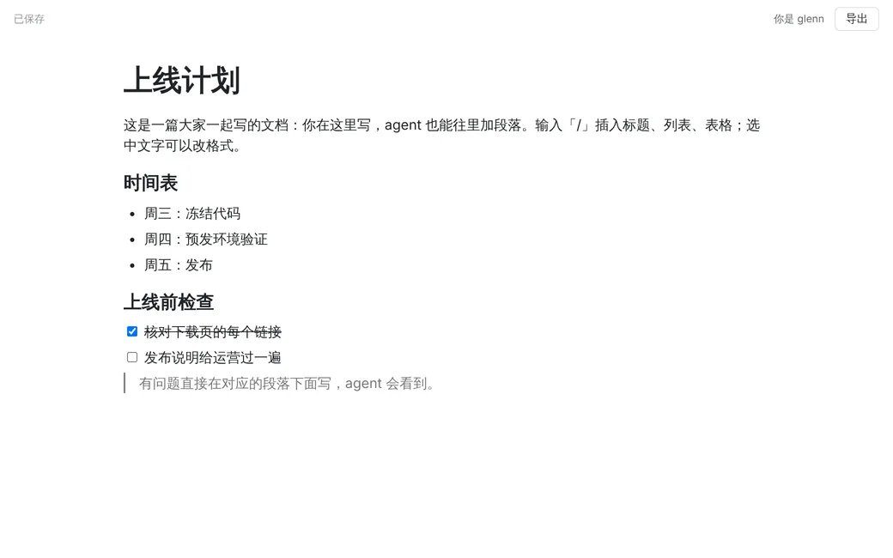</picture> <b>Document</b> Write together like in Feishu Docs: '/' inserts headings, lists, to-dos, tables and code; each paragraph saves on its own; export Markdown or HTML.</td>
<td width="50%"><picture><source media="(prefers-color-scheme: dark)" srcset="assets/apps/table-dark.webp">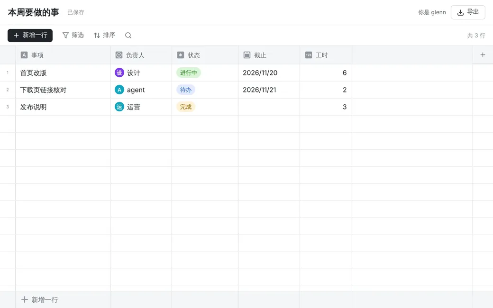</picture> <b>Table</b> A spreadsheet to fill in together: typed columns (tags, dates, people), copy and paste from Excel, fill down, filter, sort, export Excel or CSV.</td>
</tr>
<tr>
<td width="50%"><picture><source media="(prefers-color-scheme: dark)" srcset="assets/apps/base-dark.webp">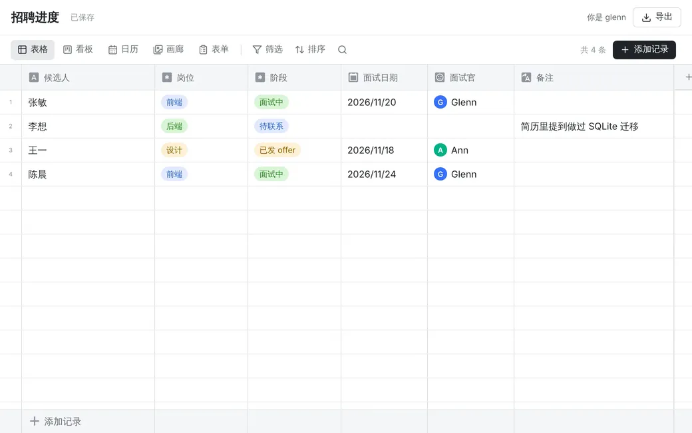</picture> <b>Database</b> One set of records as a table, board, calendar, gallery or form, like Feishu Base: typed fields, filters and sorting, details on the side, export Excel.</td>
<td width="50%"><picture><source media="(prefers-color-scheme: dark)" srcset="assets/apps/slides-dark.webp">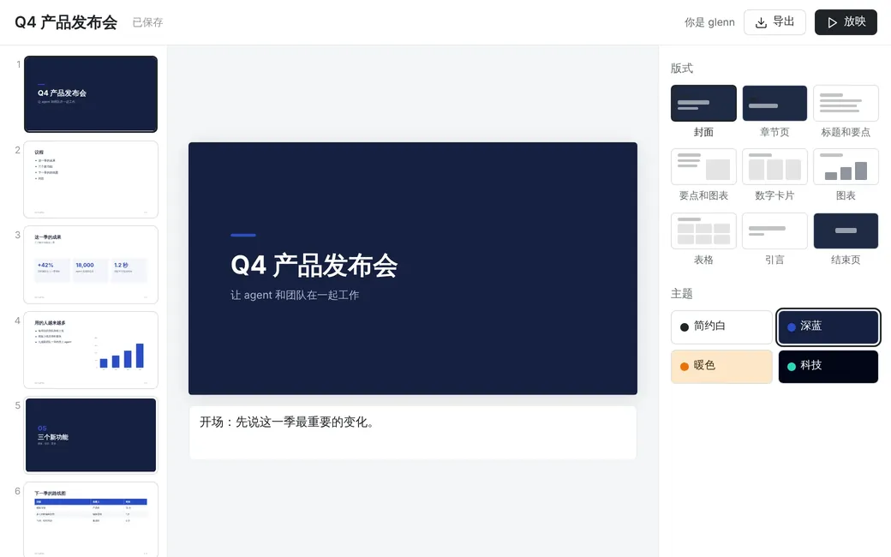</picture> <b>Slides</b> The agent writes the content and the page lays it out: covers, key points, charts, number cards, tables, quotes. Edit in place, reorder, present full screen, export editable PowerPoint.</td>
</tr>
<tr>
<td width="50%"><picture><source media="(prefers-color-scheme: dark)" srcset="assets/apps/meeting-dark.webp">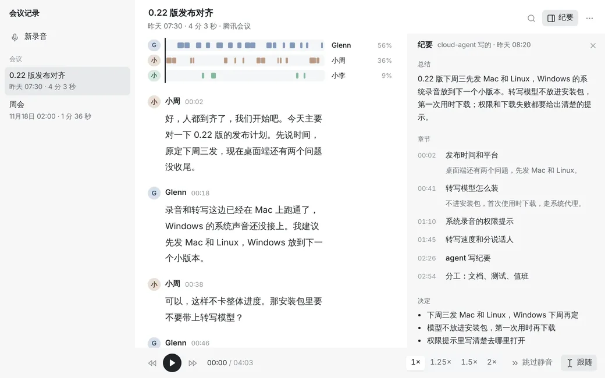</picture> <b>Meeting notes</b> Record a meeting in Zoom, Tencent Meeting or Feishu, with your microphone and the others on separate tracks; transcribe it on your computer (nothing is uploaded), tell speakers apart, and let the agent write the minutes. Needs the myco app.</td>
<td width="50%"></td>
</tr>
</table>

## Development

<table>
<tr>
<td width="50%"><picture><source media="(prefers-color-scheme: dark)" srcset="assets/apps/code-dark.webp">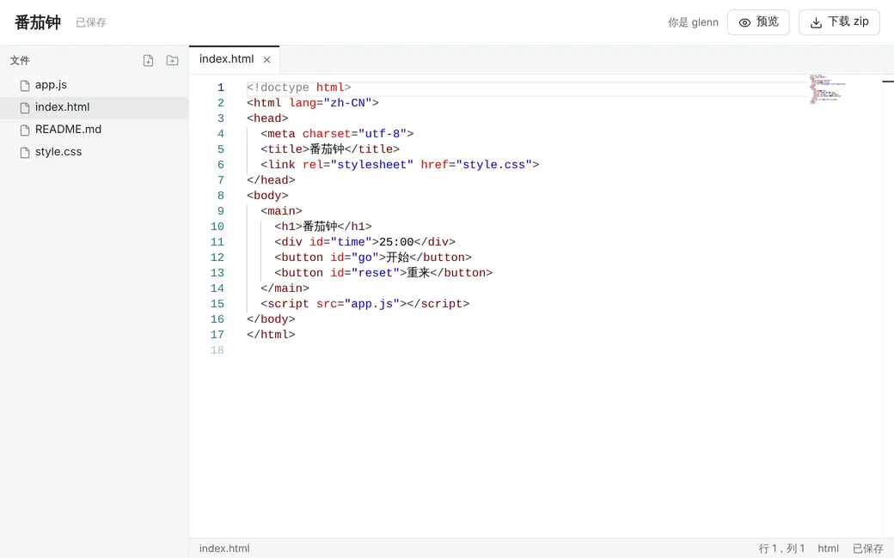</picture> <b>Code editor</b> A VS Code-style editor with a file tree, tabs, highlighting, find and replace, multiple cursors and a minimap. The agent writes files and you edit them; preview HTML and Markdown, download the project as a zip.</td>
<td width="50%"><picture><source media="(prefers-color-scheme: dark)" srcset="assets/apps/issues-dark.webp">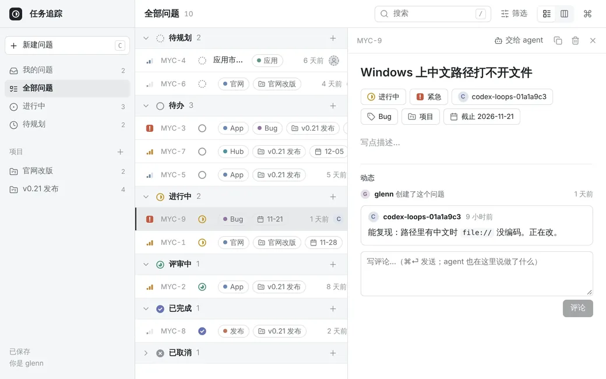</picture> <b>Issue tracker</b> Issues and projects, Linear-style: IDs, status, priority, assignee, labels, list and board, keyboard first. Assign an issue to an agent and watch it change the status and comment.</td>
</tr>
<tr>
<td width="50%"><picture><source media="(prefers-color-scheme: dark)" srcset="assets/apps/devtools-dark.webp">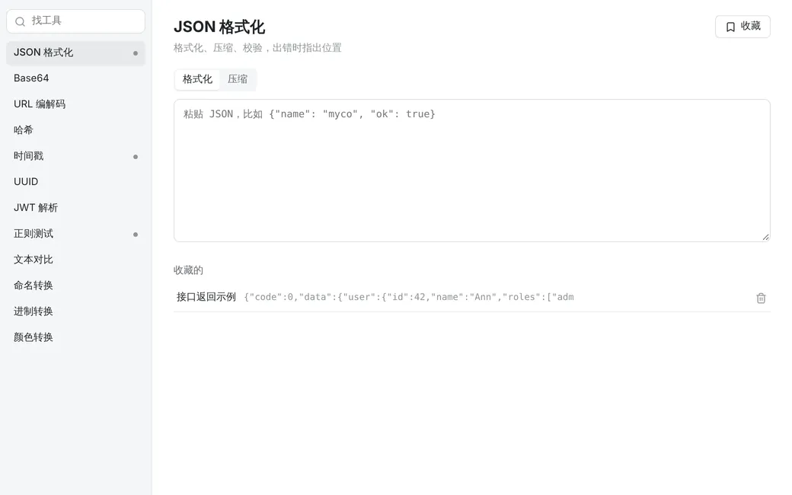</picture> <b>Developer toolbox</b> JSON formatting, Base64, URL encoding, MD5 and SHA, timestamps, UUIDs, JWT decoding, regex testing, text diff, case and base conversion. Everything runs locally.</td>
<td width="50%"></td>
</tr>
</table>

## Tools

<table>
<tr>
<td width="50%"><picture><source media="(prefers-color-scheme: dark)" srcset="assets/apps/disk-dark.webp">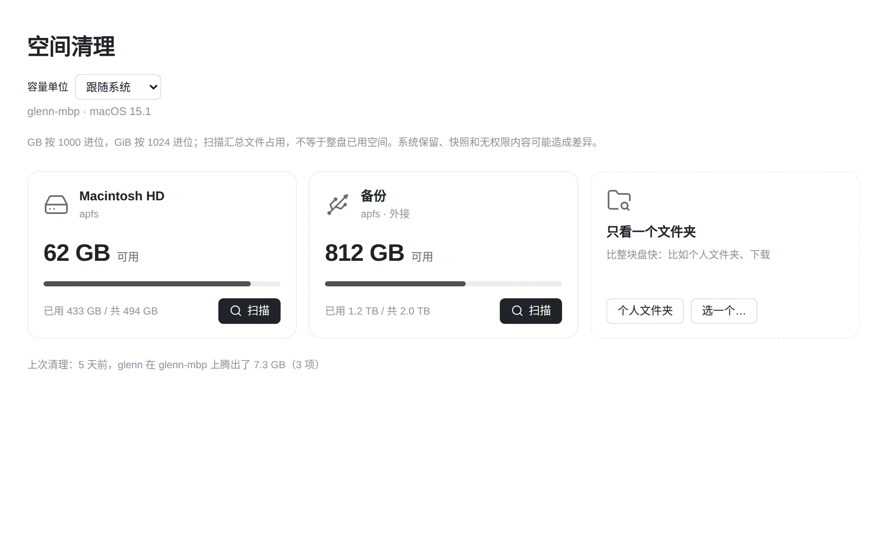</picture> <b>Disk cleanup</b> See what fills this computer's disk as rings, with a list by size; drill into folders, collect what you don't need, then move it to the Trash (and put it back if you change your mind). Needs the myco app.</td>
<td width="50%"><picture><source media="(prefers-color-scheme: dark)" srcset="assets/apps/remote-desktop-dark.webp">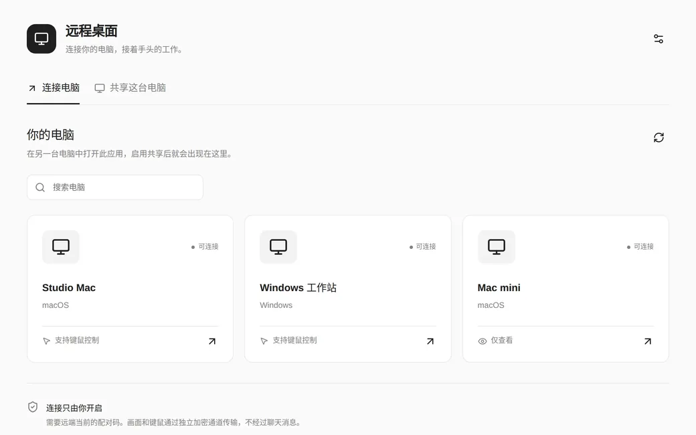</picture> <b>Remote desktop</b> See and control a Mac or Windows PC in the same workspace from another computer or an iPhone (touchpad and keyboard on the phone). Off until you install it; direct over your LAN or Tailscale.</td>
</tr>
<tr>
<td width="50%"><picture><source media="(prefers-color-scheme: dark)" srcset="assets/apps/notes-dark.webp">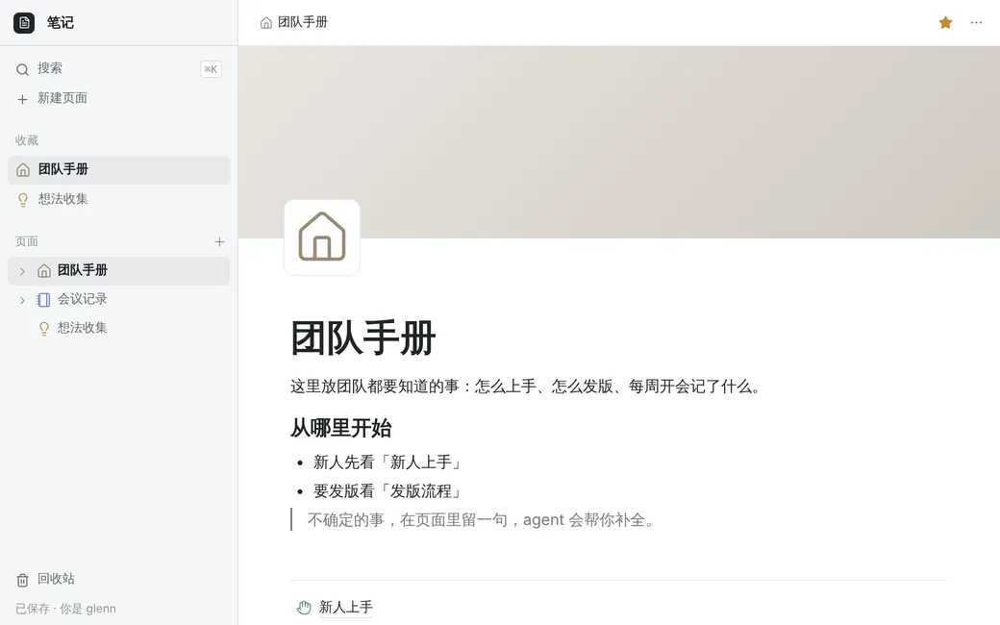</picture> <b>Notes</b> Notes like Notion: nested pages with icons and covers, '/' commands, search, favourites and a trash. The agent can create pages and write into them while you watch.</td>
<td width="50%"><picture><source media="(prefers-color-scheme: dark)" srcset="assets/apps/todo-dark.webp">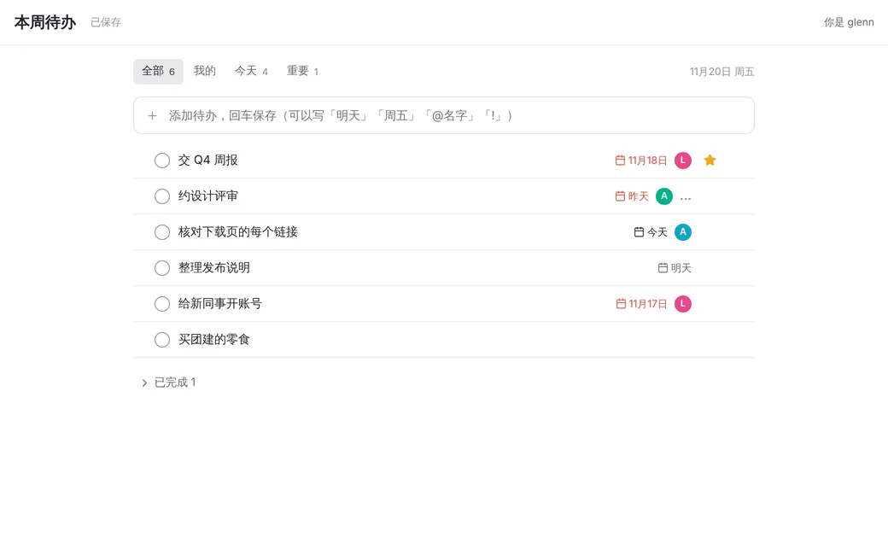</picture> <b>To-do list</b> Shared to-dos: press Enter to add; understands 'tomorrow', 'Friday', '@name' and '!'. Due dates, owners, notes, drag to reorder; the agent can collect to-dos from a meeting.</td>
</tr>
<tr>
<td width="50%"><picture><source media="(prefers-color-scheme: dark)" srcset="assets/apps/stocks-dark.webp"></picture> <b>Stock watch</b> A shared watchlist for China, Hong Kong and US stocks with daily, weekly and monthly candles, volume, moving averages and notes. Switchable data sources; quotes are fetched by the computer that opens it.</td>
<td width="50%"><picture><source media="(prefers-color-scheme: dark)" srcset="assets/apps/proxy-console-dark.webp">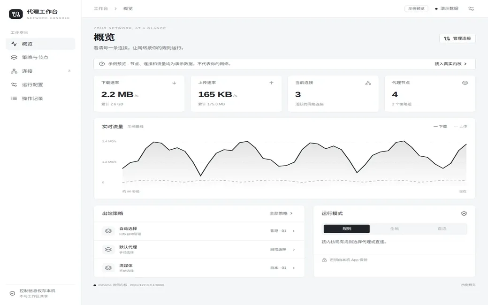</picture> <b>Proxy console</b> Manage the Mihomo and sing-box running on this computer: live traffic, policy groups, node speed tests, connections. The control key stays on this computer. Needs the desktop app.</td>
</tr>
</table>

## Life

<table>
<tr>
<td width="50%"><picture><source media="(prefers-color-scheme: dark)" srcset="assets/apps/ledger-dark.webp">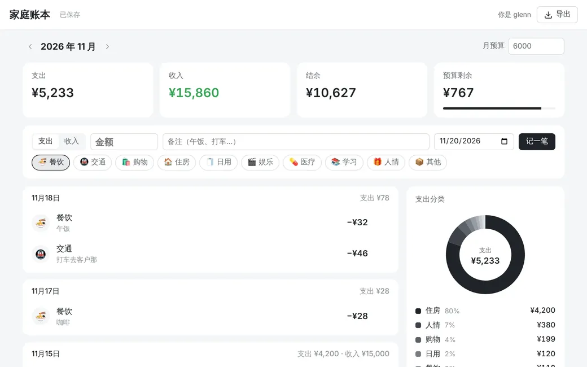</picture> <b>Budget book</b> Income and spending by month, balance and budget left, where the money went by category, every entry by day. Keep it with family or a small team; the agent can file bills for you.</td>
<td width="50%"><picture><source media="(prefers-color-scheme: dark)" srcset="assets/apps/habit-dark.webp">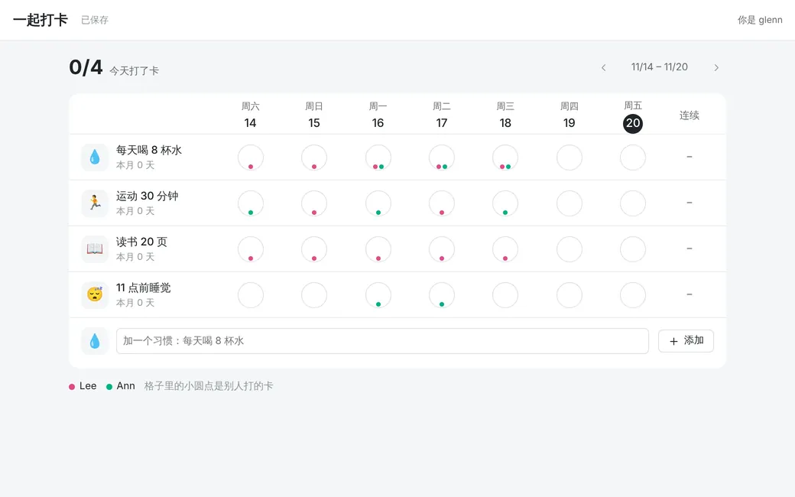</picture> <b>Habit tracker</b> Check in on your habits together: this week's days, streaks, and who else has checked in. The agent can remind you and count.</td>
</tr>
<tr>
<td width="50%"><picture><source media="(prefers-color-scheme: dark)" srcset="assets/apps/cinema-dark.webp">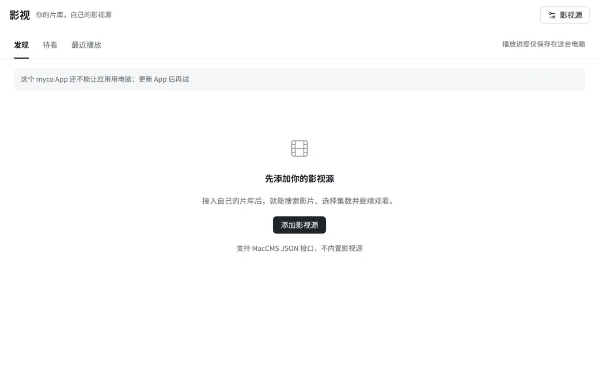</picture> <b>Cinema</b> Search films and series from your own sources, pick an episode and play, keep a watchlist; progress stays on this computer, with resume, speed and intro skipping. No sources included.</td>
<td width="50%"></td>
</tr>
</table>

## Games

<table>
<tr>
<td width="50%"><picture><source media="(prefers-color-scheme: dark)" srcset="assets/apps/gomoku-dark.webp">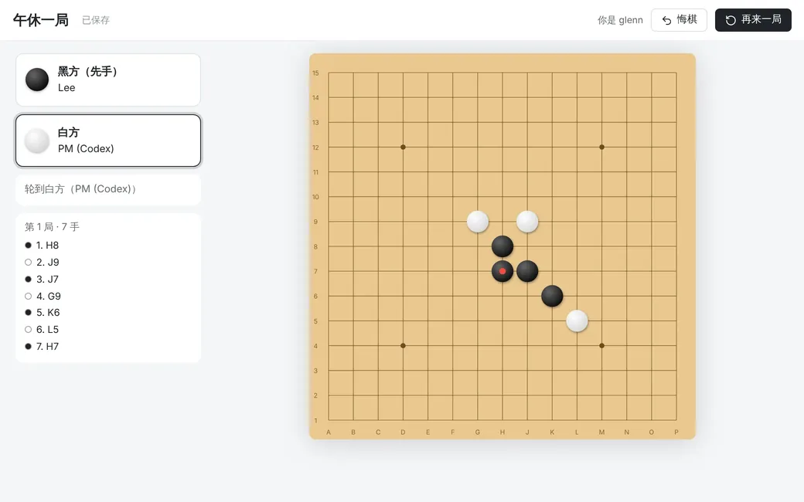</picture> <b>Gomoku</b> Play a game with a colleague or an agent: the page keeps turns and decides the winner; undo, resign, play again.</td>
<td width="50%"><picture><source media="(prefers-color-scheme: dark)" srcset="assets/apps/sudoku-dark.webp">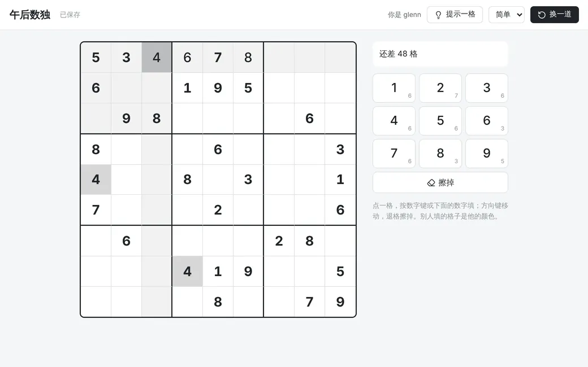</picture> <b>Sudoku</b> Solve one together: each cell saves on its own and shows who filled it, conflicts in red; easy, medium and hard puzzles with one answer each.</td>
</tr>
</table>
