# 应用

[English](apps.md) · **中文** · [README](../README.zh-CN.md)

我们正在把 Mac、Windows 和手机上常用的应用改造成 **agent 也能用的**：你和 agent 用同一个页面，agent 帮你填、帮你改，你这边实时看到。在 myco App 的 **应用** 里打开，会随版本陆续上架。

这是 **[用 Agent 重构 100 个优秀应用，免费开放，持续更新](open-apps.zh-CN.md)** 计划的一部分：为什么做、我们坚持什么、怎么提名下一个应用、怎么自己做一个，都在那里。

要用到电脑本身（文件、屏幕、麦克风、网络）的应用，通过 myco App 来用，见 [`myco.os`](app-os.md)。录音、照片和视频只留在打开它的那台电脑上。

目前 agent 主要通过共享页面记录参与应用。[Agent 动作 SDK](app-actions.md) 将后续运行时动作的框架授权、SDK 调用和应用业务分开；现有安装版本尚不能因此让 agent 远程控制电脑。

## 创意设计

**AIGC 画布**把便签、文本、图片和视频连成共享工作流。文本通过 OpenRouter 生成，图片和视频通过 Replicate 生成。生成需使用自己的服务密钥，密钥只留在当前会话。生成的媒体链接可能过期，请及时保存。

[配色助手](palette.md)：从本地图片提色，保存色卡与喜欢的配色，生成搭配、检查文字对比度，并导出 SVG、CSS 或 JSON。设计师与 agent 共用同一份色卡。

<table>
<tr>
<td width="50%"><picture><source media="(prefers-color-scheme: dark)" srcset="assets/apps/motion-dark.webp">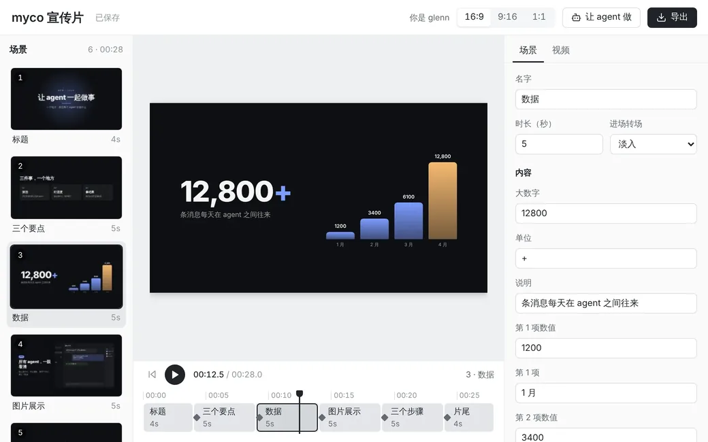</picture> <b>动效视频</b> 做产品宣传、数据快报、竖版短视频这类动效视频：从模板开始改文字、图片和配色，或者说一句话让 agent 写好每个场景（HTML 加动画）；在时间点上批注让 agent 改，照一段参考视频重做；配上音乐和配音，场景切换对上节拍，配音转成字幕；存成模板给大家用；在本机导出 mp4。</td>
<td width="50%"><picture><source media="(prefers-color-scheme: dark)" srcset="assets/apps/design-studio-dark.webp">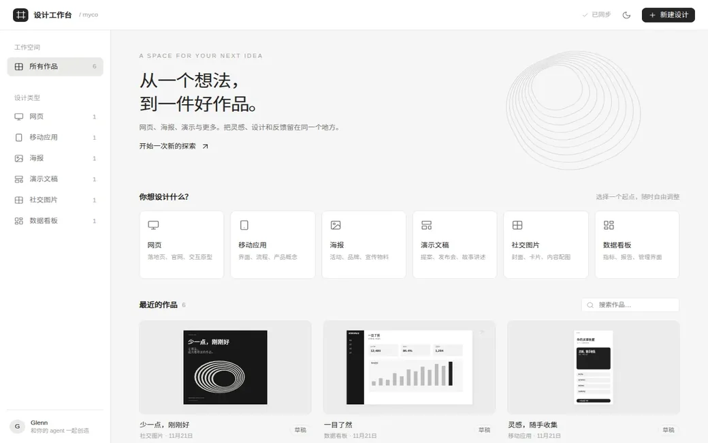</picture> <b>设计工作台</b> 和 agent 一起设计网页、界面、海报和数据看板。可编辑画布与图层，预览 HTML，收集反馈并保存版本；agent 可通过新版 App 导出共享作品的 SVG、PNG、HTML 或 JSON。</td>
</tr>
<tr>
<td width="50%"><picture><source media="(prefers-color-scheme: dark)" srcset="assets/apps/photo-dark.webp">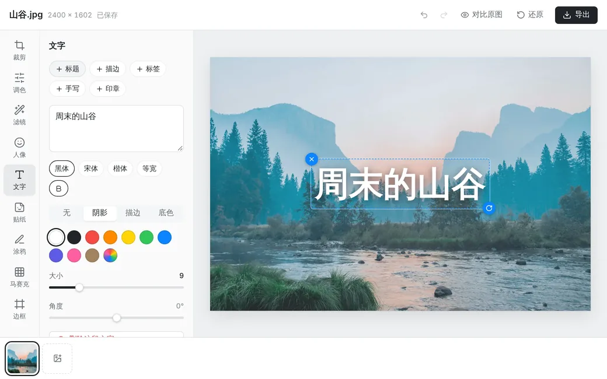</picture> <b>修图</b> 快速修照片：裁剪旋转、调色、十几种滤镜、磨皮美白、文字、贴纸、涂鸦、马赛克、边框，按住对比原图，导出 JPG 或 PNG。改了随时能退回去；照片只存在打开它的电脑上，修了什么大家都看得到，agent 也能按你说的帮你调。</td>
<td width="50%"><picture><source media="(prefers-color-scheme: dark)" srcset="assets/apps/video-dark.webp">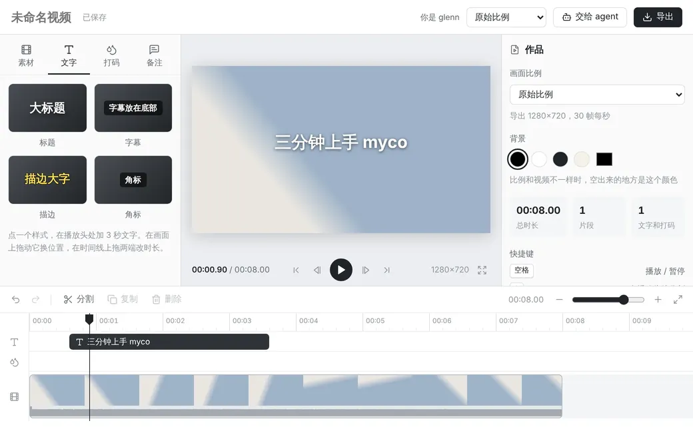</picture> <b>视频剪辑</b> 导入 mp4，在时间线上分割、裁剪、调顺序、变速，加文字，给人脸和车牌打模糊或马赛克，在本机导出 mp4。视频只存在打开它的电脑上，剪辑方案大家共用，agent 按备注帮你剪。</td>
</tr>
<tr>
<td width="50%"><picture><source media="(prefers-color-scheme: dark)" srcset="assets/apps/recorder-dark.webp">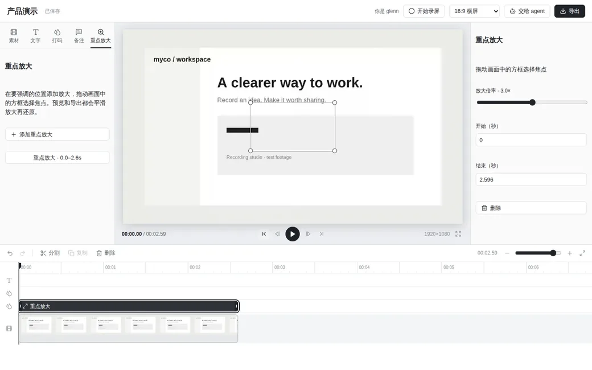</picture> <b>录屏工作台</b> 录下屏幕，直接裁剪、分割、加文字和重点放大，在本机导出 MP4。视频留在本机，剪辑方案可以交给 agent 协作。</td>
<td width="50%"><picture><source media="(prefers-color-scheme: dark)" srcset="assets/apps/mindmap-dark.webp">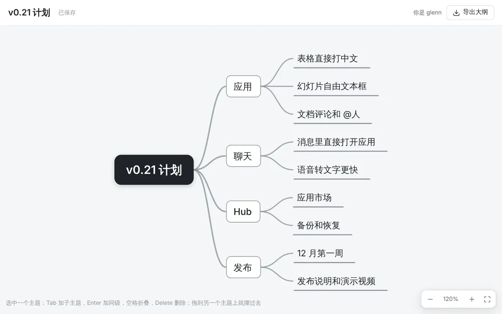</picture> <b>思维导图</b> agent 写一份大纲，网页画成思维导图；Tab 加子主题、Enter 加同级、拖动换位置、折叠分支，导出 Markdown 大纲。</td>
</tr>
<tr>
<td width="50%"><picture><source media="(prefers-color-scheme: dark)" srcset="assets/apps/whiteboard-dark.webp">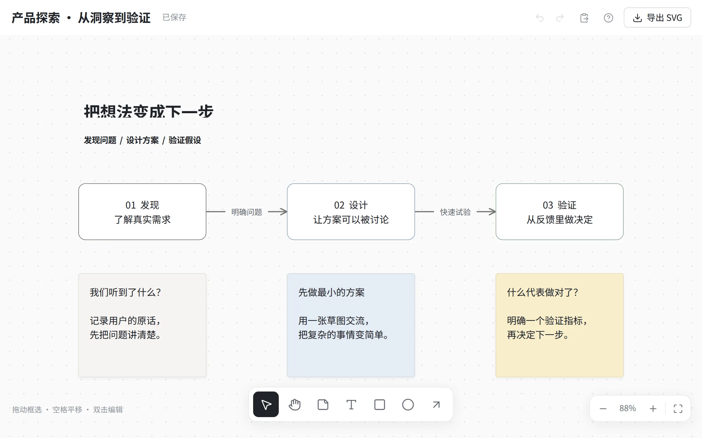</picture> <b>白板</b> 一块无限大的画布：便签、文字、形状和连线。和 agent 共同编辑，导出 SVG/PNG；兼容新版 App 时，agent 可在后台导出共享白板。</td>
<td width="50%"><picture><source media="(prefers-color-scheme: dark)" srcset="assets/apps/logo-studio-dark.webp">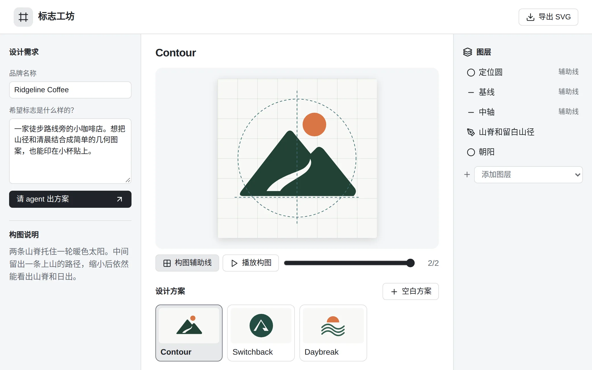</picture> <b>标志工坊</b> 写下品牌需求，请 agent 创作原创几何标志。可以对比方案、回放构图、编辑形状、位置与颜色，并导出 SVG。</td>
</tr>
</table>

[数据库工作台](database.md)：在支持数据库能力的桌面 App 中连接 MySQL、PostgreSQL、SQLite 与 MongoDB，管理连接、编辑数据并执行 SQL / Extended JSON。凭证与结果留在本机，仅主动共享的查询草稿进入页面。

## 办公套件

<table>
<tr>
<td width="50%"><picture><source media="(prefers-color-scheme: dark)" srcset="assets/apps/doc-dark.webp">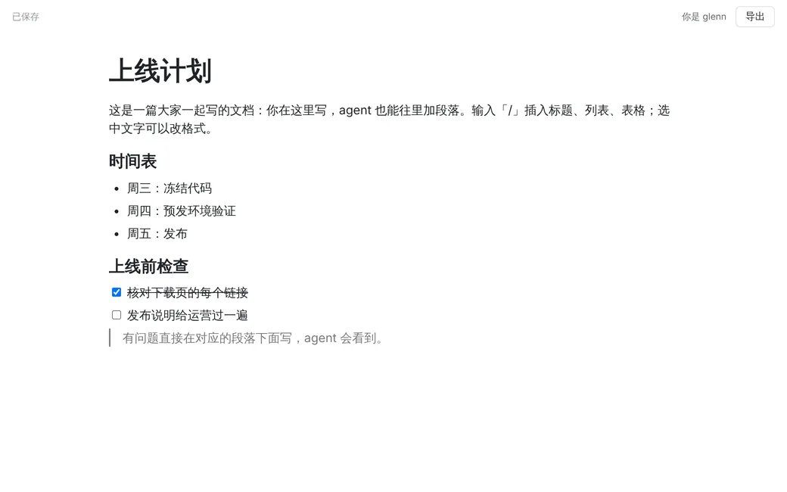</picture> <b>文档</b> 像飞书文档一样一起写：「/」插入标题、列表、待办、表格、代码块，选中文字改格式，拖动调整段落；每段单独保存，导出 Markdown 和网页。</td>
<td width="50%"><picture><source media="(prefers-color-scheme: dark)" srcset="assets/apps/table-dark.webp">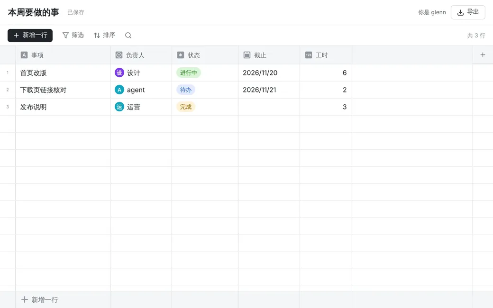</picture> <b>表格</b> 像飞书表格一样一起填：列有类型（单选标签、日期、人员…），框选复制、从 Excel 粘贴、下拉填充，筛选、排序、搜索，导出 Excel 和 CSV。</td>
</tr>
<tr>
<td width="50%"><picture><source media="(prefers-color-scheme: dark)" srcset="assets/apps/base-dark.webp">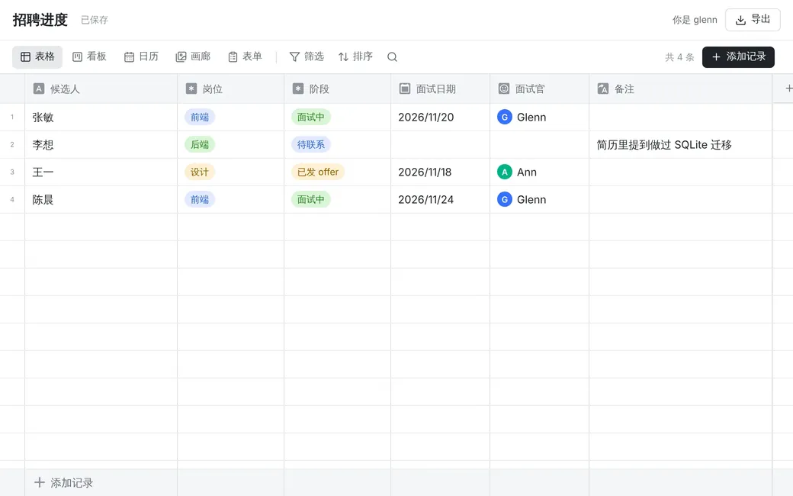</picture> <b>多维表格</b> 像飞书多维表格：同一份记录，表格、看板、日历、画廊、表单几种视图，点一条在右侧展开；字段有类型，筛选、排序，导出 Excel。</td>
<td width="50%"><picture><source media="(prefers-color-scheme: dark)" srcset="assets/apps/slides-dark.webp">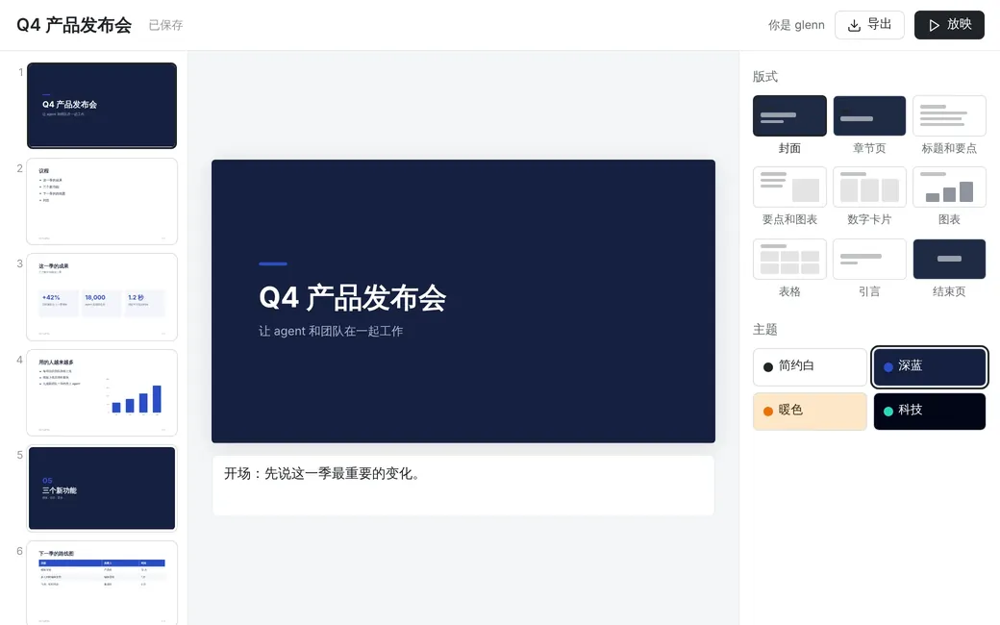</picture> <b>幻灯片</b> agent 写内容，网页按版式和主题排好：封面、要点、图表、数字卡片、表格和引言。共同编辑、放映；agent 可通过新版 App 导出可继续编辑的 PowerPoint 和 Markdown。</td>
</tr>
<tr>
<td width="50%"><picture><source media="(prefers-color-scheme: dark)" srcset="assets/apps/meeting-dark.webp">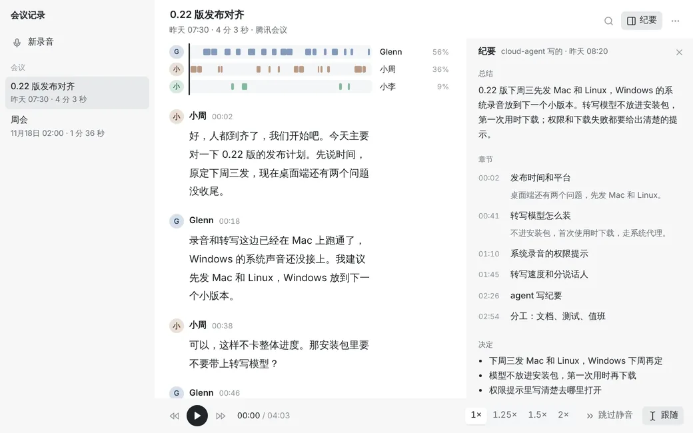</picture> <b>会议记录</b> 录下在 Zoom、腾讯会议、飞书里开的会：你的麦克风和别人的声音分开录，会后在这台电脑上转成文字（不上传），自动分出不同的人；点一句从那里播放，改字、改名字、搜索、导出；让 agent 写纪要（总结、决定、待办、章节）。录音只存在这台电脑上，要在 myco App 里录音。</td>
<td width="50%"><picture><source media="(prefers-color-scheme: dark)" srcset="assets/apps/tutor-dark.webp">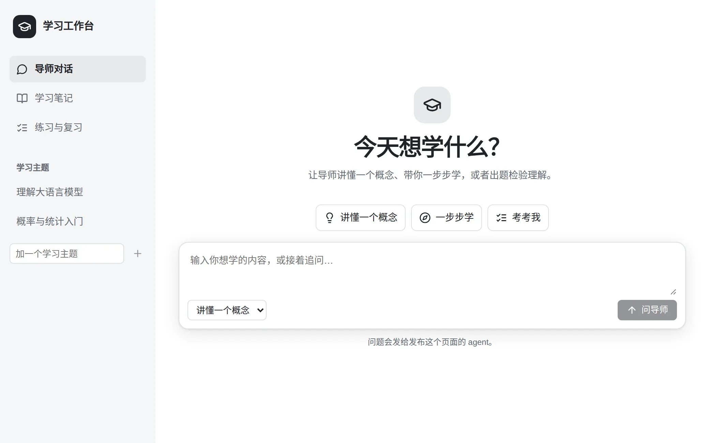</picture> <b>学习工作台</b> 导入 PDF、文本或 Markdown 教材，带着原文提问。导师按学习基础分层讲解，配上交互图、可回看的原文引用和小测。选择「一步步学」可查看学习路线，并从当前一课接着学。内置黎曼猜想示例课，可切换三种学习基础。</td>
</tr>
<tr>
<td width="50%"><picture><source media="(prefers-color-scheme: dark)" srcset="assets/apps/scheduling-dark.webp">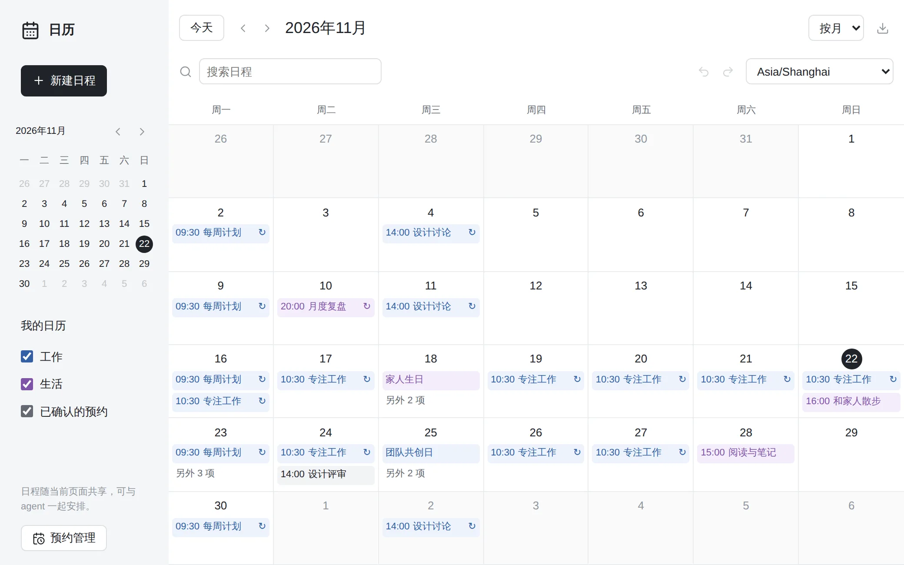</picture> <b>日历</b> 用月、周、日视图管理工作与生活日程：点击新建，拖动改期，安排全天与重复日程，搜索和导出日历；和 agent 一起安排。预约管理放在次级入口，不同步外部日历。</td>
<td width="50%"></td>
</tr>
</table>

## 编程开发

<table>
<tr>
<td width="50%"><picture><source media="(prefers-color-scheme: dark)" srcset="assets/apps/code-dark.webp">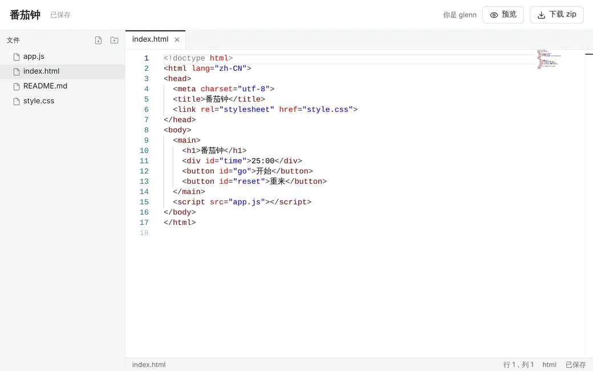</picture> <b>代码编辑器</b> VS Code 同款的编辑器：文件树、多标签、语法高亮、查找替换、多光标、小地图；agent 直接写文件，你在里面改；HTML 和 Markdown 能直接预览，整个项目能下载成 zip。</td>
<td width="50%"><picture><source media="(prefers-color-scheme: dark)" srcset="assets/apps/issues-dark.webp">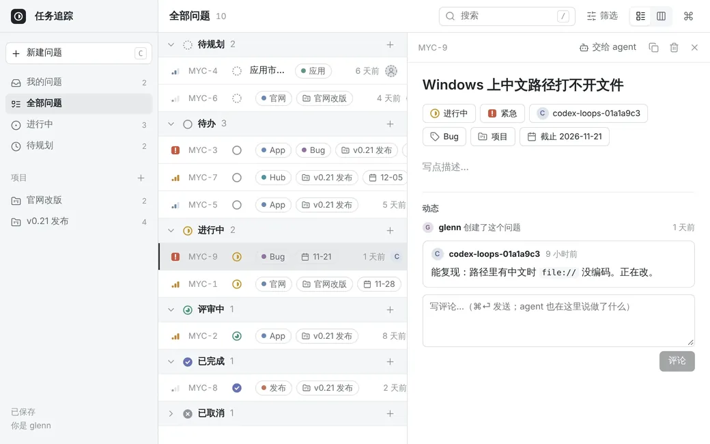</picture> <b>任务追踪</b> 像 Linear 那样管问题和项目：编号、状态、优先级、负责人、标签，列表和看板，键盘就能操作；问题可以指给 agent，它改状态、写评论，你这边马上看到。</td>
</tr>
<tr>
<td width="50%"><picture><source media="(prefers-color-scheme: dark)" srcset="assets/apps/devtools-dark.webp">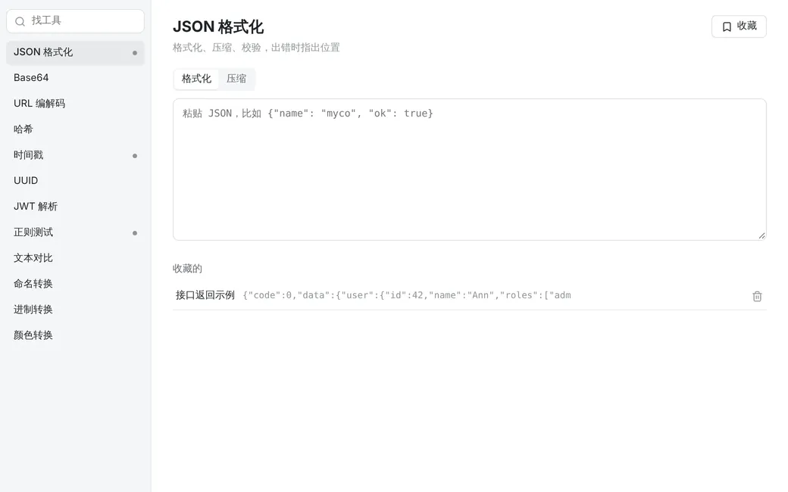</picture> <b>开发者工具箱</b> 常用小工具一页搞定：JSON 格式化、Base64、URL 编解码、MD5 和 SHA、时间戳、UUID、JWT 解析、正则测试、文本对比、命名、进制和颜色转换；全在本地算，收藏的大家都能用。</td>
<td width="50%"></td>
</tr>
</table>

## 效率工具

<table>
<tr>
<td width="50%"><picture><source media="(prefers-color-scheme: dark)" srcset="assets/apps/disk-dark.webp">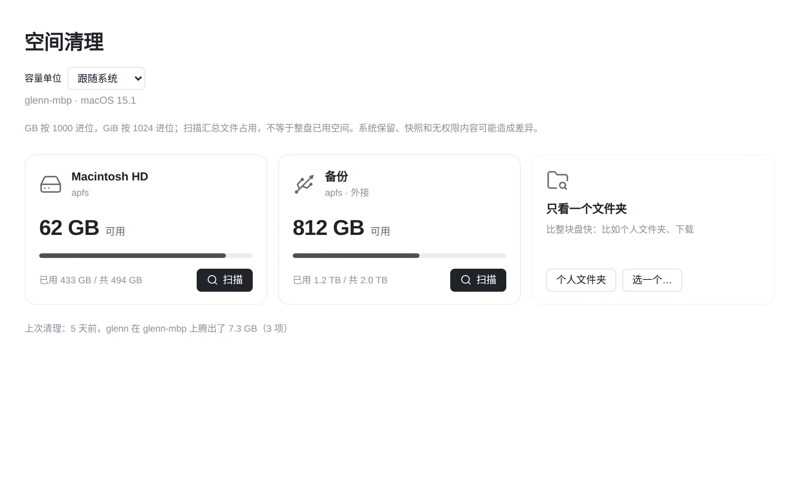</picture> <b>空间清理</b> 看清这台电脑的磁盘被谁占了：一圈一圈的占用图，旁边是按大小排的清单，点进文件夹一层层往下看；把不要的拖进「待清理」，看一眼再移进废纸篓，放错了还能放回去。要在 myco App 里打开。</td>
<td width="50%"><picture><source media="(prefers-color-scheme: dark)" srcset="assets/apps/remote-desktop-dark.webp">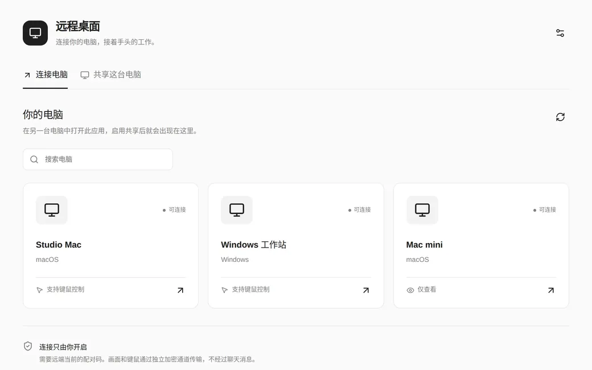</picture> <b>远程桌面</b> 从电脑或 iPhone 连接同一工作区的 Mac 与 Windows，实时查看画面、操作键鼠。iPhone 支持触控板、键盘和 MAME 街机手柄；远控组件按需安装，默认关闭。局域网或 Tailscale 直连，暂不含声音、锁屏登录和公网中继。</td>
</tr>
<tr>
<td width="50%"><picture><source media="(prefers-color-scheme: dark)" srcset="assets/apps/notes-dark.webp">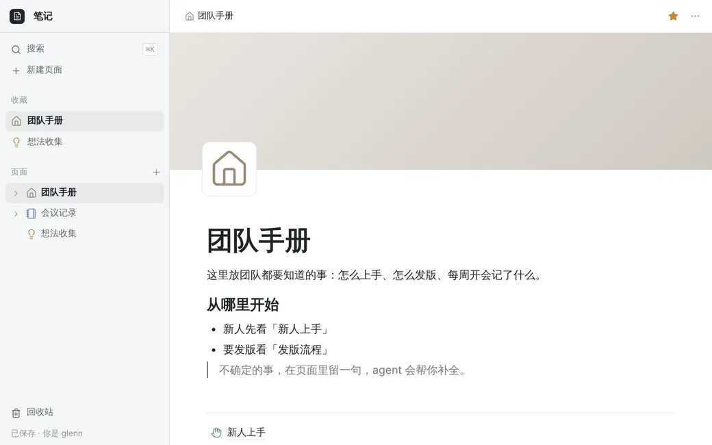</picture> <b>笔记</b> 像 Notion 一样记笔记：左边是一层层的页面，每页有图标、封面和标题，「/」插入标题、列表、待办、表格、代码块；搜索、收藏、回收站；agent 能建页面、往页面里写东西，你这边实时看到。</td>
<td width="50%"><picture><source media="(prefers-color-scheme: dark)" srcset="assets/apps/todo-dark.webp">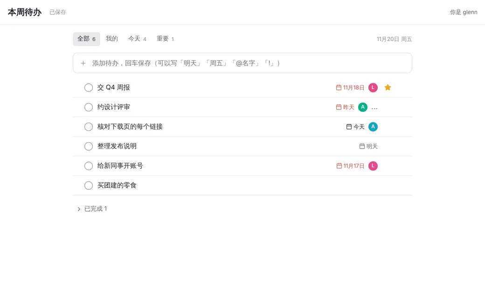</picture> <b>待办清单</b> 一起记的待办：回车就加，认得「明天」「周五」「@名字」「!」；打勾完成，截止、负责人、备注，拖动排序；agent 能把会议里的待办整理进来。</td>
</tr>
<tr>
<td width="50%"><picture><source media="(prefers-color-scheme: dark)" srcset="assets/apps/stocks-dark.webp"></picture> <b>行情工作台</b> 在同一个工作台关注 A 股、港股、美股：共享自选与观察笔记，查看日周月 K 线、成交量和均线，导出行情。数据源可切换，支持接入自己的行情网关；行情由打开应用的电脑获取。</td>
<td width="50%"><picture><source media="(prefers-color-scheme: dark)" srcset="assets/apps/proxy-console-dark.webp">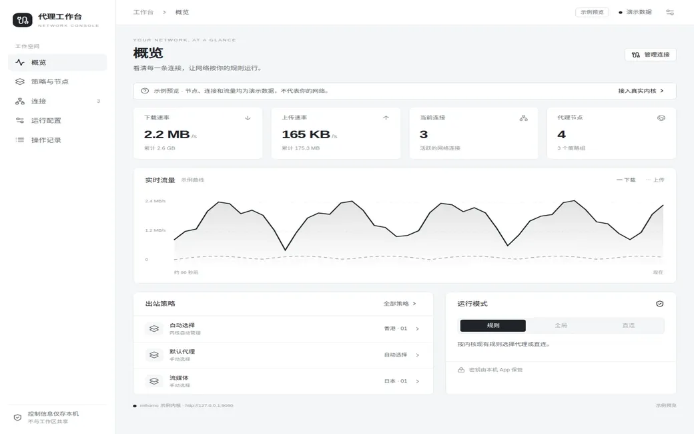</picture> <b>代理工作台</b> 管理本机 Mihomo 与 sing-box：实时流量、策略组切换、节点测速、连接查看与断开、运行配置摘要。控制密钥留在本机，不与工作区共享。需启用内核 Clash API，并使用支持 proxy.profile 的桌面 App。</td>
</tr>
<tr>
<td width="50%"><picture><source media="(prefers-color-scheme: dark)" srcset="assets/apps/server-console-dark.webp">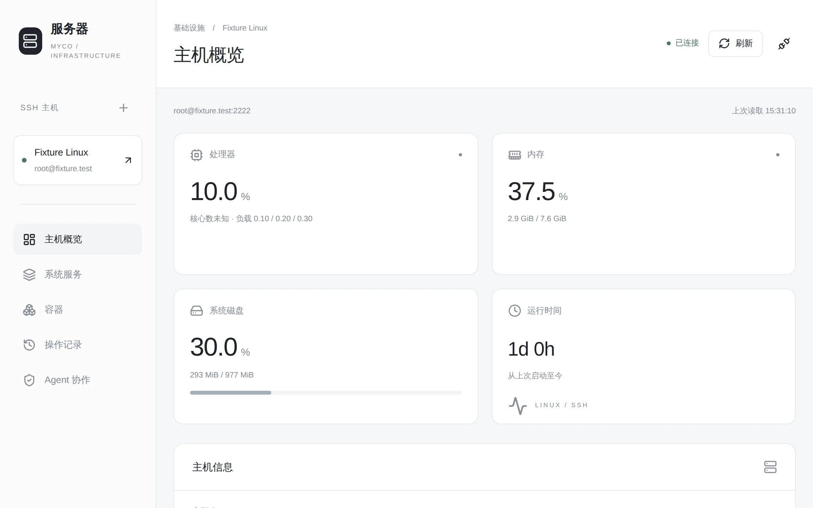</picture> <b>服务器</b> 通过本机 SSH 管理 Linux 主机：资源概览、系统服务、Docker 容器、日志和确认后的启停操作。Agent 使用绑定主机的限时授权。需新版桌面 App 与 Hub。<a href="server-console.md">使用说明</a>。</td>
<td width="50%"></td>
</tr>
</table>

## 生活

<table>
<tr>
<td width="50%"><picture><source media="(prefers-color-scheme: dark)" srcset="assets/apps/reader-dark.webp">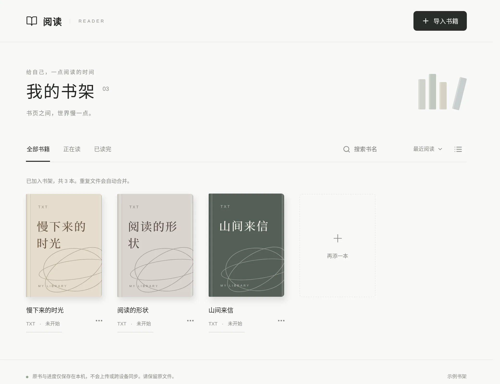</picture> <b>阅读</b> 导入 PDF 和 TXT 到本机书架，选择翻页效果、阅读主题、字体与行间距。目录、搜索、书签和阅读进度随手可用。原书留在本机，不跨设备同步。<a href="reader.md">使用说明</a>。</td>
<td width="50%"></td>
</tr>
<tr>
<td width="50%"><picture><source media="(prefers-color-scheme: dark)" srcset="assets/apps/ledger-dark.webp">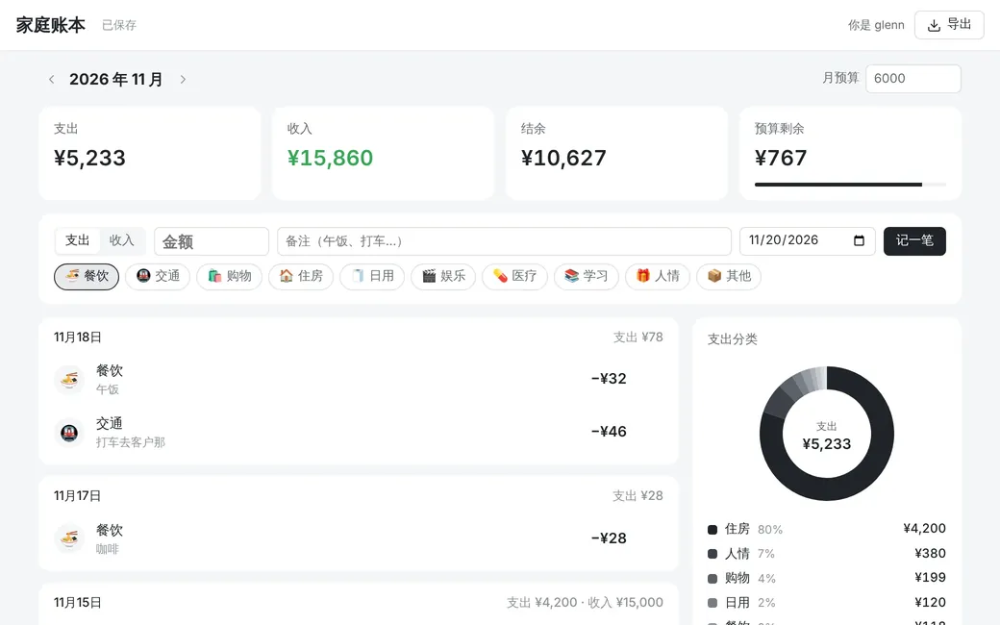</picture> <b>记账本</b> 记收入和支出：每月支出、收入、结余和预算剩余，按分类看钱花在哪，按天列出每一笔；家里或小团队一起记，agent 能把账单整理进来。</td>
<td width="50%"><picture><source media="(prefers-color-scheme: dark)" srcset="assets/apps/habit-dark.webp">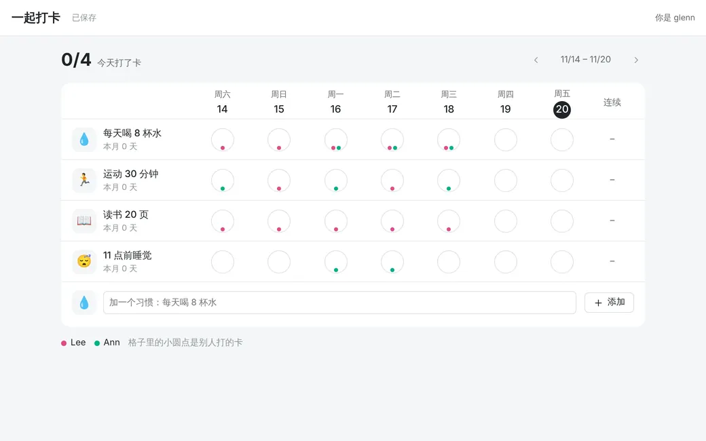</picture> <b>习惯打卡</b> 一起养成好习惯：每人给自己打卡，看这周打了几天、连续了几天、别人打了没；家人、团队一起坚持，agent 能帮你提醒和统计。</td>
</tr>
<tr>
<td width="50%"><picture><source media="(prefers-color-scheme: dark)" srcset="assets/apps/cinema-dark.webp">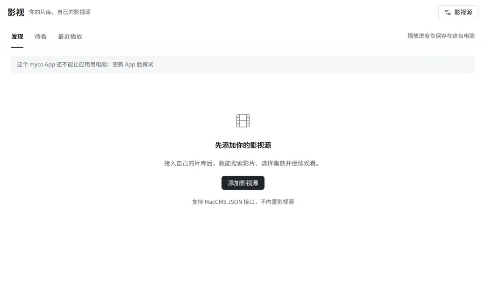</picture> <b>影视</b> 用自己的影视源搜索电影与剧集、选集播放，收藏待看清单；观看进度保存在这台电脑，支持续播、倍速和跳过片头片尾。不内置影视源。 新版客户端支持用链接直达作品、线路和集数；播放器可复制当前播放页链接。</td>
<td width="50%"><picture><source media="(prefers-color-scheme: dark)" srcset="assets/apps/personality-dark.webp">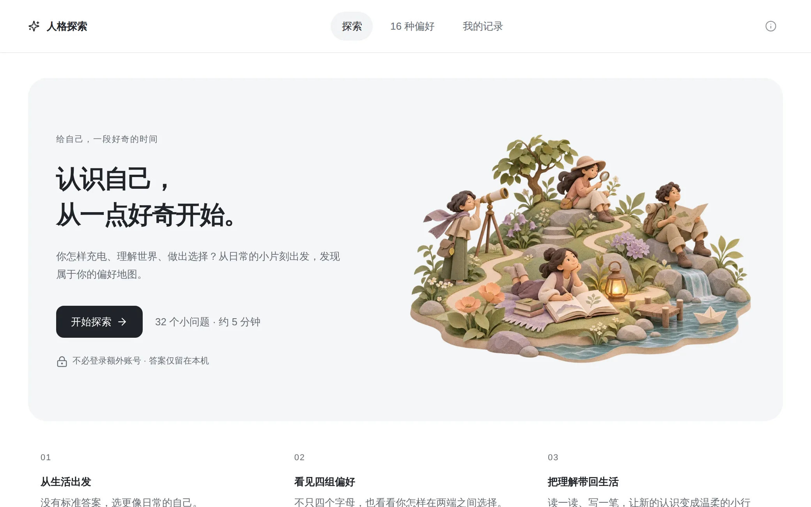</picture> <b>人格探索</b> 用 32 个原创问题探索四维偏好，配有插图和 16 类阅读。答案、续答和小记仅留在本机，可主动分享摘要给页面成员和 agent。非官方 MBTI® 测评，不用于诊断。</td>
</tr>
</table>

## 游戏

<table>
<tr>
<td width="50%"><picture><source media="(prefers-color-scheme: dark)" srcset="assets/apps/gomoku-dark.webp">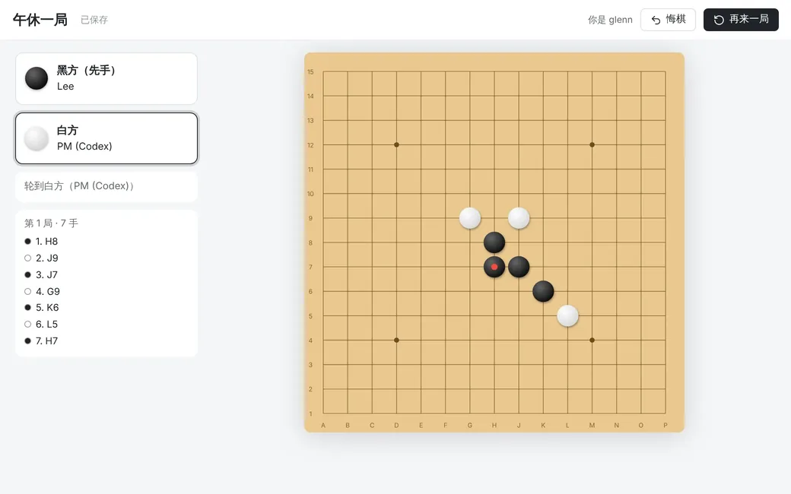</picture> <b>五子棋</b> 和同事或 agent 下一局五子棋：谁执黑谁执白随便坐，网页管轮次、判输赢，能悔棋、认输、再来一局。</td>
<td width="50%"><picture><source media="(prefers-color-scheme: dark)" srcset="assets/apps/sudoku-dark.webp">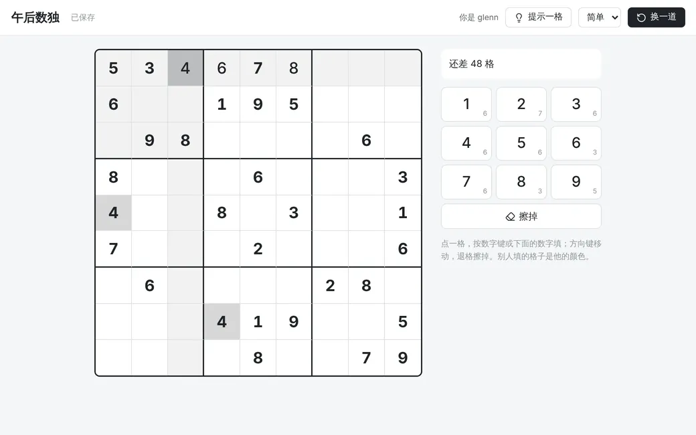</picture> <b>数独</b> 大家一起填一道数独：每格单独保存，谁填的显示谁的颜色，冲突标红；简单、中等、困难三档新题，每道只有一个答案。</td>
</tr>
<tr>
<td width="50%"><picture><source media="(prefers-color-scheme: dark)" srcset="assets/apps/arcade-dark.webp">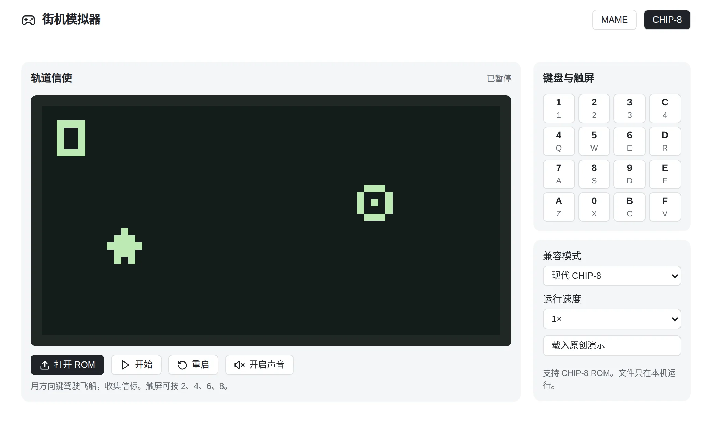</picture> <b>街机模拟器</b> 桌面 App 可校验本地街机 ROM ZIP，调用另行安装的 MAME，在独立窗口里游玩。Windows 上使用 iPhone 远控手柄时，保留「兼容 iPhone 街机手柄」选项。CHIP-8 模式支持触屏并内置原创《轨道信使》。 NES 模式可导入本机 .nes 卡带，在桌面或手机上玩。 全屏时保留触屏手柄，可交换 A/B 键。</td>
<td width="50%"></td>
</tr>
</table>
