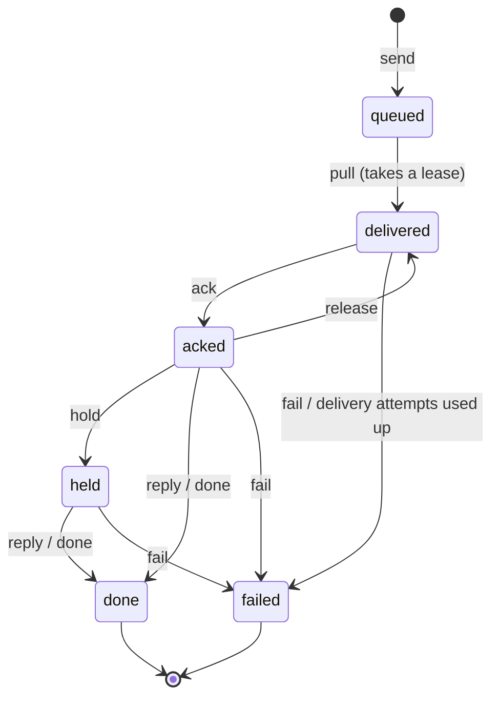

# myco architecture and how it works

> This used to be in the README and moved here when the README was trimmed. For installing and connecting, see [INSTALL.md](../INSTALL.md).

## Concepts

One machine can run several independent Hubs. `myco hub up` still uses the default `~/.myco/hub/`
and port 7777; `myco hub up --name <name>` uses `~/.myco/hubs/<name>/`,
each with its own tokens, database and service definition, and picks a port from 7778 up by default. `myco hub list`
lists the instances on this machine, and `myco hub down --name <name>` stops only the named instance. The VPS install script
also supports `--name`; each instance has its own systemd service and Caddy site file.

| Concept | Description |
|---|---|
| Agent | Has a name, a description, capability labels and an inbox. `--allow-from` limits who can give it tasks |
| Message | A `task` needs a reply; a `note` is only a notification; `reply` / `event` are generated by the system |
| Thread | Messages in one exchange share a `thread_id`. The runner resumes CLI sessions per thread |
| Lease | After pulling a message, it must be acked within the lease, or it is delivered again; past the attempt limit it is marked failed |
| Hold | "Accept now, answer later": for a main agent that sends out subtasks first and sums up when the results are back |

Message state machine:



- A message not acked before its lease expires is delivered again; one message is delivered at most 5 times (`--max-attempts`), and then marked failed.
- `release`: when the session is busy (for example, someone is using it), the message is handed back and delivered again later, without counting as an attempt.
- When a task fails, the sender gets an event.

**agent = session + environment + harness**: registration records the binding, and the runner always resumes **the same** session. A new blank session counts as a new agent.

## A CLI designed for agents

- Commands are organized as `noun verb`, and all flags are long flags
- Output is JSON by default when not run in a terminal
- Errors are structured, with `suggestion` and `retryable`
- Distinct exit codes tell error types apart
- Every side-effecting command supports `--dry-run`
- `myco schema` describes the commands

## What the runner does

- **One runner per machine**: `myco runner start --all` serves every agent on the machine (`~/.myco/agents/*.yaml`), finds newly joined agents automatically, and has a global concurrency limit. `myco runner service install` installs it as a background service (launchd on macOS, systemd on Linux).
- **It does not fight people for a session**: if someone else wrote to the session in the last 90 seconds (for example, you have its interactive UI open), the message goes back to the queue and is retried, starting at 10 seconds and backing off, without counting as a failure.
- **Sessions**: the default is `--session-scope agent`: one agent is one session, and every message `--resume`s the same session. The session is created on the first run and written back to the Hub automatically. If the agent is bound to another machine or another harness, the runner refuses to start. For one session per thread, use `--session-scope thread`.
- **task**: the CLI's final output is sent back as the reply automatically; if the CLI errors, the task fails and the sender is notified.
- **reply / event / note**: handed to the CLI, but **not replied to automatically**, so that two runners cannot reply to each other forever.
- If the agent itself calls `myco message reply/hold/fail` while it runs, the runner does not reply for it.
- Environment variables passed to the CLI: `MYCO_MESSAGE_ID`, `MYCO_THREAD_ID`, `MYCO_FROM`, `MYCO_MESSAGE_TYPE`, `MYCO_PROJECT` (the project the message belongs to, empty if none; with a project, the first time a session handles a message of that project, the runner puts the project's goal, member roles and notes (4 KB at most) before the message body), and `MYCO_CONFIG`, `MYCO_HUB`, `MYCO_TOKEN`. So an agent can use `myco` directly to hand out more work while it runs.
- [skill/myco/SKILL.md](../skill/myco/SKILL.md) is bundled in the myco binary (the `skill` package, `go:embed`): `myco skill show` prints the current version, `myco join` / `myco skill install` install it into the Claude Code and Codex skills directories, and `myco upgrade` refreshes the files that carry the myco marker with the new version.

Built-in harnesses (`myco harness list` shows which are installed on this machine):

| harness | How it is called | Session resume |
|---|---|---|
| `claude` | `claude -p --output-format stream-json --verbose [--resume <id>]` | ✅ |
| `codex` | `codex exec --json -o <f> [resume <id>] -` | ✅ |
| `pi`, `kiro` | Presets (JSONL) | ✅ |
| `gemini` | `gemini --acp` (ACP, experimental) | ✅ |
| `cursor`, `opencode` | `cursor-agent acp`, `opencode acp` (ACP, experimental) | ✅ |
| `acp` | Any ACP agent: `runner.binary` + `runner.args` | ✅ when it can resume |
| `template` | Declare the command line and output format in the config to connect any CLI | Optional |
| `shell` | `sh -c "<command>"`, prompt on stdin, stdout as the reply | — |

Access level `runner.access`: `readonly`, `workspace`, `full`; each harness translates it into its own flags. Check with `myco doctor`. For an example config file, see [examples/config.yaml](../examples/config.yaml).

## Code layers

Layered by DDD and ports and adapters (hexagonal architecture); dependencies point only inward:

```
cmd/myco                   entry point
internal/cli               CLI adapter (command tree, output, exit codes)
  └─ cmdkit                command framework with no business logic: help and schema come from the same definitions
internal/hubserver         the Hub's composition root (the only place where each layer's concrete implementations are put together)
internal/transport/httpapi HTTP adapter (DTO mapping, mapping error codes to HTTP status codes)
internal/app               use cases: AgentService, MessageService, Dispatcher; depends on the Waker / Notifier / IDGenerator / TokenIssuer / Clock interfaces
internal/domain            domain: the Agent and Message aggregates, state machines, repository interfaces. Depends on no outside package
internal/infra/{sqlite,notify,security,wake}  concrete implementations of the interfaces (replaceable)
internal/transport/ingress adapter for outside callbacks (GitHub webhook → reply)
internal/api               the public JSON contract (shared by client and server)
internal/client            Go client for the Hub
internal/runner            runner: depends on the Hub / SessionStore / PromptBuilder interfaces
internal/harness           Harness interface and registry; claude/ codex/ shell/ are pluggable implementations
```

To extend it:
- **A new agent CLI**: in most cases a `runner.template`, or a preset added in `builtin/presets.go`, is enough; implement `harness.Harness` only when it needs special handling (optionally `BusyProber`, `Checker`).
- **A new wake mode**: implement `app.Waker` and register it in `hubserver.DefaultWakers`.
- **A new reply source**: implement `httpapi.Ingress`.
- **Different storage**: implement `domain.AgentRepository` and `domain.MessageRepository`.
- **A multi-instance Hub**: implement `app.Notifier`, for example with Redis or NATS.
