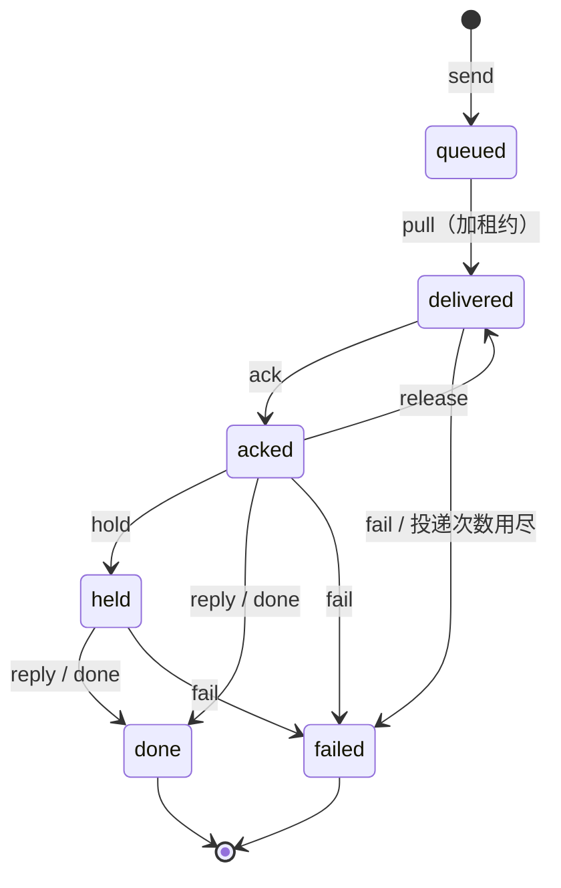

# myco 架构与运行机制

> 这部分内容原先在 README 里，README 精简后移到这里。安装和接入看 [INSTALL.md](../INSTALL.md)。

## 概念

| 概念 | 说明 |
|---|---|
| Agent | 有名字、描述、能力标签和收件箱。`--allow-from` 限制谁能给它派任务 |
| Message | `task` 需要一个回复；`note` 只是通知；`reply` / `event` 由系统生成 |
| Thread | 一来一回的消息共享 `thread_id`。runner 按线程续接 CLI 会话 |
| Lease | 拉取消息后需要在租约内 ack，否则消息会重投；超过次数上限后标记为失败 |
| Hold | "先接下，稍后答复"，用于主 agent 先派出子任务、等结果回来再汇总 |

消息状态机：



- 租约到期还没 ack 的消息会被再次投递；同一条消息最多投递 5 次（`--max-attempts`），用尽后标记为 failed。
- `release`：会话正忙（比如有人正在用）时把消息交还，稍后重投，不计入投递次数。
- task 被 fail 时，发送方会收到一条 event。

**agent = session + 环境 + harness**：注册时会记录绑定关系，runner 每次都续接**同一个** session。新开的空白 session 就算一个新的 agent。

## 为 agent 设计的 CLI

- 命令按 `名词 动词` 组织，参数都是长 flag
- 不在终端里运行时默认输出 JSON
- 错误是结构化的，带 `suggestion` 和 `retryable`
- 用不同的退出码区分错误类型
- 有副作用的命令都支持 `--dry-run`
- 提供 `myco schema` 自省命令

## runner 的行为

- **一台机器一个 runner**：`myco runner start --all` 服务本机所有 agent（`~/.myco/agents/*.yaml`），新入网的 agent 会自动发现，并有全局并发上限。`myco runner service install` 把它装成后台服务（macOS 用 launchd，Linux 用 systemd）。
- **不和人抢会话**：会话最近 90 秒内被别人写过（比如你正开着交互界面），消息就放回队列，10 秒起逐步加长重试，不算失败。
- **会话**：默认 `--session-scope agent`，一个 agent 就是一个 session，每条消息都 `--resume` 同一个 session。第一次运行时创建 session，并自动写回 Hub。如果 agent 绑定在别的机器或别的 harness 上，runner 会拒绝启动。想每个线程各用一个 session，就用 `--session-scope thread`。
- **task**：CLI 的最终输出自动作为 reply 发回；CLI 出错就 fail，发送方会收到通知。
- **reply / event / note**：交给 CLI 处理，但**不会自动回复**，避免两个 runner 无限互相回复。
- 如果 agent 在执行过程中自己调用了 `myco message reply/hold/fail`，runner 就不再替它回复。
- 传给 CLI 的环境变量：`MYCO_MESSAGE_ID`、`MYCO_THREAD_ID`、`MYCO_FROM`、`MYCO_MESSAGE_TYPE`，以及 `MYCO_CONFIG`、`MYCO_HUB`、`MYCO_TOKEN`。所以 agent 在执行过程中可以直接用 `myco` 继续派活。
- 把 [skill/myco/SKILL.md](../skill/myco/SKILL.md) 装进 agent 的 skills 目录，agent 就知道该怎么用 myco。

内置的 harness（`myco harness list` 可以看本机装了哪些）：

| harness | 调用方式 | 会话续接 |
|---|---|---|
| `claude` | `claude -p --output-format stream-json --verbose [--resume <id>]` | ✅ |
| `codex` | `codex exec --json -o <f> [resume <id>] -` | ✅ |
| `pi`、`kiro` | 预设（JSONL） | ✅ |
| `cursor`、`gemini`、`opencode` | 预设（实验性） | ✅ |
| `template` | 在配置里声明命令行和输出格式，接入任意 CLI | 可选 |
| `shell` | `sh -c "<command>"`，提示词从 stdin 传入，stdout 作为回复 | — |

权限级别 `runner.access`：`readonly`、`workspace`、`full`，由各 harness 翻译成自己的参数。自检用 `myco doctor`。配置文件示例见 [examples/config.yaml](../examples/config.yaml)。

## 代码分层

按 DDD 和端口适配器（六边形架构）分层，依赖只指向内层：

```
cmd/myco                   入口
internal/cli               CLI 适配层（命令树、输出、退出码）
  └─ cmdkit                与业务无关的命令框架：help 和 schema 由同一份定义生成
internal/hubserver         Hub 的组装根（只在这里把各层的具体实现装到一起）
internal/transport/httpapi HTTP 适配层（DTO 映射、错误码到 HTTP 状态码的映射）
internal/app               用例层：AgentService、MessageService、Dispatcher，依赖 Waker / Notifier / IDGenerator / TokenIssuer / Clock 接口
internal/domain            领域层：Agent、Message 聚合，状态机，仓储接口。不依赖任何外部包
internal/infra/{sqlite,notify,security,wake}  各接口的具体实现（可以替换）
internal/transport/ingress 外部回调的适配层（GitHub webhook → reply）
internal/api               对外的 JSON 数据契约（client 和 server 共用）
internal/client            Hub 的 Go 客户端
internal/runner            runner：依赖 Hub / SessionStore / PromptBuilder 接口
internal/harness           Harness 接口和注册表；claude/ codex/ shell/ 是可插拔的实现
```

想扩展时：
- **新增 agent CLI**：大多数情况下写一个 `runner.template`，或者在 `builtin/presets.go` 加一个预设就够了；需要特殊处理时再实现 `harness.Harness`（可选实现 `BusyProber`、`Checker`）。
- **新增唤醒方式**：实现 `app.Waker`，在 `hubserver.DefaultWakers` 里注册。
- **新增回复来源**：实现 `httpapi.Ingress`。
- **换存储**：实现 `domain.AgentRepository` 和 `domain.MessageRepository`。
- **多实例 Hub**：实现 `app.Notifier`，比如用 Redis 或 NATS。
