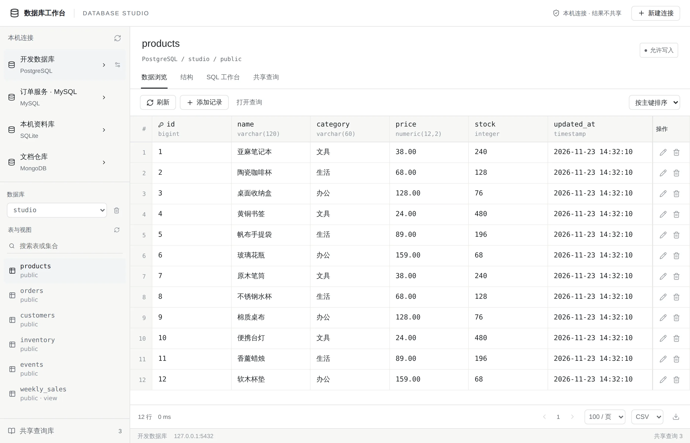

# Database studio

Database studio (`myco/database`) is a desktop client for MySQL, PostgreSQL, SQLite and MongoDB. It uses myco's neutral interface: local connections and objects on the left, data/structure/query tabs in the workspace, a bounded result grid and a deliberately shared query library. Table values and SQL use a 14px baseline; supporting text stays at least 12px, including in narrow windows.

A **desktop App build with the `db.profile` capability** is required to connect. A template update alone cannot add database drivers to an older desktop App. Clients without this capability show an update message and can still browse shared query drafts. This version does not add native database access to iOS or Android.

## Connect and work

1. Create a connection. MySQL and PostgreSQL accept host, port, user, password, default database and TLS mode. SQLite opens an existing database file by its absolute path or the file picker, with foreign-key checks enabled. MongoDB accepts host/account fields or a full private MongoDB/SRV URI. The URI's authentication/TLS options apply; its database path is the default unless explicitly overridden.
2. Test the connection, then save it. Connection profiles are local to this computer and this workspace/page. Passwords and complete MongoDB URIs cannot be read back by the page. Leave an existing password/URI blank to preserve it; use the explicit clear-password option to remove a password. Changing the host/account does not silently forward the old password.
3. Choose a database and table/collection. Browse data, inspect SQL columns, sort a table by a column, or open a query. Results are capped and paginated rather than loading an entire table.
4. SQL tables with primary keys can be edited. Insert fields can use server defaults; NULL is distinct from empty text. Updates/deletes compare the original row inside a transaction, so a stale editor cannot silently overwrite a concurrent writer. Nontransactional MySQL tables and tables without usable keys are browse-only; use explicit SQL if appropriate. MongoDB documents use canonical Extended JSON and preserve `_id` types.
5. Use **Query** for one read-only SQL statement; choose **Execute writes / DDL** on a writable connection for changes. MongoDB has find, aggregate and document insertion, with record replacement/deletion in the data browser. MongoDB does not execute SQL. Press Command/Ctrl+Enter to run a query.
6. Export the currently loaded results as CSV or typed JSON. CSV neutralizes spreadsheet formulas and uses empty fields for SQL NULL. Typed JSON preserves integer/decimal strings, nulls, dates and binary data. Exports are not full database backups.

New connections are read-only by default. To modify data, deliberately disable this setting on the connection. Actual server account permissions always apply; use database roles with appropriate privileges. Read-only transactions do not make arbitrary server functions or external integrations side-effect-free.

## Local versus shared

Connection metadata is a private local file under the App's data folder. Passwords and full MongoDB URIs use the App's system credential store. Local connection operations require a workspace/page scope and credentials are never returned by list/get operations. The native audit records operation names, argument byte counts and error codes, not query text, parameters, passwords or results.

Current results and session history remain in the client. Only **Save shared query** writes SQL/Extended JSON to page data, with a clear notice that page members and agents can see it. Connection credentials and results are never automatically shared. Loading a shared draft never runs it. Agents can draft/revise queries and return the page URL, but the App's database bridge is not a ready-made agent execution API.

## Limits and cancellation

The result limit is 1,000 rows, 512 KiB per cell/document and roughly 4 MiB per result set. Truncated results are marked. Default execution timeout is 30 seconds; the native API permits at most 120 seconds. Up to four identified database requests may run per page. Query cancellation is scoped to its originating page. A write whose acknowledgement is lost has an **unknown outcome**: inspect the database before retrying. Cancellation never implies rollback of an acknowledged or unacknowledged write.

Each query uses an independent session. Manual transaction/session commands (`BEGIN`, `COMMIT`, `SAVEPOINT`, `SET`, `USE` and their aliases) are rejected; choose the database in the selector and qualify PostgreSQL schema names.

This release supports a single SQL statement at a time, database/schema discovery, row CRUD and MongoDB document operations. It does not provide SSH tunnels, custom CA/client certificate selection, a SQL migration planner, backup/restore, a full SQL autocomplete IDE or arbitrary mongosh JavaScript. Existing server capabilities and permissions still govern what SQL can do.

## Development checks

```sh
cd templates
npm run typecheck
node localization.test.mjs
node database.test.mjs
node build.mjs database
node database.ui-test.mjs
cd ..
make vet
make test
```

`TestDatabaseNativeBridgeAndProductionUI` connects the actual desktop backend, scoped local profiles, SQLite and the production UI. Optional `TestDatabaseDrivers` accepts an explicitly provided private fixture file (`DBSTUDIO_ACCEPTANCE_FILE`) for isolated MySQL/PostgreSQL/MongoDB servers; it never reads the user's configured databases. Normal tests use temporary files and in-memory credential stores.


