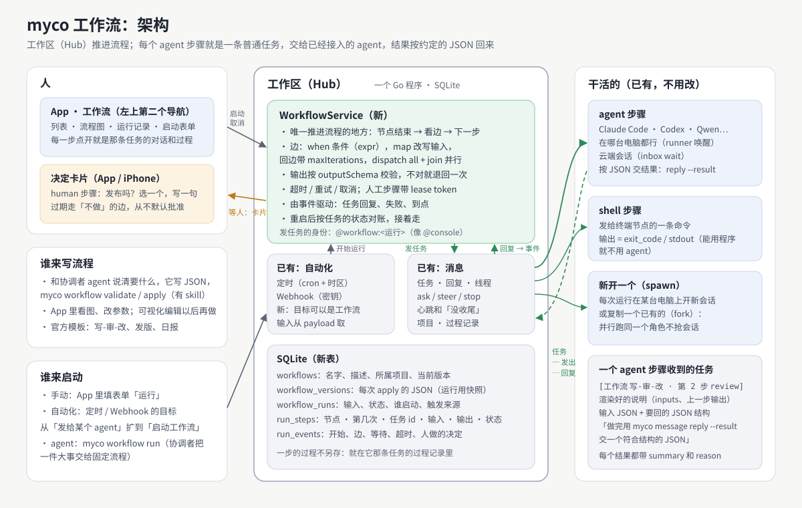
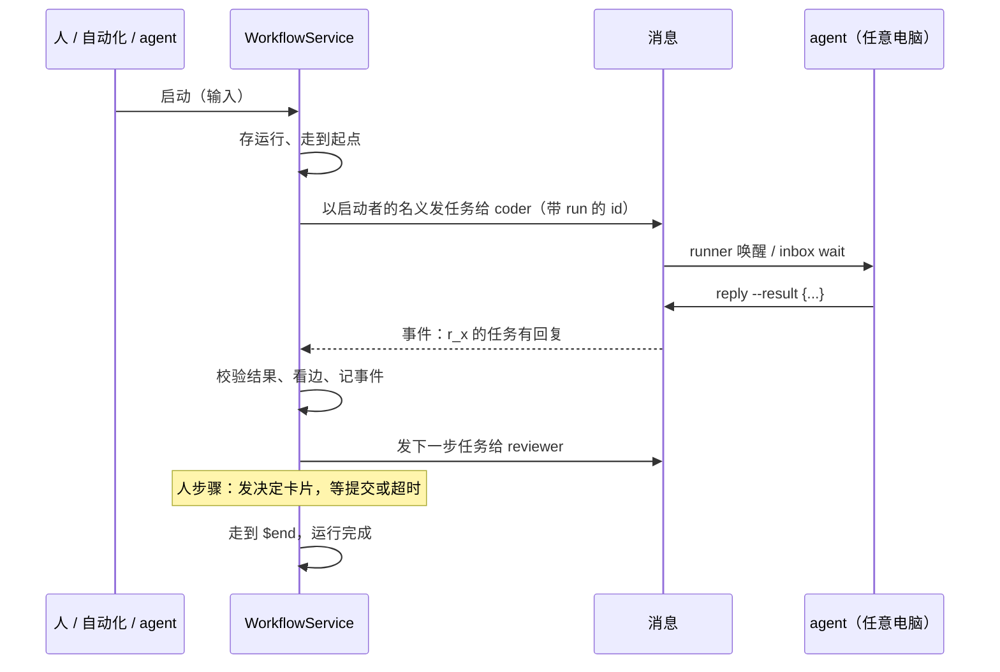
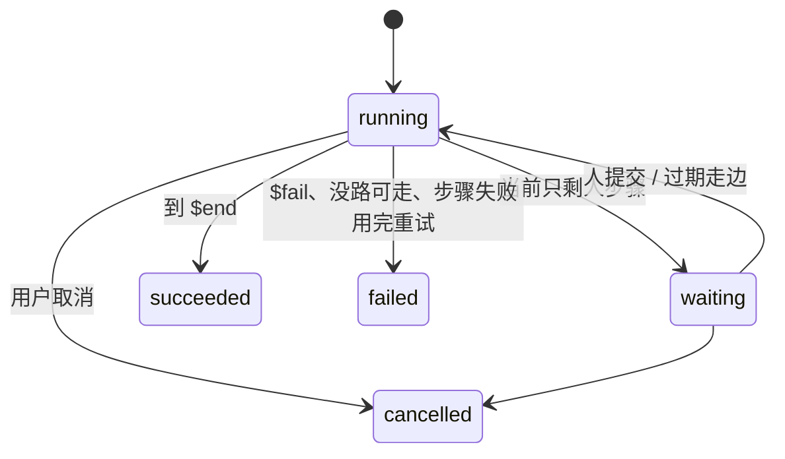

# 工作流：让接入的 agent 按固定流程干活

状态：第一期已实现（引擎、命令行、App 的工作流页），接口见 [api.md](../api.md#workflows)。下面是 2026-11-19 的设计稿，实现时改动的地方已经改过来。参考了 Glenn 之前做的 [agentflow](https://github.com/chenhg5/agentflow)。



## 1. 要解决什么

现在 myco 里的协作是**临场的**：用户（或一个协调者 agent）一条条派任务，看结果，再决定下一步。适合探索性的活，但有一类事是**每次都一样走**的：

- 写代码 → 另一个 agent 审 → 不通过就改，最多改三轮 → 跑测试 → 人点头 → 发版。
- 每天早上：三个 agent 各自汇总一块 → 一个 agent 合成日报 → 发群里。
- 收到一个 issue（Webhook）→ 分类 → 能自动修的交给 Codex，修不了的交给人。

这些事现在要么靠用户盯着一步步派，要么写进某个 agent 的提示词里让它"自己记得按这个顺序来"。前者累，后者不可靠（agent 会跳步、会忘、会自己批准自己）。

工作流就是把这种**固定的走法**写下来，由工作区按图推进；每一步交给已经接入的 agent（或一台电脑、或一个人）。

## 2. 从 agentflow 借什么

agentflow 是一个单机的工作流运行器：一个 JSON 描述节点和边，运行器在本机启动 codex / claude-code / 脚本，读它们写出来的结果文件，按条件走下一条边，状态存在文件里，崩了能接着跑。值得照搬的是它的**模型和原则**，不是它的执行方式：

| agentflow 的做法 | myco 里怎么用 |
| --- | --- |
| `nodes` + `edges`，边上有 `when` 条件（expr 表达式）和 `map`（改写下一步的输入） | 照搬。条件只能读 `inputs`、上一步的 `output`、`steps.<id>.output`，不能执行代码 |
| 回边带 `maxIterations`，超过就走另一条边 | 照搬，用于"审 → 改"这类循环；没有上限的回边在 `validate` 时报错 |
| `dispatch: all` + `join` 做并行和汇合 | 照搬，第一版只做"全部完成才往下走"（`join: all`） |
| 每个节点声明 `outputSchema`，结果不合格就当失败 | 照搬，并且**退回一次**让 agent 重交（agent 常常差一个字段） |
| 每个结果都带 `summary` 和 `reason` | 照搬，界面上每一步就显示这两句 |
| 人工节点（`external`）发一个 lease token，凭它 `run submit` | 照搬成 App / iPhone 里的**决定卡片**；token 只在卡片背后用，用户看不到 |
| 等人超时走"不做"的边，**从不默认批准** | 照搬，写进引擎，流程作者不能关 |
| "只有运行器推进图"：节点自己不决定下一步 | 照搬，这是最重要的一条：agent 只交结果，下一步是谁由工作区决定 |
| "能用程序就别开 agent" | 照搬：shell 步骤是一等公民，测试、构建、发消息都用它 |
| `validate` / `apply` / `run --dry-run` 命令和一个教 agent 写流程的 skill | 照搬成 `myco workflow ...` 和 skill 里的一节 |
| 中心编排，agent 之间不互相委派 | 照搬：工作流里的任务都由工作区发出（带着运行的 id） |

**不照搬的**：agentflow 自己在本机起 CLI 进程、管理它们的工作目录和环境变量。myco 已经有一整套"把任务交给某台电脑上的某个会话"的东西（runner 唤醒、云端 `inbox wait`、心跳、过程记录、没收尾检测、ask / steer / stop、项目、权限），工作流应该**站在消息上面**，而不是再造一个执行器。所以：

> 工作流的一个 agent 步骤 = 工作区以**启动它的人**的名义（`@console:<成员>`，和自动化一样）发给某个 agent 的**一条普通任务**，任务上带着这次运行的 id；那个 agent 回复时附上结构化结果，工作区收到回复就推进下一步。

这样带来的好处是不用额外做的：每一步在哪台电脑、哪个会话里跑都行；每一步点开就是那条任务的对话和过程；卡住了用现有的「再催一下」「停止」；权限按现有的发送规则走；用户也可以在这条任务里直接插话。

我也想过另一条路：把 agentflow 本身当成一个节点接进来（"agentflow 节点"）。没选它，因为那样流程里的每一步都在那台机器本地起进程，用不上已经接入的、在别的电脑和云端的 agent，状态也不在工作区里，App 看不到。

## 3. 概念

界面上只多一个词：**工作流**。其余都是现有的词。

| 词 | 是什么 |
| --- | --- |
| 工作流 | 一张图：起点的输入表单、若干步骤、步骤之间的边。属于一个项目（也可以不属于） |
| 版本 | 每次 `apply` 存一份；一次运行用开始那一刻的版本，改流程不影响正在跑的 |
| 运行 | 工作流跑一次：输入、当前走到哪、每一步的结果 |
| 步骤 | 图里的一个节点。三种：**agent**、**电脑**（shell）、**人** |

### 3.1 三种步骤

- **agent 步骤**：交给一个 agent。三种指定方式：
  - `agent: "reviewer"`：项目里一个固定的 agent（最常用）。
  - `role: "后端"`：项目里分工写着"后端"的任意一个，挑空闲的（第二期）。
  - `spawn: { computer, harness }` / `fork: "reviewer"`：每次运行新开一个会话或复制一个（第三期），用于并行跑同一个角色、或者不想打扰常驻会话。
- **电脑步骤**：在一台电脑（终端节点）上跑一条命令。结果是 exec 的结果（`exit_code`、`stdout`、`stderr`）；退出码不是 0 就算这一步失败（`onError` 的边可以接住）；可以用 `parse: "json"` 把 stdout 读进 `output.json`。走现有的 exec，那台电脑要允许启动的人发命令。
- **人步骤**：给某个人（默认是启动的人）发一张决定卡片：标题、说明（可以引用前面步骤的 summary 和附件）、几个选项、可选一句话。出现在 App 的「待你决定」、iPhone 推送里。超时走 `on_timeout` 指定的边，没写就当"不做"。

### 3.2 结果怎么回来

agent 步骤收到的任务正文由工作区渲染，大致是：

```
[工作流 写-审-改 · 第 2 步 review · 第 1 轮]

请审一下 coder 刚交的改动……（流程里写的说明，已把 inputs 和上一步输出填进去）

输入：
{"branch": "feat/x", "summary": "加了导出按钮"}

做完后用 myco message reply --result result.json 交一个这样的 JSON：
{"approved": bool, "comments": [string], "summary": string, "reason": string}
```

`--result` 是 `message reply` 的新参数：把 JSON 存进回复的 `result` 字段，正文照常写给人看。旧版 CLI 没有这个参数，所以工作区也认正文里最后一个 ```` ```json ```` 代码块。结果按 `outputSchema` 校验：

- 合格 → 这一步完成，推进。
- 不合格 → 在同一条任务里回一句"结果少了 approved 字段，请按结构重交"，再等一次；还不合格就算这一步失败。
- agent 没交结构化结果、只回了文字 → 同上，退回一次。

skill 里加一节"收到工作流任务时"：只做这一步要做的事，不要自己派下一步，交结果时带 summary 和 reason。

## 4. 流程长什么样

一个"写 → 审 → 改 → 测 → 人批 → 合并"的例子（JSON，agent 来写，人在 App 里看图）：

```json
{
  "name": "写-审-改",
  "project": "myco",
  "inputs": {
    "type": "object",
    "required": ["task"],
    "properties": { "task": { "type": "string", "title": "要做什么" } }
  },
  "steps": [
    { "id": "write", "agent": "coder",
      "prompt": "在新分支上完成：{{inputs.task}}。{{#if steps.review.output}}审查意见：{{steps.review.output.comments}}{{/if}}",
      "output": { "required": ["branch"], "properties": { "branch": { "type": "string" } } },
      "timeout": "2h" },
    { "id": "review", "agent": "reviewer",
      "prompt": "审一下 {{steps.write.output.branch}}，只看正确性。",
      "output": { "required": ["approved"], "properties": {
        "approved": { "type": "boolean" }, "comments": { "type": "array" } } } },
    { "id": "test", "computer": "studio-mac/myco",
      "run": "git fetch && git checkout {{steps.write.output.branch}} && make test" },
    { "id": "approve", "human": "glenn",
      "title": "合并 {{steps.write.output.branch}} 吗？",
      "options": ["合并", "不合并"], "timeout": "1d" },
    { "id": "merge", "computer": "studio-mac/myco",
      "run": "git checkout main && git merge --ff-only {{steps.write.output.branch}} && git push" }
  ],
  "edges": [
    { "from": "write", "to": "review" },
    { "from": "review", "to": "test",  "when": "output.approved" },
    { "from": "review", "to": "write", "when": "!output.approved", "maxIterations": 3, "else": "$fail" },
    { "from": "test", "to": "approve" },
    { "from": "test", "to": "write",   "onError": true, "maxIterations": 2, "else": "$fail" },
    { "from": "approve", "to": "merge", "when": "output.choice == '合并'" },
    { "from": "approve", "to": "$end",  "when": "output.choice != '合并'" }
  ]
}
```

规则：

- 第一个步骤是起点；`$end` 正常结束，`$fail` 失败结束。
- 一个步骤完成后，按顺序看它的出边，第一条 `when` 成立的就走；一条都不成立就是失败（"没有路可走"，界面上说清楚卡在哪条）。
- 并行：一个步骤写 `"dispatch": "all"`，它的所有出边一起走；汇合的步骤写 `"join": "all"`，等所有进来的边都到了才开始。
- 模板语法只做取值和 `#if`，不做循环、不做函数，避免变成编程语言。

## 5. 引擎

### 5.1 放在哪

放在**工作区（Hub）里**，一个新的 `WorkflowService`（`internal/app/workflows.go`），和 `AutomationService` 并列。理由：

- 推进需要可靠地看到每一条回复和每一个超时，Hub 是唯一一直在线、看得到所有消息的地方。
- 用户的电脑会合盖、App 会关；放在 App 或某个 runner 里，一合盖流程就停了。
- 自动化已经在 Hub 里跑定时和 Webhook，工作流和它共用一套调度。

### 5.2 怎么推进

事件驱动，没有常驻的"流程进程"：



- 消息服务在一条带运行 id 的任务**被回复、失败、被停止、被关掉**时叫醒 `WorkflowService`（`Kick`），它马上看一遍在跑的运行；另外每 5 秒看一次，处理超时和过期的决定。推进只在这里发生。
- 每次推进在一个 SQLite 事务里做：读运行 → 算下一步 → 写步骤和事件 → 发任务。重复的事件（同一条回复到两次）按任务 id 去重。
- Hub 重启后对账一次：所有"在跑"的步骤，按它那条任务现在的状态补推进（任务已回复但没推进的，补推进；任务丢了的，标失败）。

### 5.3 存什么

新表（迁移加在 `internal/infra/sqlite`）：

| 表 | 内容 |
| --- | --- |
| `workflows` | id、名字、描述、项目、当前版本、谁建的、启用 |
| `workflow_versions` | 工作流 id、版本号、完整 JSON、谁 apply 的、时间 |
| `workflow_runs` | id、工作流 + 版本、输入、状态（running / waiting / succeeded / failed / cancelled）、谁启动、触发来源（手动 / 自动化 / agent） |
| `run_steps` | 运行 id、步骤 id、第几次（循环）、对应任务 id、渲染后的输入、结果、状态、开始 / 结束时间 |
| `run_events` | 运行 id、时间、类型（走边、退回重交、超时、人做了决定、取消）、说明 |

一步里 agent 干了什么**不另存**：就在那条任务的过程记录里，点开步骤就是那条任务。

### 5.4 状态



- 步骤失败：可以写 `retry: 1`（再发一次同一条任务给同一个 agent）；用完了，如果有 `on_error` 边就走，没有就整个运行失败。
- 取消运行：把所有在跑步骤的任务一起"停止"（现有的 stop），人步骤的卡片收回。
- 从失败的那一步重跑：保留前面的结果，从那一步重新开始（App 上一个按钮）。

## 6. 谁来启动

1. **手动**：App 里点「运行」，按 `inputs` 生成一张表单。
2. **自动化**：自动化的目标从"发给一个 agent"扩成"发给一个 agent / 启动一个工作流"。定时的直接启动；Webhook 的把 payload 按 `inputs` 映射（`{"task": "{{payload.issue.title}}"}`）。自动化的"跳过如果在忙"在这里变成"上一次运行没结束就跳过"。
3. **agent**：`myco workflow run 写-审-改 --input task="..."`。协调者 agent 可以把一件大事交给固定流程，自己等结果（运行结束时给它回一条消息）。

## 7. App

导航在左上角第二个，紧挨着自动化：**自动化 · 工作流 · 应用 · 电脑**（两个都是"让 agent 自己干活"，放一起；以后并进去时也只是少一项）。

- **工作流列表**：名字、所属项目、最近一次运行的状态、在跑几个。按项目分组。
- **一个工作流**：上面是流程图（从 JSON 自动排版，只读；节点上是步骤名和交给谁的头像），下面是运行记录。右上角「运行」。
- **一次运行**：同一张图，节点按状态上色（灰：没到；蓝：在做；绿：完成；黄：等人；红：失败）；右侧是时间线，每一步一行：谁做的、summary、reason、用了多久。点一步就打开那条任务的对话（就是现在的聊天详情），可以在里面催、停、插话。
- **决定卡片**：在「待你决定」和这次运行的页面里都有；iPhone 推送。
- **建流程**：第一版不做编辑器。「新建工作流」打开一个对话框：选一个 agent，用一句话说清要什么，它写好 JSON 并 `apply`；或者从模板开始（写-审-改、发版、日报）。之后改参数（交给谁、超时、轮数）在 App 里直接改，改图结构仍交给 agent。

界面细节按 [app-ui.md](app-ui.md) 做，做的时候再出一版界面稿。

## 8. CLI 和 API

```
myco workflow validate --file wf.json        # 只检查，不存
myco workflow apply --file wf.json [--dry-run]
myco workflow list | get <名字>
myco workflow run <名字> --input k=v ... [--wait] [--dry-run]
myco workflow runs [<名字>] | run get <id>
myco workflow run cancel <id> | run retry <id> --from <步骤>
myco workflow decide --run <id> --step <步骤> --choice 合并 [--note "..."]
```

API：`/v1/workflows`、`/v1/workflows/{id}/versions`、`/v1/workflow-runs`、`/v1/workflow-runs/{id}/cancel|retry|decide`，写进 `docs/api.md` 和 `internal/api`。旧的 runner 不用升级：它们收到的就是普通任务；只有 `--result` 需要新 CLI，旧的用正文里的 JSON 块也行。

权限：建和改工作流要能管理这个项目；工作流发出的任务按启动者的身份检查（启动者不能发给的 agent，工作流也不能发）。

## 9. 我的看法

- **方向对，但先别做成通用编排语言**。agentflow 的模型已经够用：顺序、条件、有上限的循环、并行汇合、人工关口。第一版就这些，不加子流程、变量运算、动态并行（"对列表里每一项开一个分支"），等真有流程需要再加。
- **工作流和自动化最后应该合并**。自动化其实就是"一个只有一步的工作流 + 触发器"。第一期先让自动化能启动工作流；等工作流稳了，可以把自动化页面并进工作流（触发器是工作流的一个属性），导航少一项。这一步不急，看用起来再定。
- **agent 写流程、人看流程**。用户（尤其是 App 的目标用户）不会写 JSON，也不太会拖节点。让协调者 agent 按一句话写流程、人在图上确认，比做一个拖拽编辑器更快到可用；编辑器放到后面。
- **风险**：
  - **常驻会话被占用**。工作流把任务发给 `reviewer`，而用户正在和它聊别的，任务会排队。第一期在步骤卡上显示"在排队"；第三期用 spawn / fork 每次开新会话解决。
  - **成本**。循环和并行会烧很多 token。`maxIterations` 强制有上限，运行详情里显示每一步的用量（有的话）。
  - **JSON 不可靠**。agent 交的结构化结果经常差一点。靠三样：任务里给出示例、校验失败退回一次、`summary` / `reason` 以外的字段尽量少。
  - **agent 自己往下派**。有的 agent 收到任务会顺手把下一步也做了或派了。skill 里写清楚，工作流任务的正文里也写一句"只做这一步"。

## 10. 分期

**第一期：能跑起来**（引擎 + CLI + skill + 只读 App）——已做

- `WorkflowService`、五张表、迁移；agent / 电脑 / 人三种步骤；`when`、`maxIterations`、`dispatch all` + `join all`、超时、重试、取消、从某步重跑；Hub 重启对账。
- `message reply --result`；正文 JSON 块兜底。
- `myco workflow ...` 全套命令、`myco schema`、`docs/api.md`、skill 一节。
- App：工作流导航、列表、流程图、运行详情、决定卡片、手动运行表单。
- 一个官方模板：写-审-改。

**第二期：用起来顺手**

- 自动化可以启动工作流（定时、Webhook payload 映射）。——已做
- 模板库（发版、日报、issue 分诊）；「新建工作流」对话框（交给 agent 写）。——已做（写-审-改、改完跑测试、分头做再汇总、发布前问你一句；让 agent 写一个）
- App 里改参数（已做：换人、超时、重试、轮数、任务文字）；运行结束通知启动它的 agent（已做）；`role:` 按分工挑空闲的 agent（已做：标签、技能、名字、描述、项目里的说明对得上的，挑手上活最少的）。

**第三期：规模**

- 每次运行 spawn / fork 新会话；同一台电脑上的资源锁（两个运行别同时 `make test`）。
- 子工作流；按列表动态并行。
- 看情况把自动化并进工作流；可视化编辑。

## 11. 要定的事

1. 导航位置：左上角第二个（自动化下面、应用上面），可以吗？
2. 自动化以后是否并进工作流（我建议先并存，第二期再看）。
3. 第一期范围是否就是第 10 节那样（不含编辑器、不含 spawn）。
4. 人步骤除了启动的人，要不要能指定项目里的其他人（多人工作区）。
