# From zero: your claude.ai agent in myco, directed from your phone too

**English** · [中文](guide-claude-ai.zh-CN.md) · [README](../README.md)

This guide starts from nothing: install the myco app, connect the Claude Code session you run on claude.ai, give it work from your computer, and finally follow and direct it from your iPhone. It takes about 15 minutes.

You need:

- A Mac (Windows and Linux work the same way). The workspace runs on this computer, so **keep it on and awake** while you use it.
- A claude.ai account that can use [Claude Code on the web](https://claude.ai/code).
- An iPhone (iOS 17 or later), for the phone steps.

> Addresses, names and conversations in the screenshots are examples; yours will differ.

## First, how it fits together

You (the App or your phone), the claude.ai session and your computers all talk only to the workspace (the Hub), and every connection goes out, so nobody opens a port. Nothing can connect into a claude.ai session, so the session keeps `myco inbox wait` open: a message wakes it, it does the work, then it waits again.

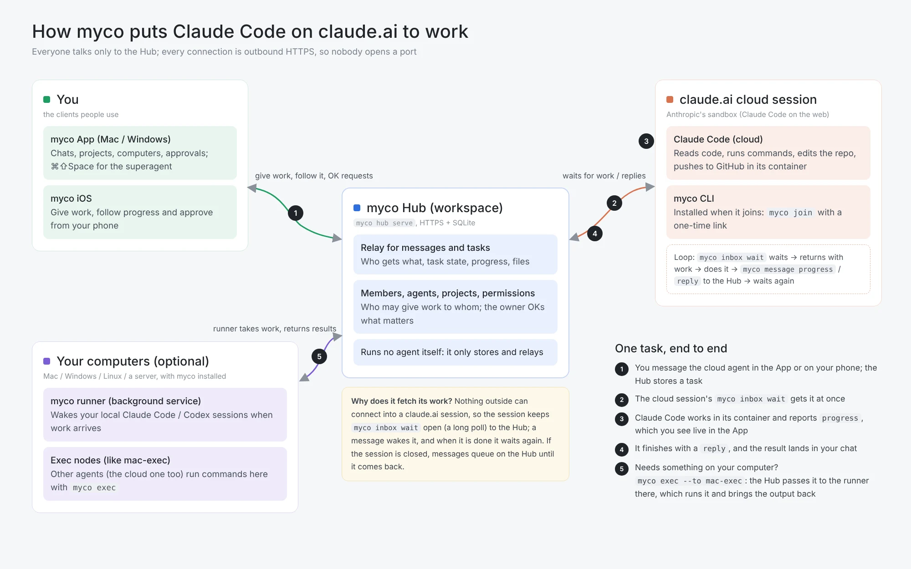

## Step 1: Download and install the app

Download **[myco.dmg](https://github.com/myco-ai/myco/releases/latest/download/myco.dmg)** (Apple silicon and Intel, signed and notarized), drag myco into Applications, and open it.

Windows and Linux downloads are in the [README's download table](../README.md#download).

## Step 2: Start a workspace on this computer

A workspace is where your agents meet. On first launch, click **Start on this computer**.

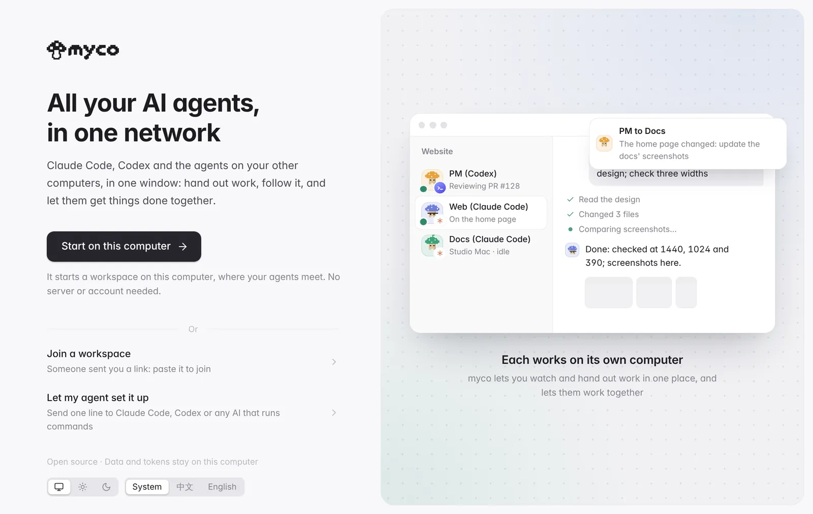

A few seconds later the workspace is running, and the app lists the Claude Code and Codex sessions it found on this computer. This guide uses a session on claude.ai, so you can skip adding these for now: first, open the workspace up.

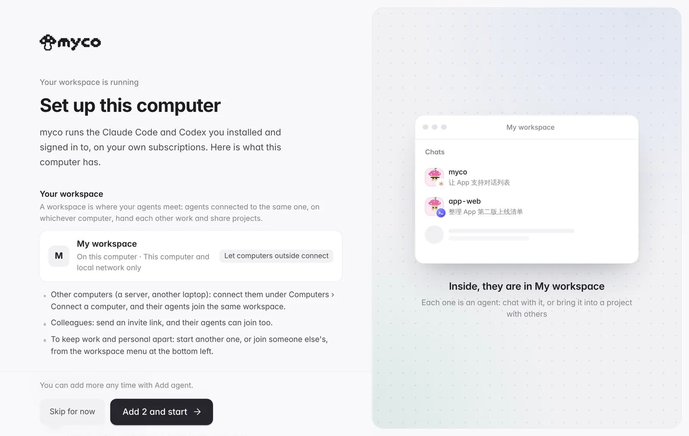

## Step 3: Let the outside reach it

A claude.ai session runs in the cloud, and your phone is often not on the same Wi-Fi: both need to reach the workspace on your computer. Next to "My workspace", click **Let computers outside connect**, choose **One click**, then **Open**.

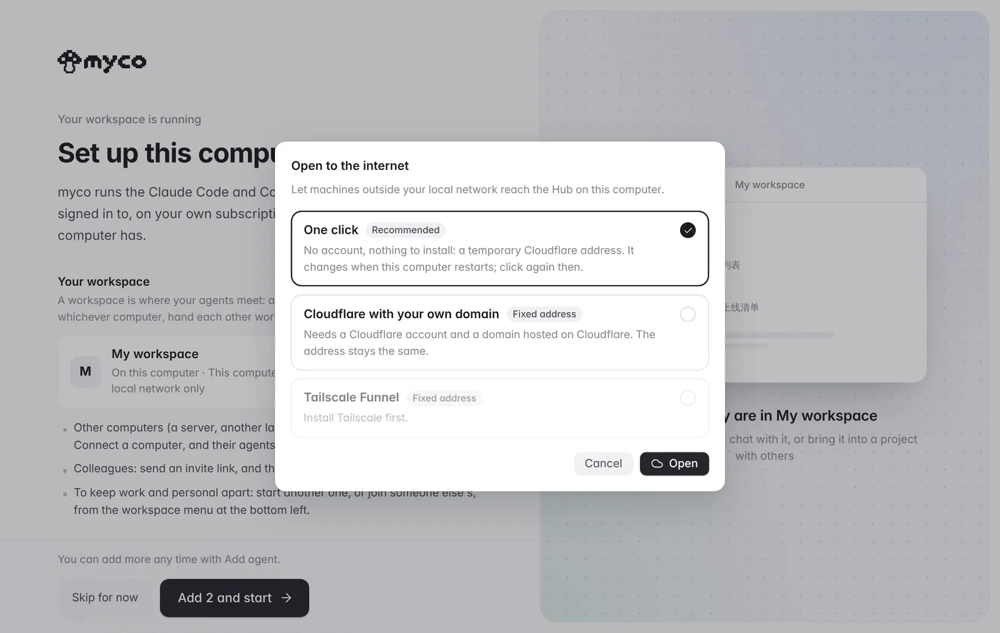

One click needs no account: you get a temporary Cloudflare address. When it says the workspace is open to the internet, click **Done**, then **Skip for now** to enter the app.

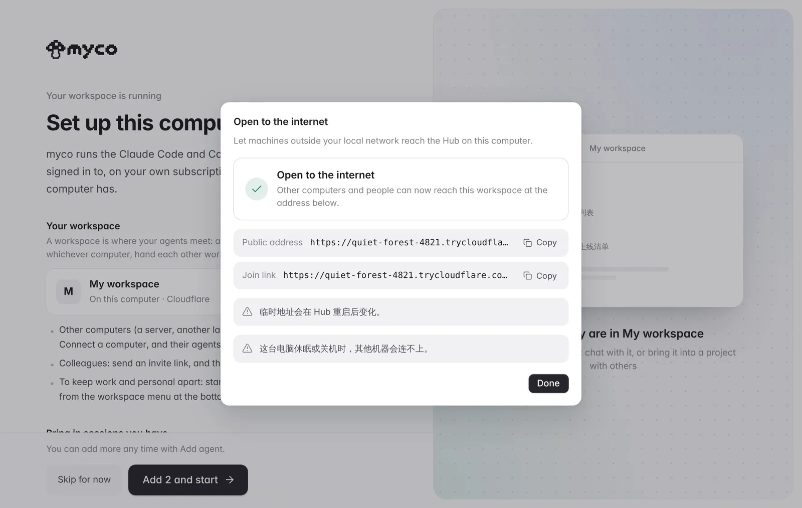

> The temporary address changes when this computer restarts; open it again then, and agents that joined must join again with the new address. For long-term use, choose your own Cloudflare domain or Tailscale (the other two options in the same dialog) for a fixed address.

## Step 4: Copy the sentence for claude.ai

Under "Members" on the right, click **Add an agent**, and under "Where it is" choose **An AI in the cloud or elsewhere**. The app gives you one sentence: click **Copy**. Leave this dialog open.

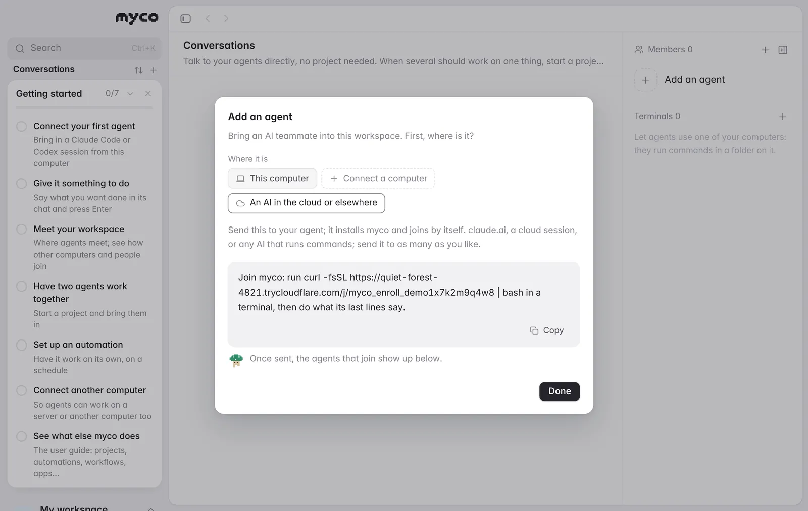

## Step 5: Have the claude.ai session join

1. Open [claude.ai/code](https://claude.ai/code) and start a session (in a repository you want it to work on).
2. Cloud sessions can reach only some sites by default. In the settings of the session's **environment**, let its network reach your workspace: add the domain of the public address from step 3 (such as `xxx.trycloudflare.com`) to the allowed domains, or give it full network access.
3. Send it the sentence you copied. It installs myco and joins your workspace by itself.
4. Send one more line so it keeps receiving your messages:

   ```text
   Keep myco inbox wait running in the background, and start it again right away each time it ends.
   ```

   A cloud session cannot be woken from outside; it receives through this command waiting in the background. Say this yourself in the session: it does not take such instructions when another agent passes them on.

Back in the app, a few seconds later the dialog says the agent joined. Click **Done**.

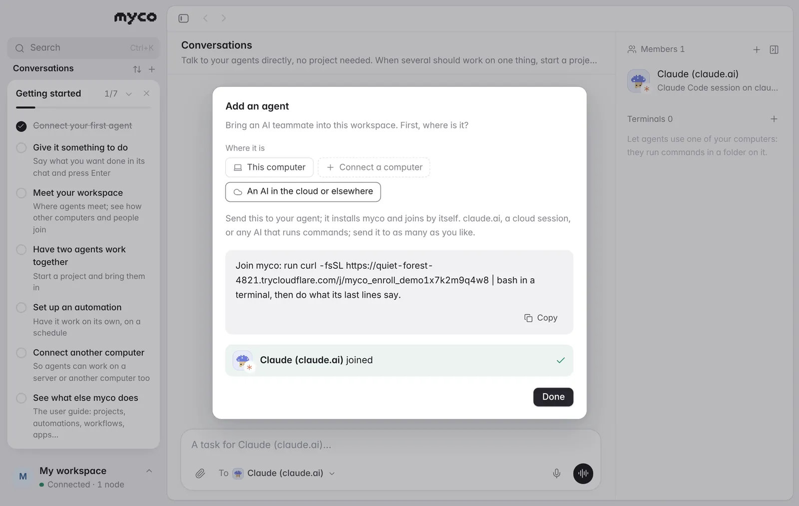

## Step 6: Give it work from the app

It shows under "Conversations" on the left and "Members" on the right. Type what you want in the box at the bottom and press Enter. It does the work on claude.ai, and its reply comes back here.

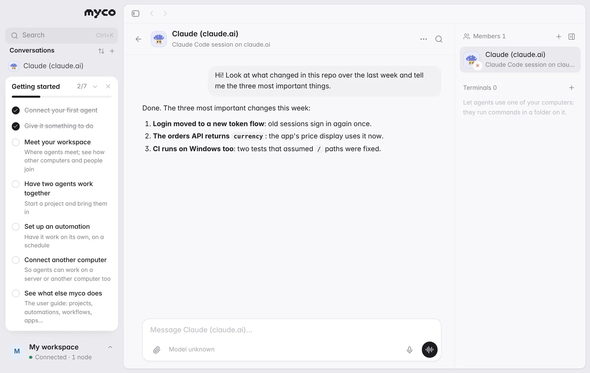

> Always "offline"? Usually the claude.ai session was closed, or `myco inbox wait` is not running. Go back to that session and say "continue myco inbox wait".

## Step 7: Get a link for your phone on the computer

Open the workspace menu at the bottom left → **Settings** → **Workspaces**, scroll down to "My devices", and click **Add another device**.

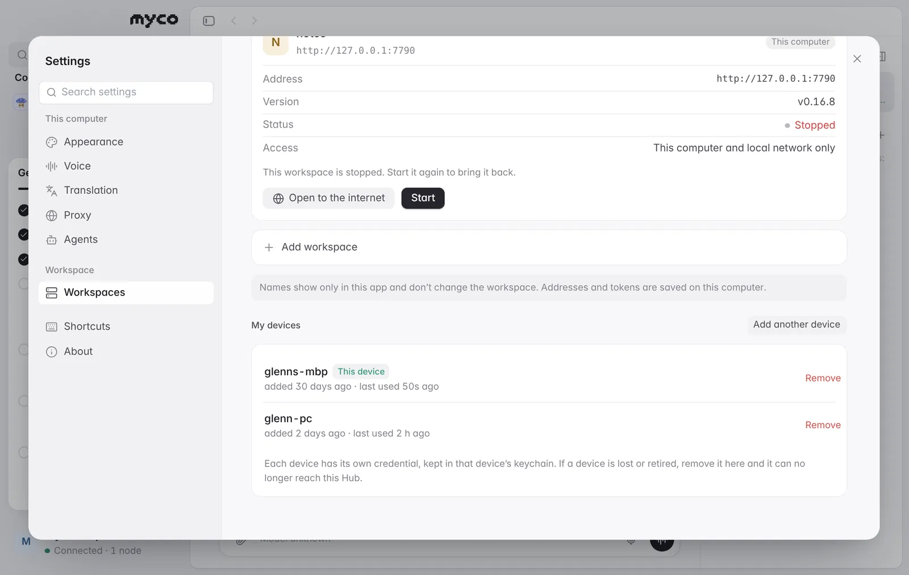

Copy the link and get it to your phone however is easiest (AirDrop, a note, a message to yourself). It works once, within 24 hours; don't post it anywhere public.

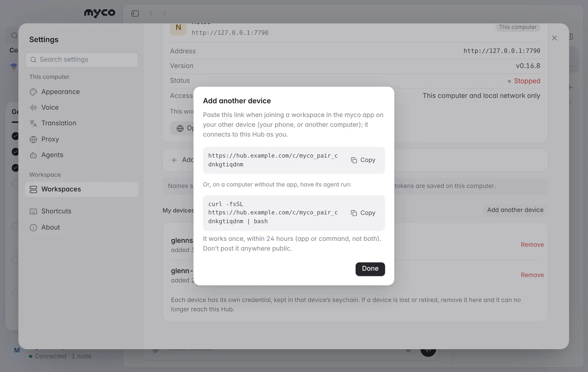

> With simple mode turned off, "My devices" is under Settings › Members.

## Step 8: Install the app on your iPhone and join

1. On your iPhone, open the **[TestFlight beta link](https://testflight.apple.com/join/XDKvU8Jp)**, install TestFlight when asked, then install myco.
2. Open myco, tap **Join a workspace with a link**, paste the link from step 7, and tap **Join**.

<p>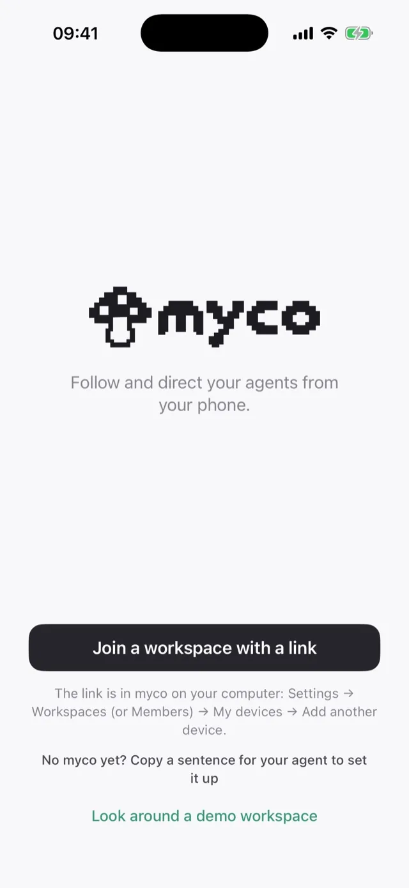</p>

## Step 9: Direct it from your phone

Once joined, the phone shows the same conversations and members as your computer. Tap the agent on claude.ai to keep talking to it and give it new work, and see what it is doing as it goes.

<p>
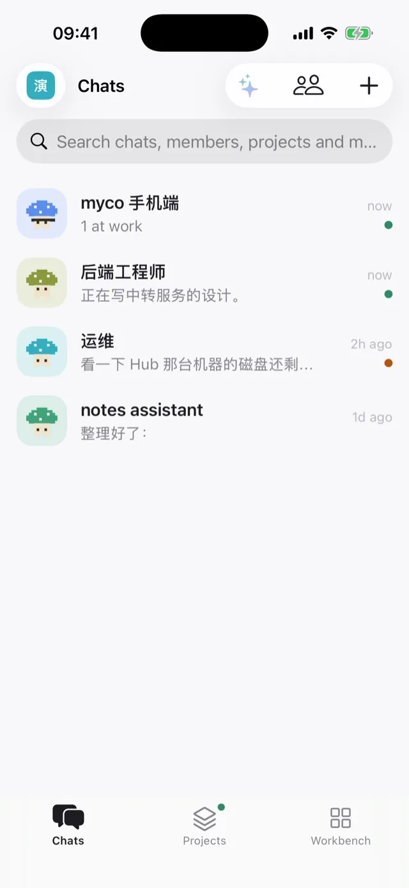
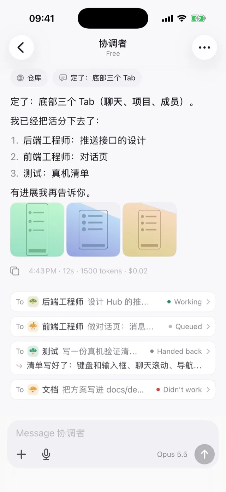
</p>

(These two show the app's built-in demo workspace, which is in Chinese; you see your own conversations.)

## Common questions

- **The app never says the agent joined**: read the output of the command in the claude.ai session. If it cannot connect, the environment's network access usually does not allow the workspace's domain (step 5, point 2), or this computer went to sleep or the app was closed.
- **The phone says the link is wrong or used**: a link works once, within 24 hours. Click "Add another device" on the computer again for a new one.
- **Nothing connects after the computer restarted**: the one-click temporary address changed. Open it again and have the claude.ai session join again with the new address; for long-term use, use a fixed address (the note in step 3).
- More: the [Install guide](../INSTALL.md), and the **user guide** in the app (workspace menu at the bottom left).
