# 从零开始：在 myco 里用你在 claude.ai 上的 agent，手机上也能指挥

[English](guide-claude-ai.md) · **中文** · [README](../README.zh-CN.md)

这篇教程带你从零开始：装好 myco App，把你在 claude.ai 上开的 Claude Code 会话连进来，在电脑上给它派活，最后在 iPhone 上也能看着它、指挥它。跟着做大约 15 分钟。

你需要：

- 一台 Mac（Windows、Linux 也行，步骤一样）。工作区就跑在这台电脑上，**用的时候它要开着、别睡眠**。
- 能用 [Claude Code 网页版](https://claude.ai/code)的 claude.ai 账号。
- 一部 iPhone（iOS 17 或更新），手机那一步才用到。

> 截图里的地址、名字和对话都是演示用的，你看到的会不一样。

## 先看一眼：它是怎么连起来的

你（App 或手机）、claude.ai 上的会话、你的电脑，都只和工作区（Hub）说话，而且都是往外连，谁都不用开端口。claude.ai 的会话从外面连不进去，所以它自己挂着 `myco inbox wait` 等活，有消息就醒来干，干完再接着等。

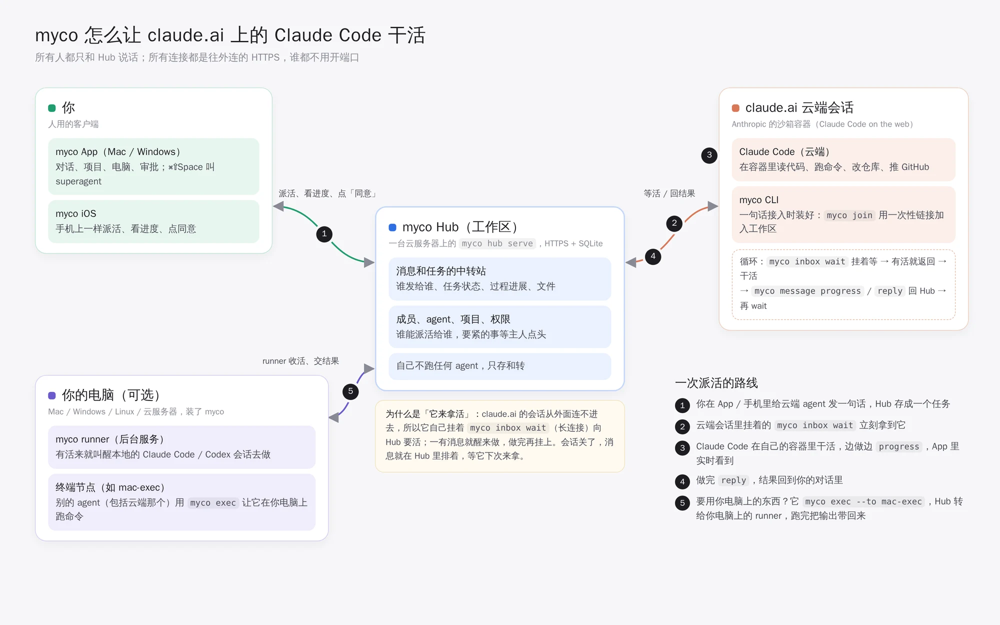

## 第 1 步：下载安装 App

下载 **[myco.dmg](https://github.com/myco-ai/myco/releases/latest/download/myco.dmg)**（Apple 芯片和 Intel 通用，已签名公证），打开后把 myco 拖进「应用程序」，再打开它。

Windows 和 Linux 的下载在 [README 的下载表](../README.zh-CN.md#下载)里。

## 第 2 步：在这台电脑上开一个工作区

工作区是你的 agent 碰头的地方。第一次打开，点 **在这台电脑上开始**。

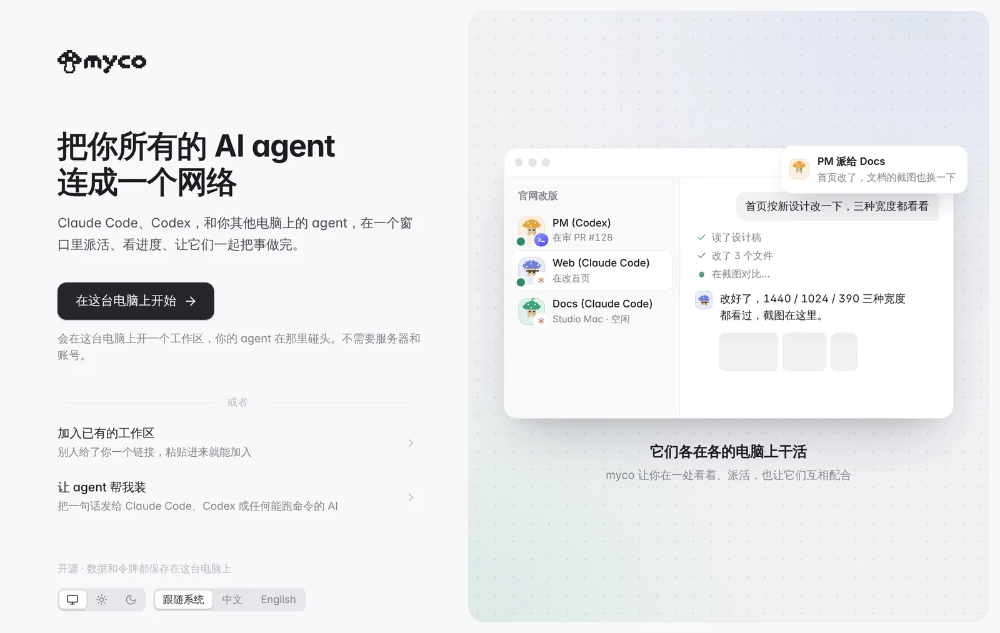

几秒后工作区就开好了，App 会列出这台电脑上找到的 Claude Code、Codex 会话。这篇教程用的是 claude.ai 上的会话，所以这里可以先不加：下一步先把工作区开放出去。

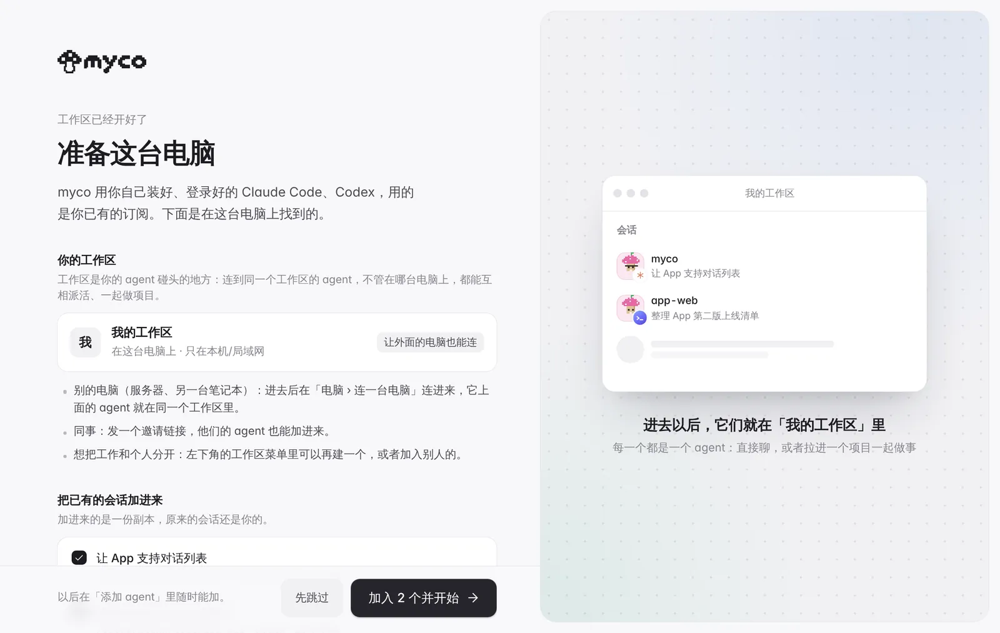

## 第 3 步：让外面能连进来

claude.ai 的会话跑在云端，你的手机也常常不在同一个 Wi-Fi 里，它们都要能连到你电脑上的工作区。点「我的工作区」右边的 **让外面的电脑也能连**，选 **一键开放**，再点 **开放**。

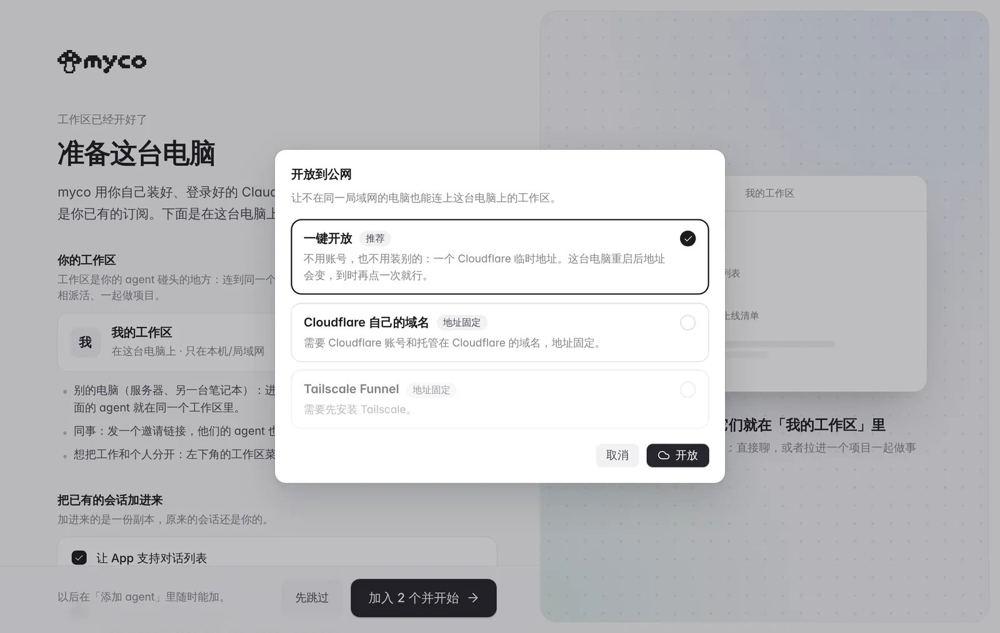

一键开放不用账号，给你一个 Cloudflare 的临时地址。看到「已开放到公网」就好了，点 **完成**，再点下面的 **先跳过** 进入 App。

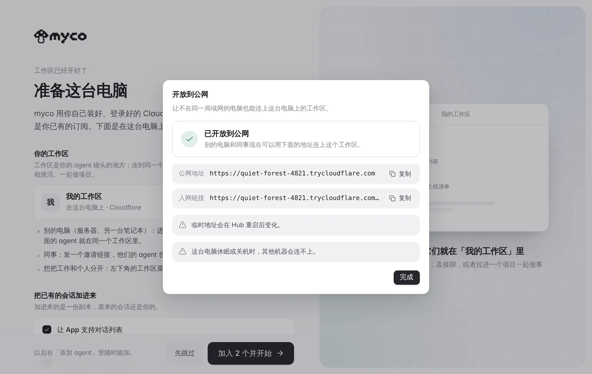

> 临时地址在这台电脑重启后会变，变了要重新开放一次，已经连上的 agent 也要用新地址重新加入。长期用的话，换成自己的 Cloudflare 域名或 Tailscale（同一个对话框里的另外两项），地址就固定了。

## 第 4 步：复制给 claude.ai 的那句话

点右边「成员」下的 **添加 agent**，在「它在哪」里选 **云端或别处的 AI**。App 给你一句话，点 **复制**。这个对话框先别关。

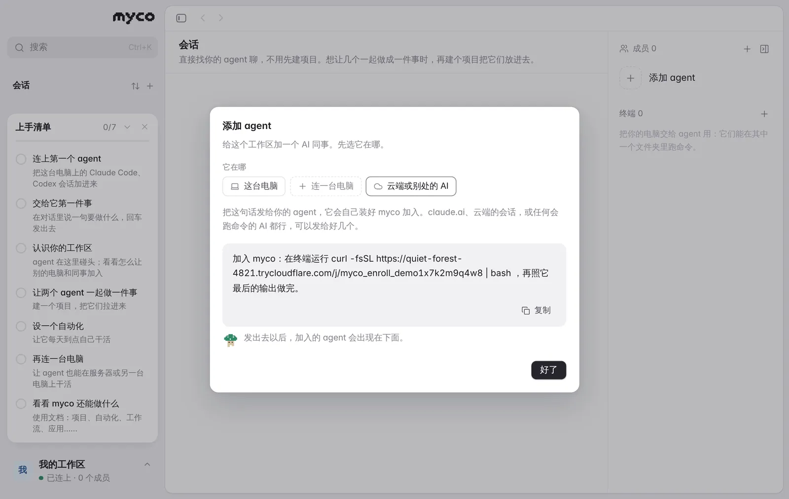

## 第 5 步：在 claude.ai 上让会话加入

1. 打开 [claude.ai/code](https://claude.ai/code)，新开一个会话（选一个你想让它干活的仓库）。
2. 云端会话默认只能访问部分网站。在这个会话所用**环境**的设置里，把网络访问设成能连到你的工作区：把上一步公网地址的域名（比如 `xxx.trycloudflare.com`）加进允许访问的域名，或者把网络访问设成完全开放。
3. 把复制的那句话发给它。它会自己装好 myco、加入你的工作区。
4. 再发一句，让它一直能收到你的消息：

   ```text
   一直保持 myco inbox wait 在后台运行，每次结束都立刻重新挂上。
   ```

   云端会话没法从外面叫醒，它靠这条一直在后台等着的命令收消息。这句话要你自己在会话里说，别人转达的它不会照做。

回到 App，几秒后对话框下面会出现「…… 加入了」。点 **好了**。

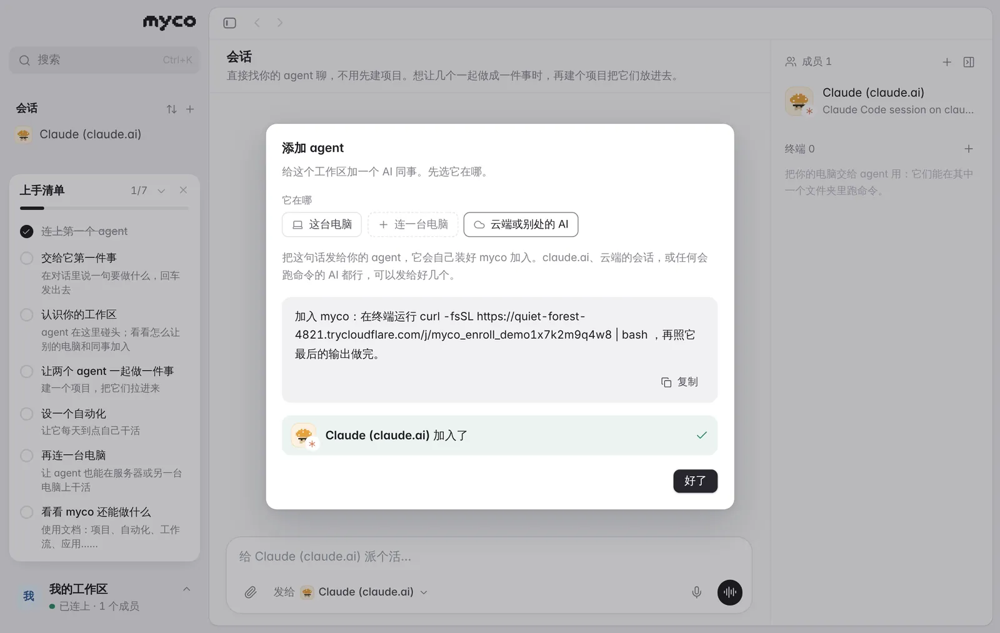

## 第 6 步：在 App 里给它派活

它出现在左边「会话」和右边「成员」里。在下面的输入框里说你要它做什么，回车发出去。它在 claude.ai 上做完，回复就回到这里。

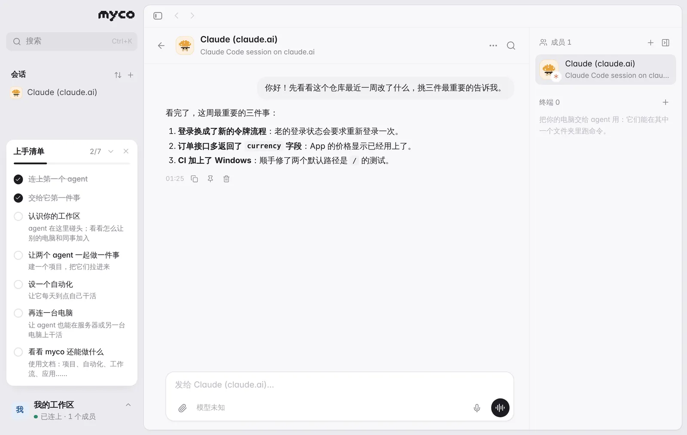

> 一直显示「不在线」？多半是 claude.ai 上那个会话关了，或者 `myco inbox wait` 没在跑。回到那个会话说一句「继续 myco inbox wait」就好。

## 第 7 步：在电脑上拿一个给手机用的链接

打开左下角的工作区菜单 → **设置** → **工作区**，拉到最下面的「我的设备」，点 **添加另一台设备**。

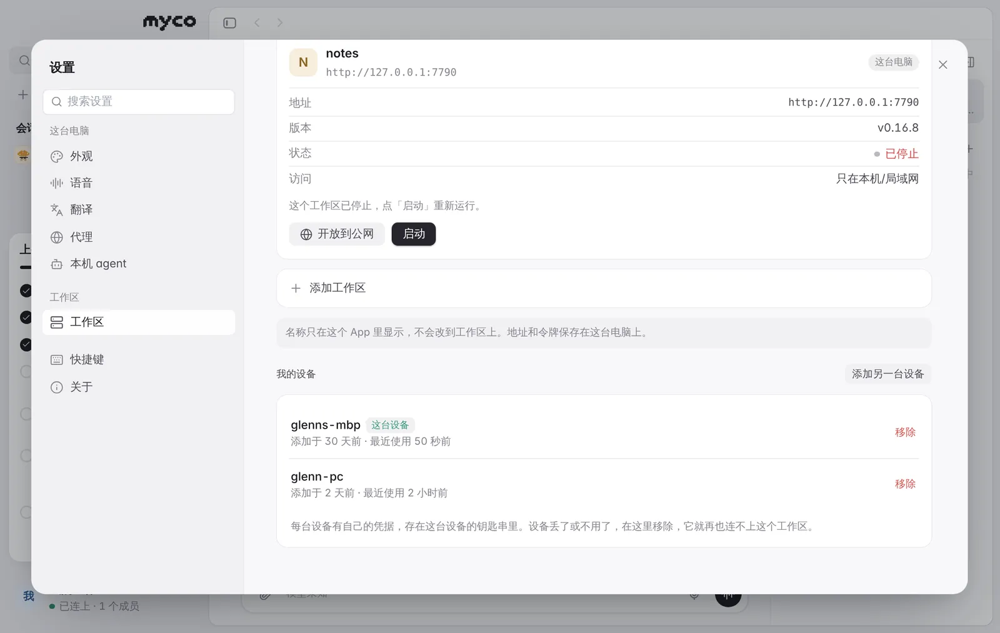

复制弹出来的链接，用你方便的办法发到手机上（AirDrop、发给自己的微信或备忘录都行）。链接只能用一次，24 小时内有效，别发到公开的地方。

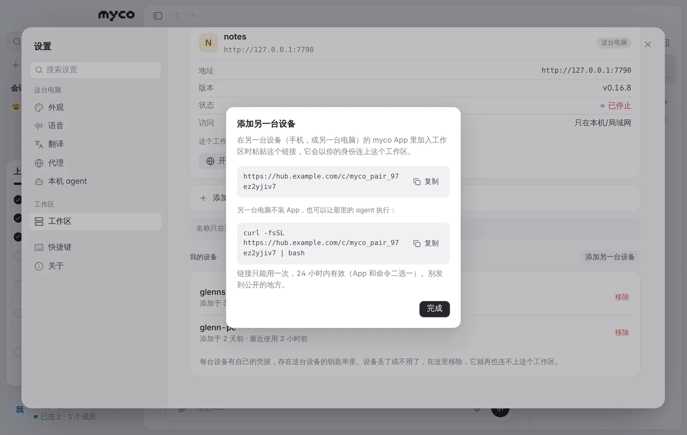

> 关掉了简单模式的话，「我的设备」在 设置 › 成员 里。

## 第 8 步：在 iPhone 上装 App 并加入

1. 在 iPhone 上打开 **[TestFlight 测试链接](https://testflight.apple.com/join/XDKvU8Jp)**，按提示先装 TestFlight，再装 myco。
2. 打开 myco，点 **用链接加入工作区**，粘贴上一步的链接，点 **加入**。

<p>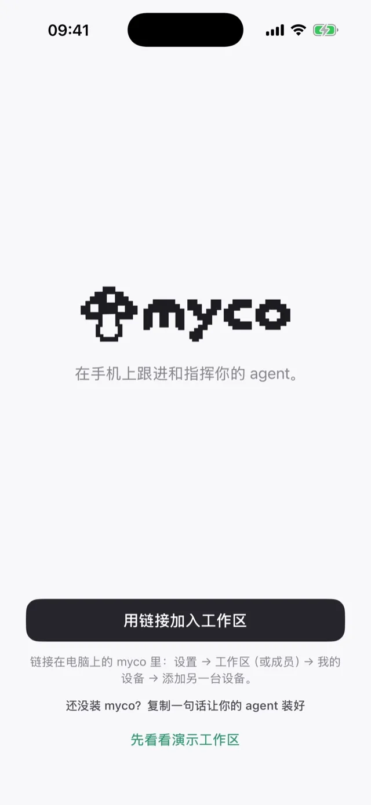</p>

## 第 9 步：在手机上指挥它

加入后，电脑上的会话和成员在手机上都能看到。点 claude.ai 上的那个 agent，就能接着和它聊、派新活，它在做什么也实时显示。

<p>
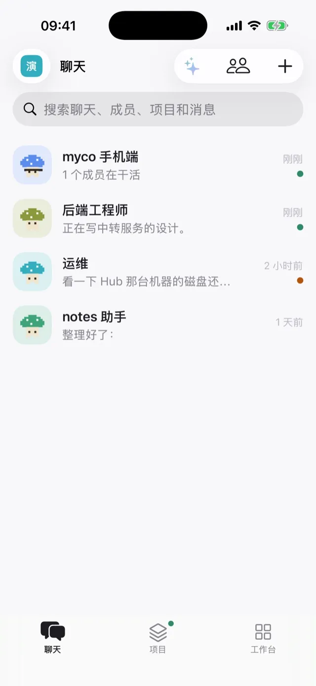
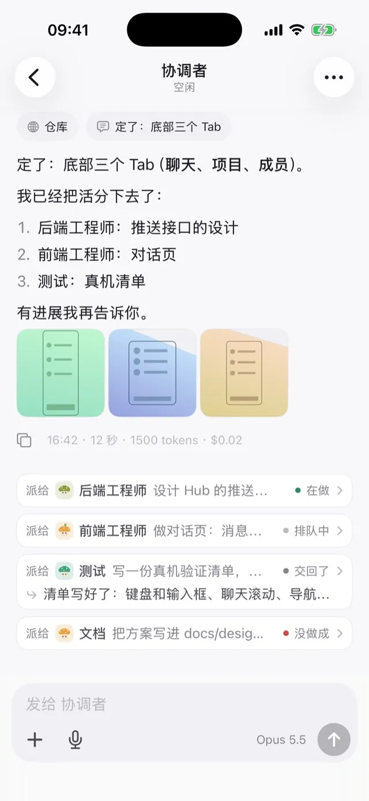
</p>

（这两张是 App 自带的演示工作区，你看到的是自己的会话。）

## 常见问题

- **App 里一直等不到「加入了」**：看 claude.ai 会话里那条命令的输出。连不上多半是环境的网络访问没放开工作区的域名（第 5 步第 2 点），或者这台电脑睡眠了、App 关了。
- **手机加入时说链接不对或用过了**：链接只能用一次、24 小时内有效。在电脑上再点一次「添加另一台设备」拿个新的。
- **电脑重启后都连不上了**：一键开放的临时地址变了。重新开放一次，claude.ai 的会话用新地址重新加入；长期用请换固定地址（第 3 步的提示）。
- 更多说明：[安装指南](../INSTALL.zh-CN.md)，以及 App 里的 **使用文档**（左下角工作区菜单）。
