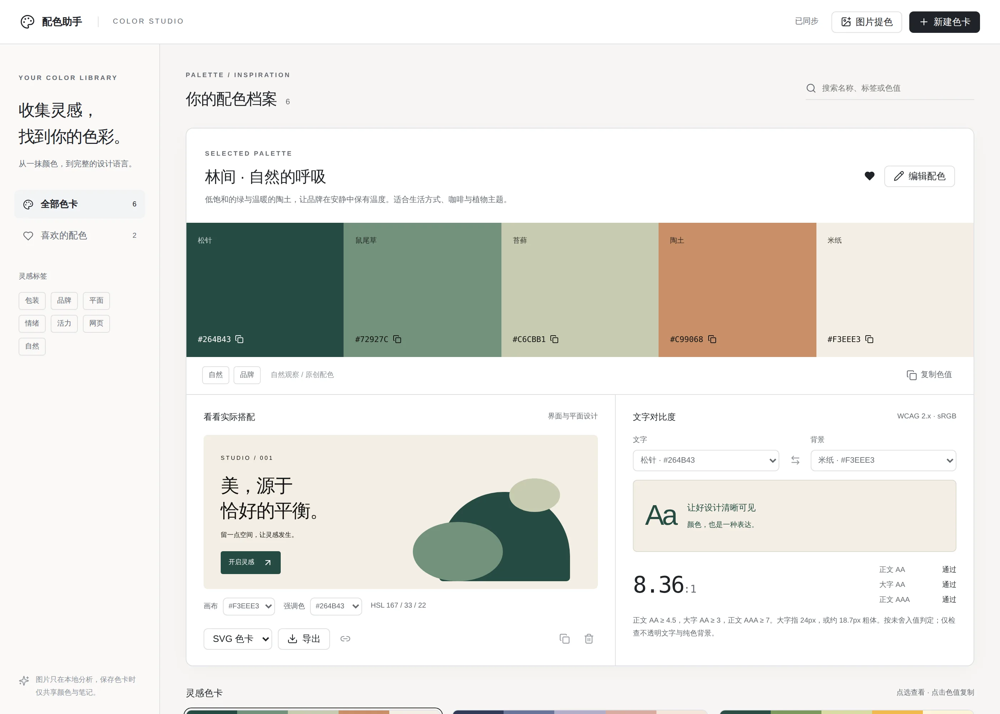

# Color studio

Color studio (`myco/palette`) is a shared library for design palettes. Create a page from Apps, start with the sample library, or build your own. No color API account or key is needed.

- Create palettes with 2–12 opaque sRGB colors. Edit HEX or HSL, name color roles, and generate analogous, complementary, triadic or monochromatic variations. Locked colors and the selected reference color stay in place when generating.
- Extract up to six representative colors from a local PNG, JPEG, WebP, GIF or AVIF under 20 MiB. Extraction analyzes a small, bounded sample; transparent pixels are ignored and partial opacity weights their contribution. Only colors and notes are saved. The original image stays in the tab. Animated images are sampled as a still image. If just one visible color is found, white is added as an editable second color.
- Save palettes, add tags and design notes, search by name/tag/HEX, and mark favorites. Both palettes and favorites are shared with everyone authorized to use the page, including its agents.
- Preview a layout with selectable background/accent colors, and check specific text/background pairs. The preview automatically selects dark or light text for its sample layout; the contrast checker measures the pair you explicitly choose.
- Export an SVG palette, CSS custom properties, or JSON. Copy HEX colors or a direct palette link. Downloads use the host App's download support. Older hosts without public page URLs cannot copy a palette link; upgrade the App or share the page normally.
- Press **N** to create a palette or **F** to favorite the selected palette while outside a text field. Delete offers Undo. Drafts remain local until Save; concurrent changes require loading the latest version or saving the draft as a new palette.

Agents read and write the page's `palettes` collection, preserve the separate `favorites` collection, and return a public `/pages/pg_…#palette?id=…` link to the result. The template's `agent.md` documents every field and conditional-write examples. Creating new variations should not overwrite the existing library.

## Contrast limits

Contrast follows [WCAG 2.x text contrast](https://www.w3.org/WAI/WCAG22/Understanding/contrast-minimum.html): AA text requires 4.5:1; large text requires 3:1; AAA text requires 7:1. Large text is 24 CSS px normal or approximately 18.67 CSS px bold. Thresholds use the unrounded ratio. Only opaque colors against solid backgrounds are covered. A ratio is one part of accessibility, not a full accessibility certification. Harmony suggestions use the HSL color wheel, which is not perceptually uniform.

